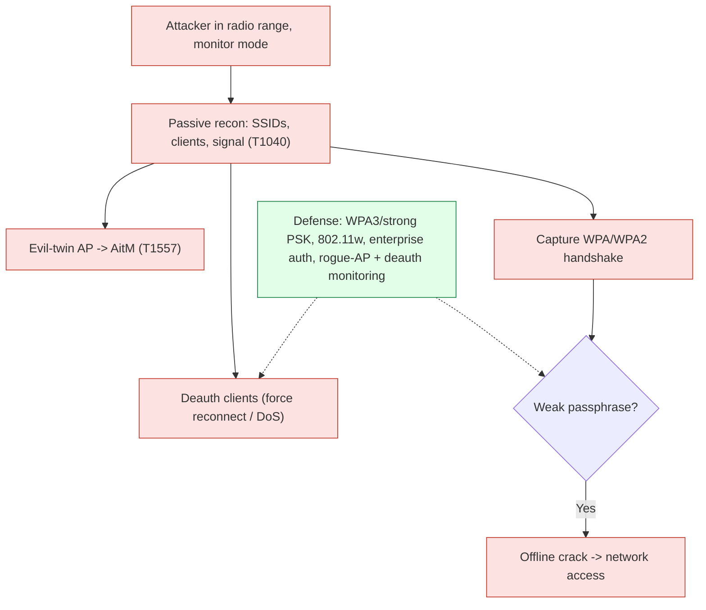

# Wireless Network Reconnaissance and Attacks

## Summary

Wi-Fi broadcasts over the air, so an attacker within radio range needs no physical connection to observe and interfere with it — which makes wireless a distinct attack surface with its own reconnaissance and attack techniques. On Linux, a wireless adapter in **monitor mode** can passively capture nearby traffic and management frames (network sniffing, T1040), revealing SSIDs (including hidden ones), connected clients, and signal details. From there, classic attacks include capturing **WPA/WPA2 handshakes** for offline password cracking, **deauthentication** frames to knock clients off (forcing a reconnect that yields a handshake, or denying service), and **rogue/"evil twin" access points** that impersonate a legitimate network so victims connect through the attacker (adversary-in-the-middle, T1557). Toolkits like the aircrack-ng suite implement capture, deauth, and cracking. The defensive takeaways are concrete: use **WPA3** or at least WPA2 with a strong passphrase (weak/short passphrases fall to offline cracking), prefer enterprise authentication where possible, and monitor for rogue APs and deauth floods. Use these techniques only on networks you are authorized to test.

## Techniques and defenses

| Technique | Effect | Defense |
|---|---|---|
| **Monitor-mode sniffing** | Passive capture of frames/SSIDs/clients (T1040) | Encryption (WPA2/WPA3); assume air is observed |
| **Handshake capture + offline crack** | Recover PSK if passphrase is weak | Strong passphrase; WPA3; enterprise auth |
| **Deauthentication** | Disconnect clients; force reconnect/DoS | Management-frame protection (802.11w); monitoring |
| **Rogue / evil-twin AP** | AitM by impersonating a network (T1557) | Verify networks; 802.1X; rogue-AP detection |

The two anchors: encryption strength decides whether a captured handshake is crackable, and management-frame protection plus rogue-AP monitoring blunt deauth and evil-twin attacks.

## Wireless attack flow

## Security relevance

- **No physical access needed**: radio range is the only prerequisite, widening the attack surface.
- **Passphrase strength is decisive**: captured handshakes only yield access if the PSK is weak (T1040 enables the capture).
- **Evil-twin APs** enable interception of traffic and credentials (T1557).
- Deauth floods and unexpected APs broadcasting your SSID are detectable signals.

## Defense / practices

- **Use WPA3**, or WPA2 with a long, random passphrase; avoid WEP and weak PSKs entirely.
- **Prefer enterprise (802.1X)** authentication over shared passphrases where feasible.
- **Enable management-frame protection (802.11w)** to resist deauthentication attacks.
- **Monitor for rogue/evil-twin APs** and deauth floods; use wireless IDS where available.
- **Authorize testing**: only assess wireless networks you own or have explicit permission to test.

## ATT&CK mapping

| ID | Name | Tactic |
|---|---|---|
| T1040 | Network Sniffing | Credential Access, Discovery |
| T1557 | Adversary-in-the-Middle | Credential Access, Collection |

## Explanation

Wired networks make an attacker physically plug in; Wi-Fi hands them the conversation through the air, so anyone standing close enough with the right antenna can listen without touching a thing. Put a Linux wireless card into "monitor mode" and it hears every nearby network announcing itself, every device chatting, like a scanner picking up radio stations. The classic move is to grab the brief cryptographic "handshake" a device performs when it joins a protected network; that handshake can't be used directly, but it's a locked box an attacker can take home and try to pick at leisure — and if the Wi-Fi password is short or common, they'll pick it. Two nastier tricks round it out: blasting "get off" messages to kick devices off the network (either to annoy, or to force the handshake you wanted), and standing up a fake copy of a trusted network so victims connect *through* the attacker, who now sees everything. The defenses are refreshingly concrete: a long random password (or better, WPA3) makes the stolen handshake uncrackable, frame protection stops the "get off" trick, and watching for impostor networks catches the fake twin.
