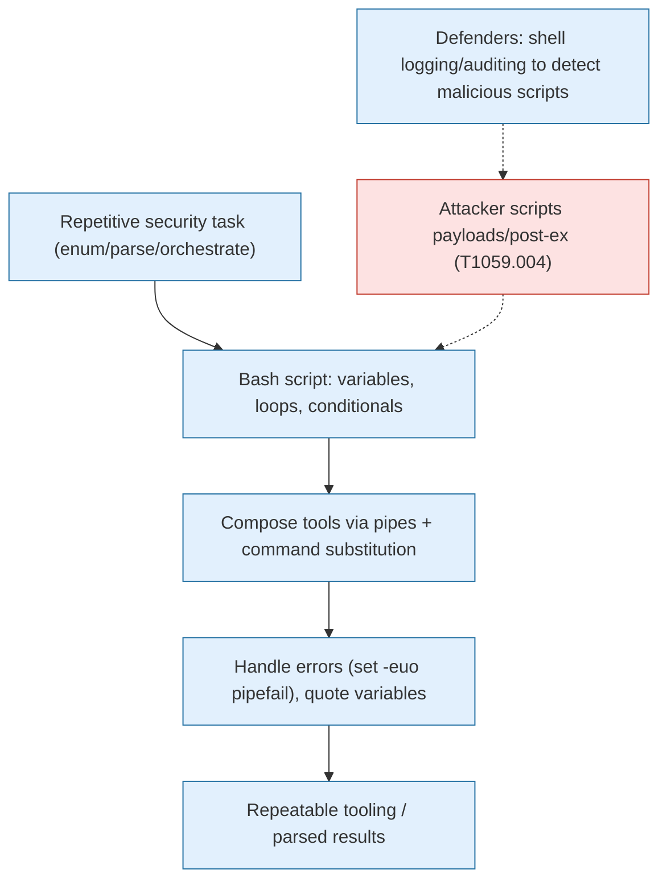

# Bash Scripting for Security Work

## Summary

Bash scripting turns one-off command-line work into repeatable tooling, which is why it is central to both offensive and defensive Linux practice: automating enumeration, parsing logs, orchestrating tools, and glueing together a workflow. The same power makes Bash a common vehicle for attacker activity — scripted payloads, one-liners, and post-exploitation automation (command and scripting interpreter: Unix shell, T1059.004). Understanding Bash's building blocks (variables, conditionals, loops, functions, command substitution, exit codes) and its sharp edges (word-splitting, unquoted variables, injection) is essential both to write reliable security tooling and to read and analyse malicious scripts. Defenders also need to log and monitor shell activity, because the command line is where much Linux attack behaviour is expressed.

## Core constructs

| Construct | Role |
|---|---|
| **Variables & quoting** | Store/compose values; quoting prevents word-splitting and injection |
| **Conditionals** (`if`, `[[ ]]`) | Branch on tests and exit codes |
| **Loops** (`for`, `while`) | Iterate over files, hosts, lines |
| **Command substitution** `$(...)` | Capture command output into logic |
| **Pipes & exit codes** | Compose tools; `$?` and `set -e` for error handling |
| **Functions** | Reusable units for larger scripts |

Two cautions define robust scripting: always quote variable expansions (unquoted `$var` splits on whitespace and enables injection), and handle errors (`set -euo pipefail`) so a script fails safely rather than continuing in a broken state.

## Automation flow

## Security relevance

- **Tooling**: automate enumeration, log parsing, and multi-host workflows reliably.
- **Analysis**: read and understand malicious shell scripts and one-liners (T1059.004).
- **Pitfalls**: unquoted variables and untrusted input cause injection and bugs — in your tools and as attack vectors.
- **Monitoring**: shell activity is a prime detection surface on Linux.

## Defensive / practical guidance

- **Write defensively**: quote all expansions, use `set -euo pipefail`, validate inputs.
- **Never pass untrusted input to a shell** unescaped (command injection).
- **Log and monitor shell activity** (auditd, shell history, process creation) to detect malicious scripting.
- **Review scripts** for safety before running, especially from untrusted sources.
- **Prefer explicit, readable scripts** over clever one-liners in tooling you must maintain.

## ATT&CK mapping

| ID | Name | Tactic |
|---|---|---|
| T1059.004 | Command and Scripting Interpreter: Unix Shell | Execution |

## Explanation

The command line is brilliant for a single question, but you don't want to retype a twenty-step investigation every morning. Bash scripting is how you record that investigation once and replay it forever — and, more powerfully, wrap it in loops and decisions so it adapts ("for every host in this list, check X; if Y, do Z"). That's why it's the duct tape of Linux security, holding tools and tasks together for defenders and attackers alike. The two things that separate solid scripts from dangerous ones are humble but crucial: putting quotes around your variables (so a filename with a space, or a malicious value, can't split your command into something unintended) and making the script stop the moment something goes wrong rather than blindly charging on.
