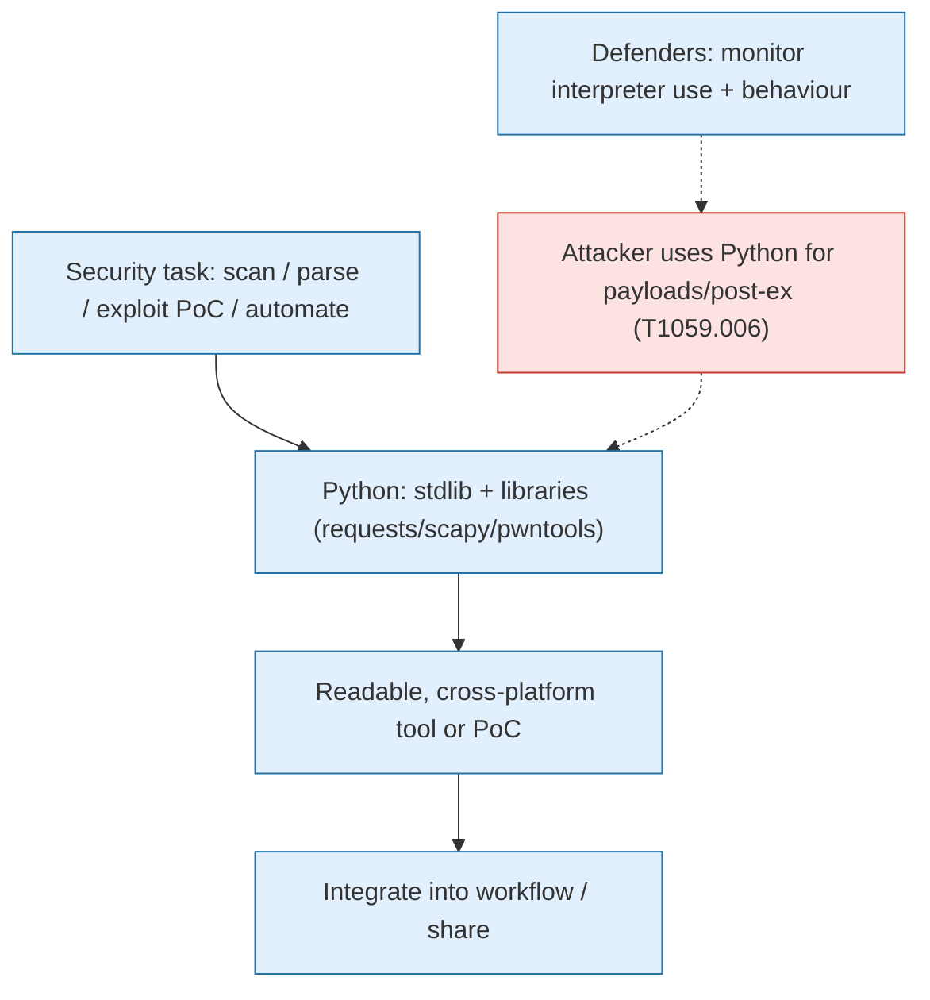

# Python Scripting for Security Tools

## Summary

Python is the lingua franca of security tooling: readable, batteries-included, and backed by a vast ecosystem of libraries for networking (sockets, `requests`, `scapy`), binary and protocol work (`struct`, `pwntools`), parsing, and automation. Practitioners use it to build scanners, parsers, exploit proof-of-concepts, and automation that would be awkward in shell. Because it is interpreted and widely installed, it is also used by attackers for cross-platform payloads and post-exploitation (command and scripting interpreter: Python, T1059.006). Understanding Python's strengths — rapid development, rich libraries, and clear code — explains why it dominates offensive and defensive tooling, and why defenders must also monitor interpreter use as a potential execution vector.

## Why Python dominates tooling

| Strength | Security use |
|---|---|
| **Rich standard library** | Sockets, HTTP, subprocess, parsing without extra installs |
| **Ecosystem** | `requests`, `scapy`, `pwntools`, `cryptography`, parsers, SDKs |
| **Readability** | Shareable, maintainable tools and PoCs |
| **Cross-platform** | One script runs across OSes |
| **Rapid prototyping** | Fast iteration for research and automation |

The same qualities that make Python ideal for defenders' automation make it convenient for attackers' agents and loaders (T1059.006), so interpreter activity is a telemetry source worth watching.

## Tooling workflow

## Security relevance

- **Defensive tooling**: scanners, log parsers, enrichment, automation, and orchestration.
- **Offensive tooling / research**: exploit PoCs (often with `pwntools`), protocol work (`scapy`), agents.
- **Analysis**: scripting repetitive reverse-engineering and forensic tasks.
- **Execution vector**: attacker Python payloads (T1059.006) make interpreter use a monitoring target.

## Defensive / practical guidance

- **Use virtual environments** and pinned dependencies; vet third-party packages (supply-chain risk).
- **Avoid `shell=True`/`eval`** on untrusted input (injection); validate inputs.
- **Monitor interpreter execution and behaviour** (network, child processes) as an execution signal.
- **Apply application control** where unexpected interpreter use is a concern.
- **Keep secrets out of scripts**; handle credentials safely.

## ATT&CK mapping

| ID | Name | Tactic |
|---|---|---|
| T1059.006 | Command and Scripting Interpreter: Python | Execution |

## Explanation

If Bash is the duct tape of Linux, Python is the toolbox with a labelled compartment for almost everything. Need to speak HTTP, craft raw packets, pull apart a binary, or talk to a cloud API? There's already a well-made library for it, and the language reads almost like English, so tools are quick to build and easy to share. That's why most of the security world's scanners, parsers, and exploit proof-of-concepts are written in it. The flip side is that the same convenience serves attackers, whose payloads often ride the Python interpreter that's already installed everywhere — so defenders treat a Python process doing network or process-spawning things it normally wouldn't as a signal worth examining, just as they would any other interpreter.
