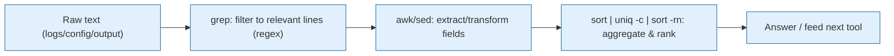

# Text Processing with sed, awk and Regular Expressions

## Summary

Most security data is text — logs, configuration, command output, packet dumps, scan results — and the classic Unix trio of **grep** (search), **sed** (stream editing/substitution), and **awk** (field-oriented processing) plus **regular expressions** is how practitioners slice and summarise it at speed. These tools shine at exactly the questions security work asks: extract the fields that matter, filter to the lines of interest, count and rank, and reshape data for the next tool. They are indispensable for log analysis, threat hunting, parsing tool output, and building detection pipelines, because they turn a wall of text into an answer in one command line. Mastery of regex underpins all of it, and also appears directly in detection logic (signatures, log parsing).

## The toolset

| Tool | Best at |
|---|---|
| **grep** | Find lines matching a pattern (regex), count, invert, context |
| **sed** | Stream substitution and line editing (`s/old/new/`, deletion, ranges) |
| **awk** | Field-based processing: columns, arithmetic, per-field logic, aggregation |
| **Regular expressions** | The pattern language shared across all three (and detection rules) |
| **Supporting tools** | `cut`, `sort`, `uniq -c`, `tr`, `wc` for the glue |

The typical pattern is a pipeline: `grep` to filter, `awk` to pull the relevant field, `sort | uniq -c | sort -rn` to rank — e.g. "top source IPs in this access log" in a single line.

## Log-analysis pipeline

## Security relevance

- **Log analysis & hunting**: extract, filter, count, and rank events to find anomalies.
- **Parsing tool output**: reshape scan/recon results for the next stage.
- **Detection logic**: regular expressions power signatures and log-based rules.
- **Frequency analysis**: `sort | uniq -c | sort -rn` surfaces the rare and the noisy.

## Defensive / practical guidance

- **Learn regex well** — it transfers to grep, sed, awk, SIEM queries, and detection rules.
- **Build reusable pipelines** for common log formats (web, auth, firewall).
- **Prefer structured parsing** (awk fields, or dedicated parsers/`jq` for JSON) over fragile regexes where possible.
- **Watch for catastrophic regex** (ReDoS) on untrusted input in automated tooling.
- **Document pipelines** so investigations are repeatable.

## ATT&CK mapping

No single ATT&CK technique; text processing is a core analytical skill supporting detection, hunting, and forensics across the knowledge base.

## Explanation

A security analyst spends a huge amount of time staring at text that's 99% noise, hunting for the 1% that matters. grep, sed and awk are the power tools for that search. grep throws away every line that doesn't match your pattern; awk reaches into each surviving line and pulls out just the column you care about (say, the source IP); and a quick `sort | uniq -c | sort -rn` tallies them up and puts the busiest at the top. String those together and "which address hammered this server last night?" goes from an impossible scroll to a one-line answer. Regular expressions are the pattern language that makes all of it precise — and because the same regex skill powers detection signatures and SIEM queries, it's one of the highest-leverage things a defender can learn.
