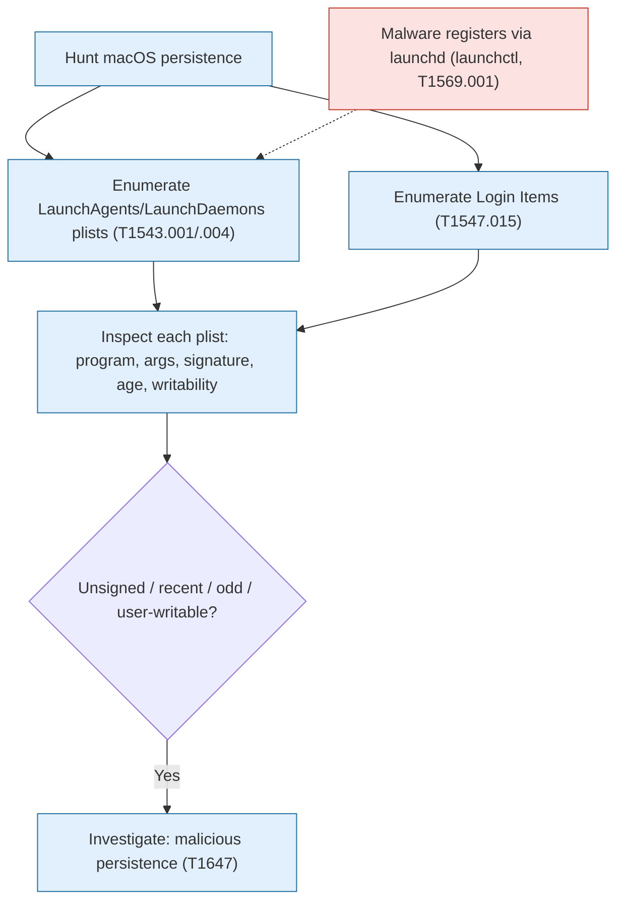

# macOS Persistence and Malicious Behaviour Hunting

## Summary

macOS malware, like its Windows counterpart, needs to survive reboots and logins, and it does so through a well-known set of **persistence mechanisms** that are exactly where defenders hunt. The most common are **Launch Agents** (per-user, run at login; T1543.001) and **Launch Daemons** (system-wide, run at boot as root; T1543.004), both defined by **property-list (plist)** files in standard `Library/LaunchAgents` and `Library/LaunchDaemons` locations and loaded by `launchd` (often via `launchctl`, T1569.001). Others include **Login Items** (T1547.015), configuration profiles, cron jobs, and modification of plists to alter behavior (plist file modification, T1647). Because these locations are finite and well-documented, **hunting** is tractable: enumerate the launch-agent/daemon directories and login items, inspect each plist's program and arguments, and flag unsigned, recently added, oddly named, or user-writable entries that run suspicious binaries. Behavioural hunting adds context: new persistence appearing alongside TCC prompts, outbound connections, or signed-tool abuse. The analytic edge is that persistence is both the malware's necessity and its exposure — it must register somewhere `launchd` will find it, and those somewheres are exactly what the defender enumerates.

## Persistence locations to hunt

| Mechanism | Where | ATT&CK |
|---|---|---|
| **Launch Agents** | `~/Library/LaunchAgents`, `/Library/LaunchAgents` | T1543.001 |
| **Launch Daemons** | `/Library/LaunchDaemons` (root at boot) | T1543.004 |
| **Login Items** | Per-user login items / SMLoginItems | T1547.015 |
| **Plist modification** | Altered plists change behavior | T1647 |
| **launchctl loading** | `launchctl load/bootstrap` | T1569.001 |

The hunter's advantage: `launchd` persistence must live in known directories as plist entries, so enumerating and vetting those entries (signature, age, writability, target binary) surfaces most footholds.

## Hunting flow

## Detection / value

- **Finite locations**: launch agents/daemons and login items are well-known, so enumeration is comprehensive (T1543.001/.004, T1547.015).
- **Plist inspection**: the program path, arguments, signature, and file age flag suspicious entries (T1647).
- **Behavioural context**: new persistence plus outbound connections, TCC prompts, or signed-tool abuse strengthens detection.
- Unsigned binaries, user-writable daemon plists, and recently added entries are high-value signals.

## Defense / practices

- **Enumerate and baseline**: regularly list launch agents/daemons and login items; compare against a known-good baseline.
- **Vet each entry**: signature, program path, arguments, age, and file permissions; flag anomalies.
- **Monitor launchd loading** (`launchctl`, T1569.001) and plist changes (T1647).
- **Use EDR/behavioural tooling** to correlate persistence with suspicious runtime behavior.
- **Least privilege and integrity**: restrict who can write daemon plists; protect persistence locations.

## ATT&CK mapping

| ID | Name | Tactic |
|---|---|---|
| T1543.001 | Create or Modify System Process: Launch Agent | Persistence, Privilege Escalation |
| T1543.004 | Create or Modify System Process: Launch Daemon | Persistence, Privilege Escalation |
| T1547.015 | Boot or Logon Autostart Execution: Login Items | Persistence, Privilege Escalation |
| T1647 | Plist File Modification | Defense Impairment |
| T1569.001 | System Services: Launchctl | Execution |

## Explanation

Any malware that wants to stick around on a Mac faces the same problem: the computer turns off, and it needs a way to come back to life at the next boot or login. macOS offers a tidy, well-documented set of "please start me automatically" slots — Launch Agents that fire when a user logs in, Launch Daemons that fire at boot with full privileges, Login Items, and a few others — each described by a small settings file (a plist) kept in a handful of standard folders. That tidiness is the malware's necessity and the defender's gift. Because the number of places a program can register to auto-start is small and known, hunting becomes a checklist: list everything in those folders, open each settings file, and ask the obvious questions — is this signed, is it brand new, does it have a weird name, can any user quietly rewrite it, and does it point at something it shouldn't? Honest software sits comfortably under that scrutiny; malware's auto-start entry is the loose thread that, when pulled, unravels its hiding place. The persistence it can't live without is exactly the thing that gives it away.
