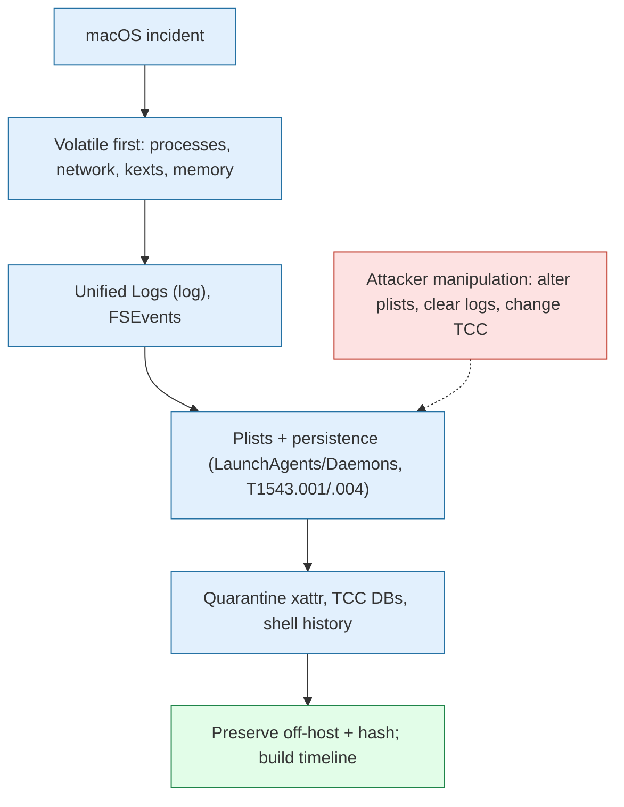

# macOS Incident Response Data Collection and System Manipulation

## Summary

Responding to a macOS incident means systematically collecting the platform's distinctive evidence sources, which differ from Windows. Key artifacts: the **Unified Logs** (Apple's consolidated, high-volume system logging, queried with `log`), **property lists (plists)** that store configuration and persistence (launch agents/daemons, T1543.001/.004), **FSEvents** (filesystem change records), **quarantine/`com.apple.quarantine` extended attributes** (download provenance for Gatekeeper), **TCC databases** (what was granted access to what), shell histories, **persistence locations** (LaunchAgents/LaunchDaemons, login items), and running process/network state. Collection should follow forensic discipline: capture **volatile data first** (processes, network connections, loaded kernel extensions, memory where feasible) before disk artifacts, use **trusted tools**, and preserve evidence off-host with hashes. "System manipulation" refers both to what attackers do (altering plists, clearing logs, changing TCC) and to the responder's need to collect without destroying evidence — e.g. reading extended attributes and logs without resetting timestamps. As on other platforms, correlating these sources into a timeline reconstructs the intrusion, and the macOS-specific artifacts (Unified Logs, quarantine attributes, TCC) are what make that reconstruction possible.

## Key macOS artifacts

| Source | Yields |
|---|---|
| **Unified Logs** (`log`) | System/process/auth events (high volume) |
| **Plists** | Config + persistence (launch items, T1543.001/.004) |
| **FSEvents** | Filesystem change history |
| **Quarantine xattr** | Download provenance (Gatekeeper) |
| **TCC databases** | Granted privacy/resource access |
| **Persistence locations** | LaunchAgents/Daemons, login items |
| **Process/network state** | Live volatile evidence |

The macOS-specific trio — Unified Logs, quarantine attributes, and TCC records — is what lets a responder reconstruct how something arrived, ran, and gained access.

## IR collection order

## Detection / value

- **Provenance**: quarantine extended attributes show where a file was downloaded from (Gatekeeper context).
- **Access granted**: TCC databases reveal what obtained camera/mic/file access.
- **Persistence**: plist and launch-item collection exposes footholds (T1543.001/.004).
- **Timeline**: Unified Logs + FSEvents + artifact timestamps reconstruct the intrusion sequence.

## Defense / practices

- **Collect volatile data first** (processes, network, kexts, memory) with trusted tools, then disk artifacts.
- **Capture macOS-specific sources**: Unified Logs, plists, FSEvents, quarantine xattrs, TCC DBs.
- **Preserve without destroying**: avoid altering timestamps/attributes; hash and store off-host.
- **Hunt persistence** in LaunchAgents/LaunchDaemons and login items during collection.
- **Correlate into a timeline** and watch for attacker anti-forensics (log clearing, plist/TCC manipulation).

## ATT&CK mapping

| ID | Name | Tactic |
|---|---|---|
| T1543.001 | Create or Modify System Process: Launch Agent | Persistence, Privilege Escalation |
| T1543.004 | Create or Modify System Process: Launch Daemon | Persistence, Privilege Escalation |

(IR data collection is a defensive/forensic activity; the artifacts expose persistence techniques such as T1543.001/.004.)

## Explanation

Investigating a hacked Mac is a different hunt from a hacked Windows box, because Apple keeps its evidence in its own particular places. The richest is the Unified Log, a firehose of everything the system has been doing, if you know how to query it. Scattered around are the little settings files (plists) that reveal what's set to auto-start — a favorite malware hiding spot — plus a change-log of the filesystem, and a quietly brilliant detail: every file you download gets an invisible tag recording where it came from, which is how the Mac decides whether to trust it. There's also a ledger (TCC) of exactly which apps were granted the camera, the microphone, or your files. A responder gathers all of this in the right order — grabbing the fleeting things first, like running programs and live network connections, before touching the disk — and, crucially, collects it without trampling it, since merely opening files carelessly can smear the very timestamps you need. Stitch these macOS-specific sources into a single timeline and the story emerges: how the thing got in, when it ran, and what it was allowed to touch. And you stay alert to the attacker having tidied up behind themselves — wiped logs, edited a plist, flipped a permission.
