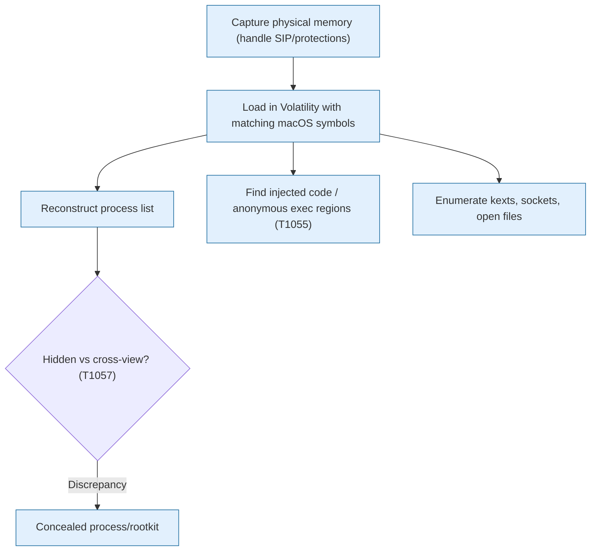

# macOS Memory Forensics

## Summary

Memory forensics on macOS recovers evidence that exists only in RAM — running and hidden processes, injected code (process injection, T1055), network connections, loaded kernel extensions, decrypted data, and credentials — from a captured memory image. The workflow mirrors other platforms but with macOS specifics: **acquire** physical memory (historically harder on macOS, requiring appropriate tools and, on modern systems, dealing with SIP and hardware protections), then **analyze** the image with a framework such as **Volatility** using macOS **symbol/profile** support matched to the exact kernel version. From the image, analysts reconstruct the process list and compare it against live or lower-level views to find hidden processes (process discovery and concealment, T1057), enumerate open files and network sockets, inspect loaded kernel extensions for rootkit-like components, and carve injected or decrypted payloads. The macOS-specific challenges are acquisition (protections and the need for the right tooling) and symbol availability (analysis requires matching the captured kernel's structures). The value is the same as everywhere: memory exposes what disk and live, possibly-subverted tools cannot — in-memory-only malware, injected code, and the true process and network state at the time of capture.

## Workflow and specifics

| Step | macOS detail |
|---|---|
| **Acquire** | Physical memory capture; contend with SIP/hardware protections |
| **Profile/symbols** | Match exact kernel version for structure layout |
| **Process analysis** | Reconstruct + cross-check for hidden processes (T1057) |
| **Injected code** | Find anonymous executable regions / injected payloads (T1055) |
| **Kernel extensions** | Inspect loaded kexts for rootkit components |
| **Network/files** | Recover sockets and open files from memory |

The two macOS hurdles are acquiring the image at all (platform protections) and having symbols that match the exact kernel; past those, analysis exposes in-memory-only and injected threats.

## Analysis flow

## Detection / value

- **In-memory-only threats**: injected code (T1055) and decrypted payloads appear in RAM, not on disk.
- **Hidden processes**: cross-view comparison in memory exposes concealment (T1057).
- **Kernel components**: loaded kexts can reveal rootkit-like modules.
- **True state at capture**: processes, sockets, and open files reflect reality, bypassing subverted live tools.

## Defense / practices

- **Acquire correctly**: use appropriate macOS memory-acquisition tooling; account for SIP and hardware protections.
- **Match symbols**: analysis needs structures for the exact captured kernel version.
- **Cross-check for concealment**: compare memory-derived process lists against other views (T1057).
- **Hunt injected code**: anonymous executable regions and injected payloads (T1055).
- **Preserve evidence**: hash the image and analyze a copy, documenting methodology.

## ATT&CK mapping

| ID | Name | Tactic |
|---|---|---|
| T1055 | Process Injection | Privilege Escalation, Stealth |
| T1057 | Process Discovery | Discovery |

(Memory forensics is a defensive/forensic activity that exposes in-memory techniques such as T1055 and conceals-vs-reveals process state, T1057.)

## Explanation

A Mac's memory holds the parts of the story that never touch the hard drive: the programs actually running right now, code an intruder has smuggled into another process, live network connections, decrypted secrets, and passwords sitting in the clear. Memory forensics is the craft of freezing all that into a single snapshot and then reading it. On a Mac this comes with two extra headaches. First, just grabbing the snapshot is harder than on many systems, because Apple's protections guard memory, so you need the right tools and sometimes have to work around them. Second, to make sense of the snapshot you need a precise map of how that exact version of the Mac's kernel arranges things in memory — the wrong map turns the snapshot into gibberish. Once you're past those, the payoff is the same as on any platform and uniquely valuable: you can list the real running programs and spot one that was hiding, find code injected where it doesn't belong, check for sneaky kernel add-ons, and see the true network connections — all without trusting the live machine's own tools, which a clever intruder may have taught to lie.
