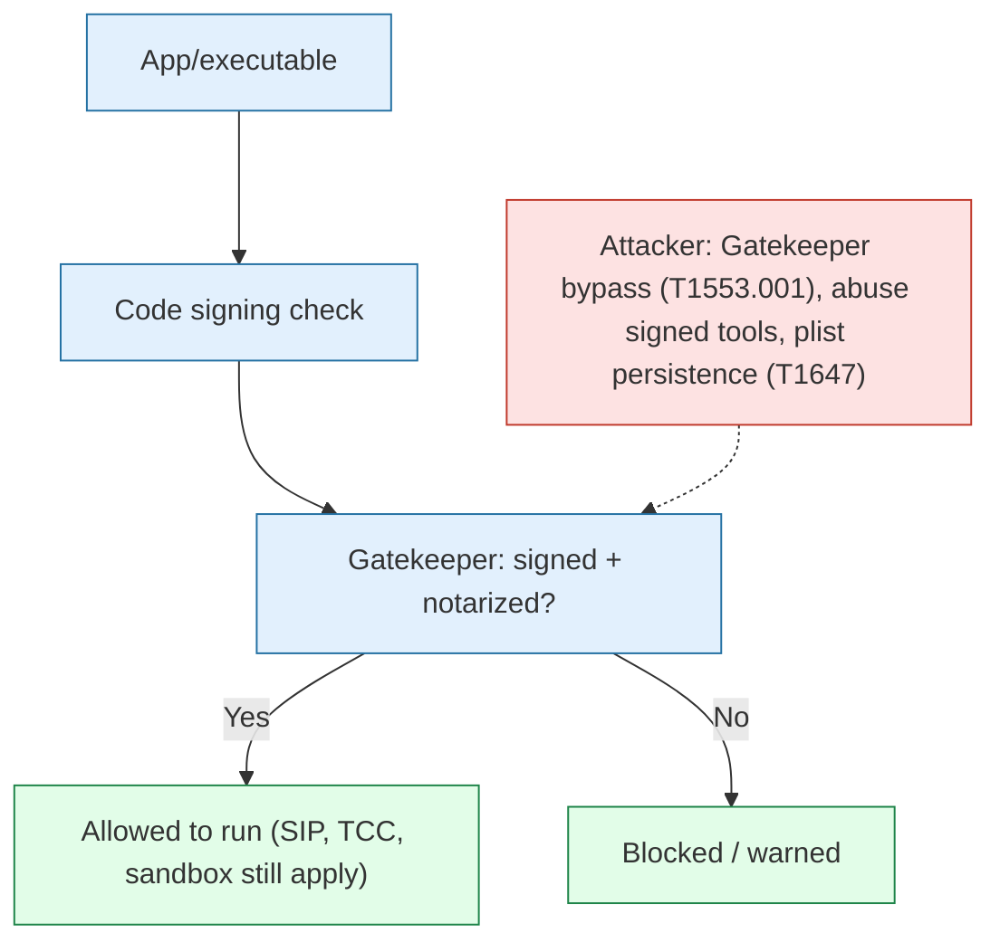

# macOS and iOS Security Model and Threats

## Summary

Apple's platforms layer several cooperating security mechanisms, and understanding them is the basis for both defending macOS and analyzing macOS/iOS malware. **Code signing** underpins trust: executables and apps are signed, and the OS checks signatures. **Gatekeeper** enforces that downloaded apps are signed and **notarized** (scanned by Apple) before they run, so unsigned/unnotarized code is blocked or warned on — a control attackers try to bypass (Gatekeeper bypass, T1553.001). **System Integrity Protection (SIP)** restricts even root from modifying protected system files and processes. **TCC (Transparency, Consent, and Control)** gates access to sensitive resources (camera, mic, files, full-disk access) behind user consent. The **app sandbox** confines apps to declared entitlements, strongest on iOS where nearly everything is sandboxed and system integrity is hardware-backed (Secure Enclave, boot chain). **XProtect** provides built-in signature-based malware blocking. Threats accordingly focus on **bypassing these layers**: tricking Gatekeeper/notarization, abusing legitimate signed tools, exploiting TCC, and persisting via property-list configuration (plist modification, T1647). iOS's tighter model pushes attackers toward exploit chains and jailbreaks. The defensive theme is that these layers are strong but not absolute, and much macOS malware works by social engineering and configuration abuse rather than breaking the cryptography.

## Security layers

| Layer | Protects |
|---|---|
| **Code signing** | Authenticity/integrity of executables |
| **Gatekeeper + notarization** | Blocks unsigned/unnotarized downloaded apps (bypass: T1553.001) |
| **SIP** | Protects system files/processes even from root |
| **TCC** | User consent for sensitive resources (camera, mic, files) |
| **App sandbox** | Confines apps to entitlements (strongest on iOS) |
| **XProtect** | Built-in signature malware blocking |

The pattern: layered, mostly strong controls — so attackers bypass or socially engineer around them (Gatekeeper evasion, plist-based persistence, T1647) rather than breaking the crypto.

## Trust and bypass

## Detection / value

- **Layered defenses**: code signing, Gatekeeper/notarization, SIP, TCC, sandbox, and XProtect each raise attacker cost.
- **Bypass is the attack surface**: Gatekeeper evasion (T1553.001), TCC abuse, and signed-tool abuse are the recurring techniques.
- **Configuration persistence**: plist modification (T1647) and launch items are common footholds (see persistence file).
- iOS's hardware-backed, heavily sandboxed model pushes attackers toward exploit chains and jailbreaks.

## Defense / practices

- **Keep protections enabled**: Gatekeeper, SIP, and TCC on; avoid disabling for convenience.
- **Patch and trust XProtect/notarization updates**: Apple updates signatures and revokes bad certificates.
- **Watch for bypass attempts**: unsigned/unnotarized execution, quarantine-attribute removal, and TCC prompts out of context.
- **Monitor configuration**: plist and launch-item changes (T1647) for persistence.
- **Least privilege and MDM**: restrict entitlements and manage endpoints centrally in enterprises.

## ATT&CK mapping

| ID | Name | Tactic |
|---|---|---|
| T1553.001 | Subvert Trust Controls: Gatekeeper Bypass | Defense Impairment |
| T1647 | Plist File Modification | Defense Impairment |

## Explanation

Apple builds security in layers, like a castle with several walls rather than one. Every program is supposed to carry a signed passport proving who made it; a gatekeeper at the door (aptly named Gatekeeper) refuses apps that lack a valid passport and Apple's notarized stamp of inspection; a rule called SIP means that even the king (root) can't tear down certain inner walls; a consent system (TCC) makes apps ask your permission before reaching the camera, microphone, or your files; and each app is kept in its own locked room (the sandbox), a model taken to the extreme on iPhones, where almost nothing can roam free and the locks are built into the hardware itself. Because these walls are genuinely hard to smash, most macOS malware doesn't try — it looks for ways around. It tricks the gatekeeper into waving it through, borrows a legitimately signed program to do its dirty work, nags the user into granting permissions, or quietly edits the little configuration files (plists) that tell the system what to launch, so it comes back every reboot. The lesson for defenders is that the walls are strong but the gates and the paperwork are where the fight happens.
