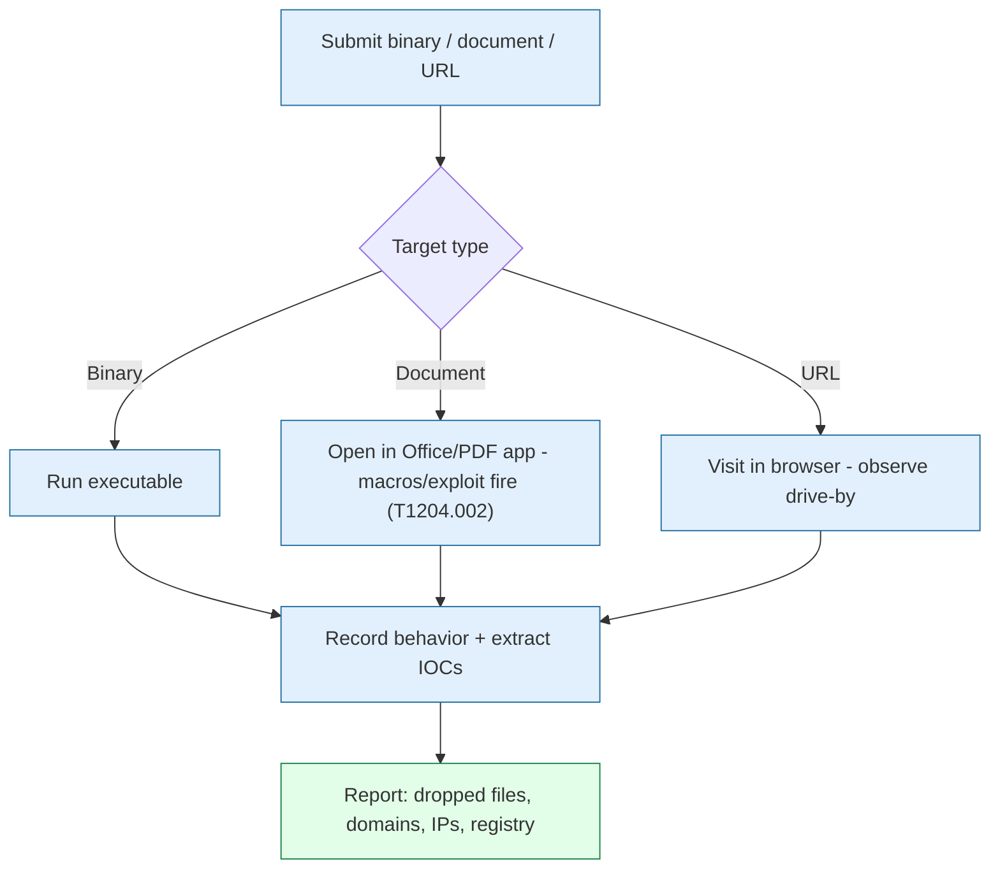

# Analyzing Documents, URLs and Binaries with Cuckoo

## Summary

Cuckoo analyzes more than executables — it can detonate **documents** (Office, PDF), **URLs**, and **binaries**, matching the real delivery vectors of modern attacks (malicious attachments, T1566.001, relying on user execution, T1204.002). For a **binary**, Cuckoo runs it and records process, file, registry, and network behavior. For a **document**, it opens the file in the appropriate application inside the guest so that embedded macros, exploits, or lures execute and their behavior — spawned processes, downloaded payloads, C2 — is captured, which is how you reveal a weaponized Office doc or PDF without reading obfuscated macro code by hand. For a **URL**, Cuckoo visits it in a browser in the guest to observe drive-by behavior, redirects, and downloads. Across all three, the value is the same: Cuckoo elicits and records the actual behavior and extracts indicators (dropped files, hashes, domains, IPs, registry changes), with simulated network services letting network-dependent stages proceed offline. The analyst then reads the behavioral report rather than manually reversing each layer, reserving deep analysis for the specific parts that matter.

## Analysis targets

| Target | How Cuckoo handles it | Reveals |
|---|---|---|
| **Binary** | Executes in guest | Process/file/registry/network behavior |
| **Document (Office/PDF)** | Opens in app; macros/exploits fire (T1204.002, T1566.001) | Spawned processes, downloads, C2 |
| **URL** | Visits in browser | Drive-by, redirects, downloads |

The common payoff: whatever the vector, detonation turns an obfuscated artifact into an observable behavior trail and a set of extractable indicators.

## Detonation by vector

## Detection / value

- **Covers real vectors**: documents and URLs are primary phishing delivery (T1566.001), not just EXEs.
- **Behavior over obfuscation**: detonation reveals what weaponized macros/exploits do without manual deobfuscation.
- **IOC extraction**: dropped files, hashes, domains, IPs, and registry changes feed detection.
- Multi-stage behavior (download → execute) is captured when network services are simulated.

## Defense / practices

- **Detonate the delivered artifact** (the actual doc/URL), not just an extracted payload, to see the full chain.
- **Use realistic apps** in the guest so documents open and exploits/macros trigger.
- **Simulate network services** so downloaders fetch their next stage and reveal it.
- **Extract and deploy IOCs** from the report into detections and blocklists.
- **Escalate selectively**: manually reverse only the specific stage that needs it.

## ATT&CK mapping

| ID | Name | Tactic |
|---|---|---|
| T1204.002 | User Execution: Malicious File | Execution |
| T1566.001 | Phishing: Spearphishing Attachment | Initial Access |

## Explanation

Real attacks rarely arrive as an obvious ".exe" — they come as an invoice you're asked to open, a PDF, or a link in an email. Cuckoo is built for exactly that, because it can detonate all of these, not just programs. Hand it a booby-trapped Word document and it opens the document inside the sandbox the way a victim would, letting the hidden macro or exploit spring so you can watch what it tries to do — what it downloads, who it calls — instead of squinting at scrambled macro code. Hand it a suspicious link and it browses there in a throwaway machine to see if the page quietly pushes malware. Hand it a program and it just runs it. In every case you get the same prize: a clear account of what the thing actually did and a tidy list of clues — the files it dropped, the servers it contacted — ready to turn into defenses. The genius is matching the analysis to how the attack is really delivered, so you study the booby-trapped invoice as an invoice, springing its trap safely in the lab.
