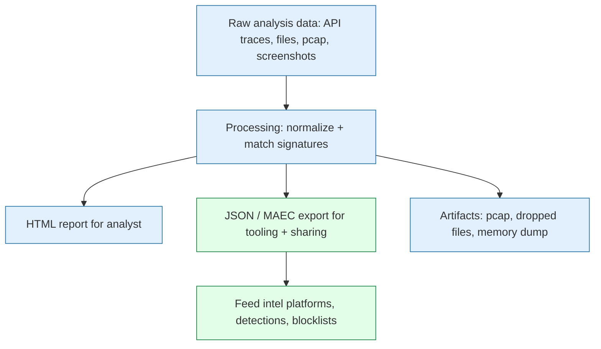

# Cuckoo Reporting and Export (HTML, MAEC)

## Summary

After Cuckoo detonates a sample, it aggregates what it observed into **reports** that make the behavior usable by humans and machines. The processing stage normalizes raw data (API call traces, dropped files, network captures, screenshots) into a structured result; reporting modules then render it in formats for different consumers. **Human-readable reports** (HTML/web UI, summary text) let an analyst quickly read the behavioral story — processes, files, registry changes, network connections, signatures triggered. **Machine-readable exports** (JSON, and standards like **MAEC** — Malware Attribute Enumeration and Characterization) let other systems ingest the results: feeding threat-intelligence platforms, generating detections, or sharing structured malware characterizations between organizations. Cuckoo also emits **extracted artifacts** (dropped files, pcap, memory dumps) and matches behavior against its **signature** modules to highlight notable actions. The practical point is that the report is the product: good analysis is only valuable if its indicators and behaviors flow into detection, intelligence, and response — which is why structured, exportable formats (JSON/MAEC) matter as much as the readable summary.

## Report outputs

| Output | Consumer | Use |
|---|---|---|
| **HTML / web UI** | Analyst | Read behavioral story, triggered signatures |
| **JSON** | Tooling/automation | Ingest, pivot, generate detections |
| **MAEC** | Intel sharing | Standardized malware characterization |
| **Artifacts** (pcap, dropped files, memory) | Deeper analysis | Network IOCs, further RE |
| **Signatures** | Analyst/triage | Highlight notable behaviors |

The core idea: the report exists to be *used* — read by an analyst, parsed by tools, and shared as standardized intelligence — so both readable and structured formats earn their place.

## From detonation to usable intelligence

## Detection / value

- **Readable behavior story** speeds analyst triage and understanding.
- **Structured export** (JSON/MAEC) lets results flow into intel platforms and detections automatically.
- **Extracted artifacts** (pcap, dropped files, memory) enable deeper analysis and network IOCs.
- **Signature matches** flag notable behaviors (persistence, injection, C2) for quick prioritization.

## Defense / practices

- **Export structured results** (JSON/MAEC), not just HTML, so findings feed automation and sharing.
- **Harvest artifacts**: pcap for network IOCs, dropped files and memory dumps for further analysis.
- **Operationalize indicators**: push domains/IPs/hashes into blocklists and detections.
- **Use signatures** to prioritize samples by notable behavior.
- **Share via standards** (MAEC) for interoperable malware characterization across teams.

## ATT&CK mapping

No single ATT&CK technique; reporting/export is a defensive analysis-output step. The behaviors reported map to specific techniques documented in their own files.

## Explanation

Watching malware misbehave is only half the job; the other half is writing it up so the knowledge actually gets used, and Cuckoo is good at this. Once the sandbox finishes, it gathers all the scattered observations — the system calls, the files dropped, the captured network traffic, the screenshots — and tidies them into reports aimed at different audiences. For a human, it produces a readable page: here's the story of what this sample did, here are the alarming behaviors it tripped. For other machines, it produces structured data (plain JSON, and a sharing standard called MAEC) so that a threat-intelligence system can swallow the results whole and a detection pipeline can turn them into rules automatically. It also hands you the raw evidence — the packet capture, the files it created, a memory snapshot — for anyone who wants to dig deeper. The lesson underneath is simple but easy to forget: an analysis that stays trapped in one analyst's head protects no one. The report, especially in a form other tools and teams can consume, is what converts a single detonation into defenses everywhere.
