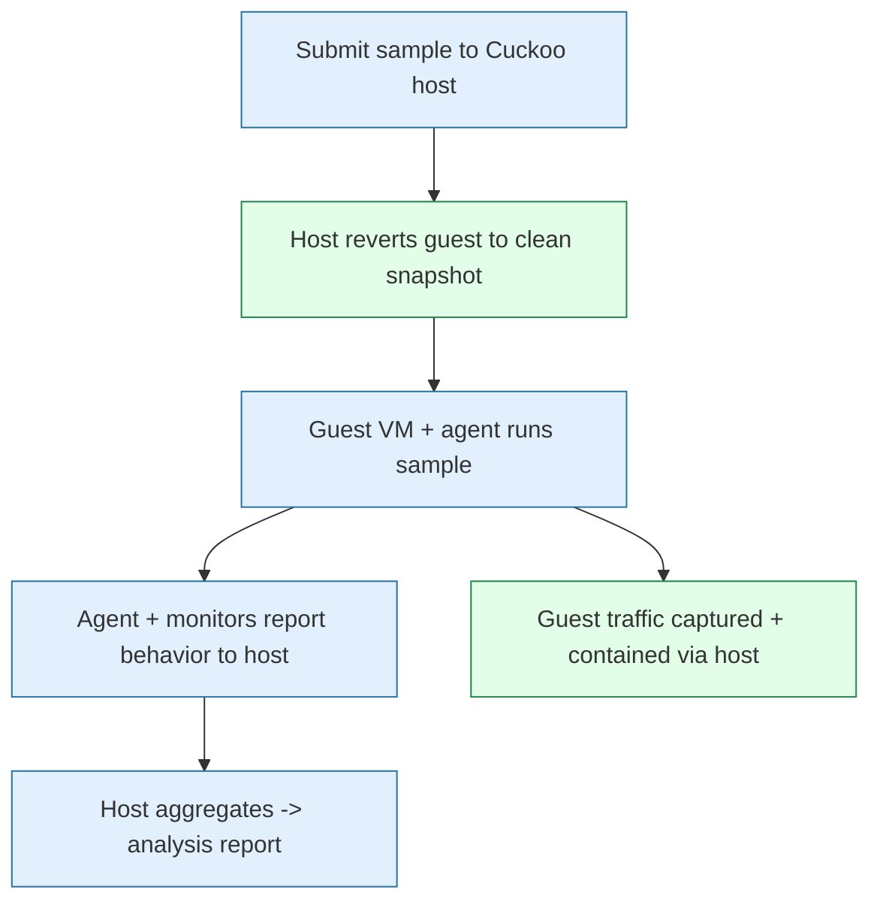

# Cuckoo Sandbox Installation and Configuration

## Summary

Cuckoo Sandbox is a well-known open-source automated malware analysis system. Architecturally it has a **host** component (the Cuckoo manager, which schedules analyses, controls VMs, and aggregates results) and one or more **guest** analysis VMs (where the sample actually runs, with an in-guest agent that launches the sample and reports behavior back). Setting it up means: installing the host software and its dependencies, preparing a guest VM (commonly Windows) with the analysis agent and realistic software, configuring the **virtualization layer** (VirtualBox/KVM/VMware) so the host can snapshot and control guests, and wiring up **networking** so guest traffic is captured and contained (often routed through the host for simulation/sinkholing rather than straight to the internet). A clean **snapshot** of the prepared guest is the reset point each analysis reverts to. The configuration choices that matter most for analysis quality are realistic guest software (to avoid looking like a bare sandbox), proper network containment and capture, and snapshotting discipline. A misconfigured network — letting guests reach the real internet unintentionally — is the classic dangerous mistake.

## Components and setup

| Component | Role | Setup concern |
|---|---|---|
| **Host (manager)** | Schedules, controls VMs, aggregates results | Dependencies, storage, web/reporting |
| **Guest VM + agent** | Runs the sample, reports behavior | Realistic software; agent installed |
| **Virtualization layer** | VM control/snapshot | VirtualBox/KVM/VMware integration |
| **Networking** | Capture + containment | Route via host; sinkhole; no accidental internet |
| **Snapshot** | Clean reset per run | Taken on a prepared, realistic guest |

The setup priorities: a convincing guest, contained-but-captured networking, and a pristine snapshot to revert to — with accidental internet exposure as the mistake to avoid.

## Cuckoo architecture

## Detection / value

- **Automated behavioral analysis** at scale once configured.
- **Containment + capture**: proper networking records traffic without freeing the sample.
- **Reproducibility**: snapshot reverts guarantee clean, independent runs.
- Realistic guests reduce sandbox-detection evasion (see anti-VM/sandbox evasion).

## Defense / practices

- **Prepare a realistic guest**: common applications, user artifacts, and the analysis agent.
- **Contain and capture networking**: route guest traffic through the host for simulation/sinkholing; avoid accidental internet access.
- **Snapshot the clean, prepared guest** as the per-analysis reset point.
- **Harden against evasion**: realistic configuration reduces trivial sandbox detection.
- **Secure the host**: isolate it from production; it controls live-malware VMs.

## ATT&CK mapping

No single ATT&CK technique; Cuckoo is defensive analysis infrastructure. Samples may attempt sandbox evasion (T1497), covered in the anti-VM/sandbox evasion file.

## Explanation

Cuckoo is a robot analyst you build once and then feed samples to forever. Picture a supervisor and a worker. The supervisor (the host) never touches the malware directly; it schedules jobs, resets the workspace to spotless before each one, and collects the findings afterward. The worker (a virtual machine with a little reporting agent inside) is the one that actually opens the suspicious file and does the risky work, narrating everything it observes back to the supervisor. Standing this up is mostly plumbing: install the supervisor, build a convincing worker machine that looks like a real person's computer rather than an empty test box, connect them through whichever virtualization software snapshots and controls the worker, and — most importantly — arrange the network so the worker's calls are recorded and bottled up inside your lab rather than escaping to the real world. Take a clean photo of the prepared worker, and that photo becomes the "reset" you revert to for every job. The one mistake that turns the whole thing dangerous is sloppy networking that accidentally lets the worker phone the real internet.
