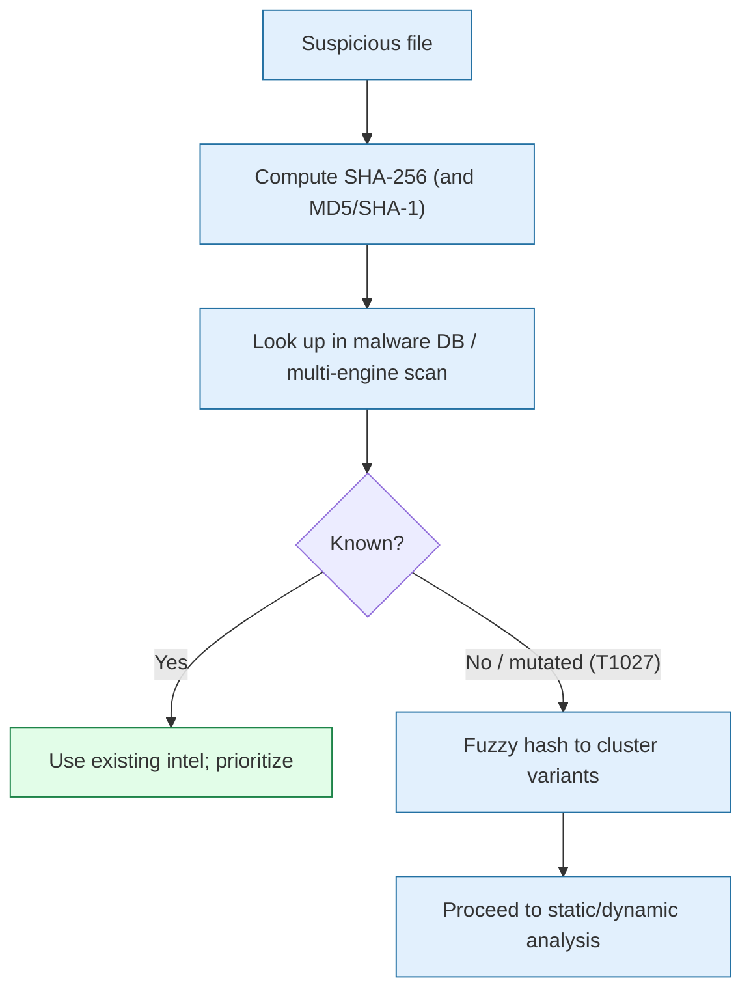

# File Hashing and Antivirus Scanning for Triage

## Summary

The very first triage step for a suspicious file is to **hash it and look it up**. A cryptographic hash (MD5, SHA-1, SHA-256) is a fixed-length fingerprint of the file's exact bytes; identical files share a hash, and any change yields a completely different one. Hashing lets analysts check the sample against known-malware databases and threat-intelligence services (e.g. multi-engine scanners) to answer "is this already identified?" in seconds, deduplicate samples, and share indicators unambiguously. Pairing hashing with **multi-engine antivirus scanning** gives a quick read on whether, and as what, the sample is already detected. Two limits shape the practice: exact hashes are brittle by design — a single flipped byte (which polymorphic/packed malware guarantees, T1027) produces a new hash, so a "clean" hash lookup never proves safety — and uploading a sample to a public service can tip off an adversary that their malware was caught. **Fuzzy hashing** (ssdeep and similar) addresses the brittleness by measuring *similarity* so related variants cluster despite byte differences. Triage by hashing is cheap and fast, but it's a starting point, not a verdict.

## Hashing for triage

| Technique | Purpose | Limit |
|---|---|---|
| **Cryptographic hash** (SHA-256) | Exact-match lookup, dedup, sharing | One byte change = new hash (T1027) |
| **Multi-engine AV scan** | Is it detected, and as what? | Misses novel/evasive samples |
| **Fuzzy hash** (ssdeep) | Cluster similar variants | Approximate, not identity |
| **Public upload caution** | — | May alert the adversary |

The guiding reality: an exact hash answers "is this *this exact file* known?" — useful and instant, but defeated by any mutation, so clustering (fuzzy hashing) and deeper analysis carry on where it stops.

## Triage lookup flow

## Detection / value

- **Instant known/unknown**: hash lookups and multi-engine scans resolve many samples immediately.
- **Deduplication & sharing**: hashes are unambiguous indicators for intel exchange.
- **Similarity clustering**: fuzzy hashing links variants that exact hashes miss (T1027-driven mutation).
- A "not detected" result is not proof of safety — novel/evasive malware evades it.

## Defense / practices

- **Hash first** (SHA-256) and check against malware databases and multi-engine scanners.
- **Never treat clean as safe**: exact hashes break on any change; corroborate with analysis.
- **Use fuzzy hashing** (ssdeep) to cluster related variants despite byte differences.
- **Mind operational security**: public uploads can alert adversaries; use private detonation for sensitive cases.
- **Record hashes** in reports and detections for sharing and tracking.

## ATT&CK mapping

No single ATT&CK technique; hashing/AV triage is a defensive step. Note that mutation techniques (obfuscation/packing, T1027) defeat exact-hash matching, covered in their own files.

## Explanation

Before doing anything clever with a suspicious file, you ask the simplest question: has anyone seen this exact file before? A hash is how you ask it — a short fingerprint computed from every byte, so two files with the same fingerprint are identical and the tiniest edit produces a totally different one. Fingerprint the file, look the print up in the big shared databases and run it past a wall of antivirus engines, and often you get your answer in seconds: "yes, that's a known trojan." The catch is baked into how fingerprints work. Change a single byte and the fingerprint is unrecognizable, and malware that mutates itself on every copy changes far more than a byte, so a fingerprint that matches nothing proves only that this *exact* file is unfamiliar — not that it's safe. That's why analysts also use "fuzzy" fingerprints that measure resemblance rather than identity, so a thousand mutated cousins of the same malware still cluster together. And there's a quiet discipline: tossing a sample onto a public scanner can tell the attacker you caught them, so sometimes you look without announcing it.
