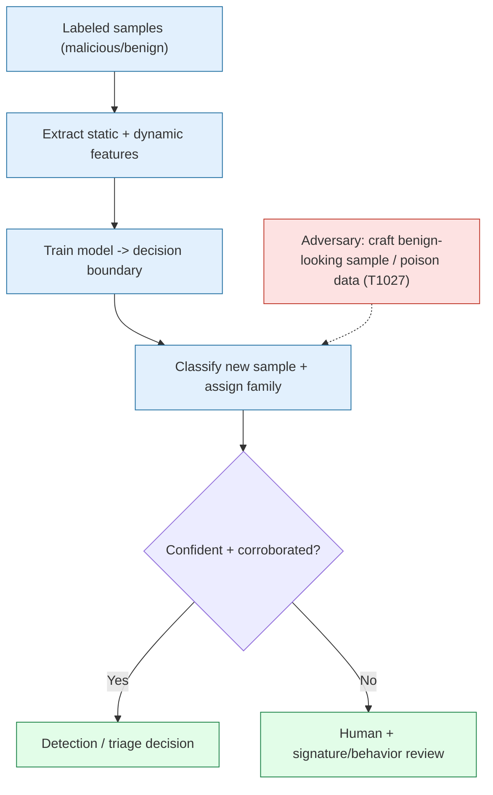

# Machine Learning Malware Detection and Classification

## Summary

Signatures catch known malware; machine learning aims to **generalize** to unseen samples by learning statistical patterns that separate malicious from benign. Models are trained on **features** extracted from samples — static features (PE header fields, imports, byte/entropy histograms, strings, opcode n-grams) and/or dynamic features (API-call sequences, behavioral events) — labeled malicious or benign, and learn a decision boundary that classifies new files and groups them into families. The appeal is scale and generalization: ML can flag novel variants that evade signatures (defeating obfuscation-driven mutation, T1027) and triage huge sample volumes. The hard parts are equally important to state plainly: ML needs large, well-labeled, representative data; it produces **false positives and false negatives** that have real costs; its features can be **evaded** by adversaries who craft samples to look benign (adversarial examples) or poison training data; and a model's decision can be hard to explain. The sound posture is ML as **one layer** in defense — powerful for generalization and triage — combined with signatures, behavior, and human analysis, with ongoing retraining and evaluation, not as a self-sufficient oracle.

## Features and trade-offs

| Aspect | Detail |
|---|---|
| **Static features** | PE fields, imports, entropy, strings, opcode n-grams |
| **Dynamic features** | API-call sequences, behavioral events |
| **Strength** | Generalizes to unseen variants; scales triage (counters T1027 mutation) |
| **Weaknesses** | Needs labeled data; false +/−; adversarial evasion; poisoning; explainability |

The balance: ML buys generalization and scale that signatures lack, at the cost of data dependence, error rates, and a new attack surface (evasion and poisoning) that must be managed, not ignored.

## ML detection pipeline

## Detection / value

- **Generalization**: flags novel variants that signatures miss (counters mutation, T1027).
- **Scale**: triages large sample volumes and clusters families automatically.
- **Caveats**: false positives/negatives carry real cost; results need corroboration.
- Adversarial evasion and data poisoning are genuine, active threats to ML detectors.

## Defense / practices

- **Use ML as a layer**, combined with signatures, behavior, and human analysis — not as a sole oracle.
- **Invest in data**: large, representative, well-labeled, and refreshed training sets.
- **Evaluate honestly**: track false-positive/negative rates on realistic data; monitor drift.
- **Harden against adversaries**: consider adversarial robustness and guard training-data integrity against poisoning.
- **Prefer explainable signals** where decisions drive action; corroborate low-confidence outputs.

## ATT&CK mapping

| ID | Name | Tactic |
|---|---|---|
| T1027 | Obfuscated Files or Information | Stealth |

(ML detection is a defensive technique aimed at generalizing past the mutation/obfuscation, T1027, that defeats signatures.)

## Explanation

Signature scanning is memorizing mugshots — great for catching crooks you've already booked, useless for first-timers. Machine learning tries to learn the *look* of trouble instead, so it can flag a face it's never seen. You feed it piles of files you've already labeled good or bad, along with lots of measurable traits — how the file is built, which system functions it borrows, how random its contents are, what it does when run — and it learns a rule of thumb that separates the two. Done well, this catches brand-new variants that slip past mugshot-matching and sorts mountains of samples fast. But it's worth being blunt about the limits, because vendors often aren't. The model is only as good as the labeled examples it learned from; it will sometimes cry wolf and sometimes miss a real one, and both mistakes cost; and clever adversaries can dress a bad file up to look innocent to the model, or even sneak poisoned examples into its training. So the grown-up way to use it is as one strong opinion among several — paired with signatures, behavior-watching, and a human — retrained and re-tested as the world shifts, never trusted as an infallible judge.
