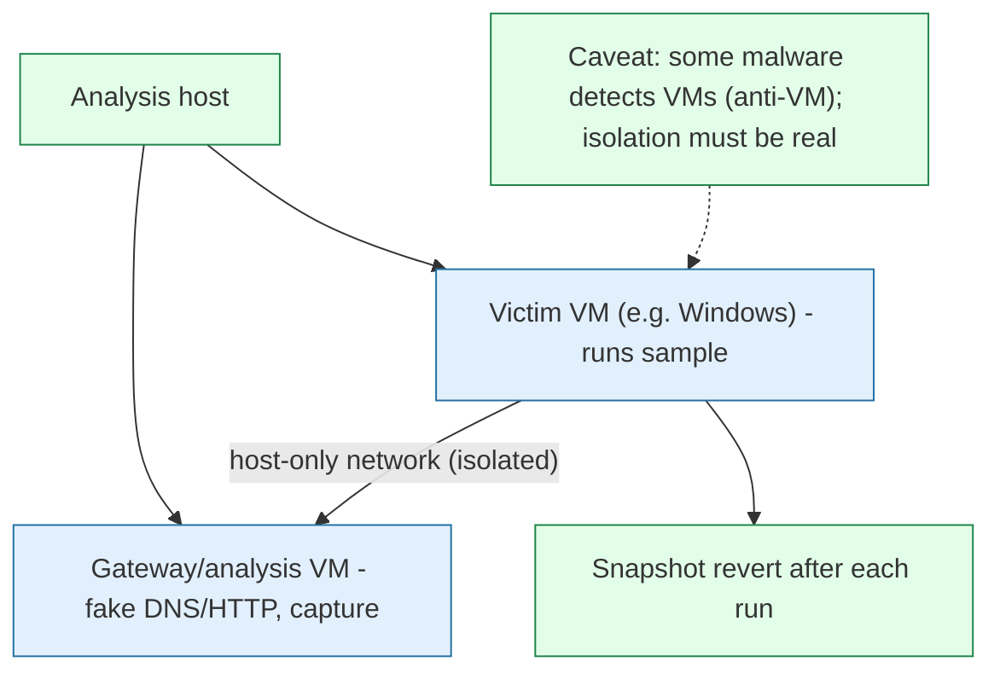

# Malware Analysis Lab Setup

## Summary

A malware analysis lab is a deliberately **isolated, instrumented, and resettable** environment for running hostile code safely. The core requirements: **isolation** from production and (by default) the internet, so a live sample can't spread or call home unexpectedly; **instrumentation** to observe process, file, registry/filesystem, and network behavior; and **fast reset** (VM snapshots) so each sample starts from a clean, known state. A typical setup uses **virtual machines** — a victim VM (often Windows, matching the target) and an analysis/gateway VM that provides fake network services (DNS, HTTP) and captures traffic — on an isolated host-only network. Tooling spans static (disassembler, PE viewer, strings), dynamic (process/file/registry monitors, network capture), and memory analysis. The important caveats: some malware detects VMs and refuses to run (so bare-metal or hardened VMs may be needed, see anti-VM evasion), and "isolated" must be real — misconfigured networking that lets a sample reach the internet or the host defeats the whole purpose. Snapshots before each run make the lab reusable and keep analyses independent.

## Lab requirements

| Requirement | Why | How |
|---|---|---|
| **Isolation** | Prevent spread / unwanted C2 | Host-only network; no production path; controlled internet |
| **Instrumentation** | Observe behavior | Process/file/registry monitors, network capture |
| **Fast reset** | Clean, independent runs | VM snapshots revert after each sample |
| **Simulated services** | Elicit behavior offline | Fake DNS/HTTP so malware "reaches" its C2 |
| **Tooling** | Static + dynamic + memory | Disassembler, PE viewer, monitors, memory tools |

The non-negotiables: real isolation, the ability to watch everything, and a one-click return to a pristine state.

## Lab topology

## Detection / value

- **Safe observation**: behavior (process, file, registry, network) is captured without risking production.
- **Reproducibility**: snapshots make each analysis independent and repeatable.
- **Offline C2 elicitation**: fake services make network-dependent malware reveal its behavior without real internet.
- Anti-VM behavior observed in the lab is itself an indicator (see anti-VM evasion).

## Defense / practices

- **Enforce real isolation**: host-only networking, no bridged access, controlled or no internet by default.
- **Instrument thoroughly**: process/file/registry monitors plus full packet capture.
- **Snapshot before every run** and revert after, keeping analyses clean and independent.
- **Simulate network services** (DNS/HTTP sinkholes) to elicit behavior offline.
- **Account for anti-VM**: harden VMs or use bare-metal when samples refuse to run under virtualization.

## ATT&CK mapping

No single ATT&CK technique; a lab is defensive infrastructure. Note that samples may use virtualization/sandbox evasion (T1497), documented in the anti-VM evasion file.

## Explanation

Studying malware safely needs the equivalent of a biosafety lab: a sealed room where you can let something dangerous loose, watch it closely, and sterilize everything afterward. Three things make the room work. First, it has to be truly sealed — no secret vent back to the rest of the building or out to the street — because the whole point is that the pathogen can't escape or quietly phone its masters. Second, the room is wired with cameras on everything: every file the sample touches, every change it makes, every packet it sends. Third, you can hit a button and have the room spotless again in seconds (a VM snapshot), so the next specimen starts in pristine conditions and your experiments don't contaminate each other. A neat trick is to pipe the sample's outbound calls to fake services inside the lab, so malware that only acts when it "reaches the internet" shows its hand without ever actually getting out. The one recurring gotcha is that some specimens can smell the lab — they detect the virtual machine and play dead — so occasionally you need a more convincing room, or a real physical one.
