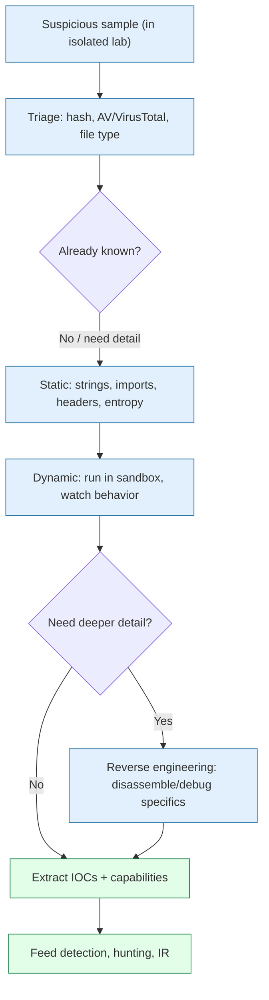

# Malware Analysis Methodology

## Summary

Malware analysis is the disciplined process of determining what a suspicious program does, how it does it, and how to detect and remediate it. A sound methodology moves from cheap, safe, broad techniques to expensive, risky, precise ones in four stages: **triage** (hashes, antivirus/VirusTotal lookups, file type — is this known?), **static analysis** (examine the file without running it: strings, imports, headers, embedded data), **dynamic/behavioral analysis** (run it in an isolated sandbox and observe process, file, registry, and network activity), and **deep reverse engineering** (disassembly/debugging to understand specific logic, decryption, or evasion). The goal is to extract **indicators of compromise** (hashes, domains, IPs, file paths, registry keys, mutexes) and **capabilities** (persistence, C2, payloads) while spending the least effort necessary. Analysis must happen in a contained, instrumented environment because the sample is live and hostile, and findings feed detection (signatures, YARA), hunting, and incident response. The order matters: each stage narrows the questions the next, costlier stage must answer.

## Stages of analysis

| Stage | Question | Techniques |
|---|---|---|
| **Triage** | Is it already known? | Hashing, AV/VirusTotal, file type |
| **Static** | What's inside without running it? | Strings, imports, PE/ELF headers, entropy |
| **Dynamic** | What does it do when run? | Sandbox: process/file/registry/network monitoring |
| **Reverse engineering** | How exactly does a feature work? | Disassembly, debugging, decryption |

The economy of the method: start broad, cheap, and safe; escalate to precise, costly, and hands-on only as far as the questions require.

## Analysis workflow

## Detection / value

- **IOC extraction**: hashes, domains, IPs, paths, keys, and mutexes drive blocking and hunting.
- **Capability mapping**: persistence, C2, and payload behavior inform response and ATT&CK mapping.
- **Efficiency**: triage and static work resolve many samples without costly reversing.
- Behavioral artifacts from dynamic analysis become detection and YARA signatures.

## Defense / practices

- **Work in isolation**: a contained, instrumented lab with no path to production or the internet by default.
- **Escalate by need**: triage → static → dynamic → RE; stop when you have the answers you need.
- **Capture everything**: hashes, screenshots, pcaps, memory dumps for reproducibility and reporting.
- **Combine static and dynamic**: each covers the other's blind spots (evasion, packing, dormant code).
- **Operationalize findings**: turn indicators and behaviors into signatures, detections, and IR guidance.

## ATT&CK mapping

No single ATT&CK technique; analysis methodology is a defensive/investigative process. The capabilities it uncovers map to specific techniques documented in their own files.

## Explanation

Taking apart a piece of malware is like a doctor diagnosing a dangerous, possibly contagious patient: you work from the safest, quickest checks toward the most invasive, and you never do it in the open ward. First you check the patient's ID against records — maybe this illness is already catalogued and you're done in a minute (triage by hashing and antivirus lookup). If not, you examine them without poking anything that bites: read the labels, check what tools they're carrying, look for hidden pockets (static analysis of strings, imports, and structure). Still unsure, you let them move around inside a sealed observation room and watch what they actually do — what they touch, who they call (dynamic analysis in a sandbox). Only when you need to understand one specific, subtle mechanism do you open them up instruction by instruction (reverse engineering). At every step you're collecting evidence — fingerprints, addresses, tells — that lets everyone else recognize this threat instantly next time. The discipline is spending no more effort than the question demands, and never, ever letting the patient loose in the building.
