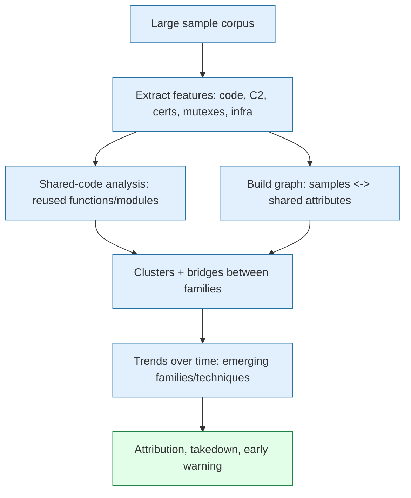

# Malware Networks, Shared Code Analysis and Trend Visualisation

## Summary

Analyzing malware at scale means studying **relationships** across many samples, not just individual files. **Shared code analysis** finds reused functions, libraries, or whole modules across samples — a strong signal of common authorship, a shared toolkit/builder, or code borrowed between families — by comparing at the function level and clustering what overlaps. **Malware networks** (graphs) connect samples to each other and to shared attributes — common C2 domains/IPs, certificates, mutexes, code, or infrastructure — so that a graph reveals clusters, bridges between families, and the infrastructure tying a campaign together. **Trend visualisation** tracks how families, techniques, and campaigns rise and fall over time, surfacing emerging threats and the spread of a technique across the ecosystem. The common thread is moving from "what is this one sample" to "how does this fit the landscape": who shares code with whom, which infrastructure links which samples, and what's growing. These relationship views power attribution, infrastructure takedown, and early warning, and they depend on consistent extraction of features (code, indicators, infrastructure) from large sample sets.

## Relationship views

| View | Connects | Reveals |
|---|---|---|
| **Shared code** | Samples via reused functions/modules | Common authorship, shared builders, code borrowing |
| **Malware graph** | Samples ↔ C2, certs, mutexes, infra | Campaign clusters, family bridges, infrastructure |
| **Trend visualisation** | Families/techniques over time | Emerging threats, technique spread |

The organizing idea: individual samples are nodes, but the intelligence lives in the edges — shared code, shared infrastructure, and change over time.

## Sample relationships as a graph

## Detection / value

- **Shared code → authorship**: reused modules link samples to common authors/toolkits.
- **Infrastructure graphs → campaigns**: shared C2/certs/mutexes cluster a campaign and expose its backbone.
- **Trends → early warning**: rising families and spreading techniques are visible before they peak.
- Graph bridges reveal code or infrastructure borrowed between otherwise distinct families.

## Defense / practices

- **Extract consistent features** (code, indicators, infrastructure) across large corpora for comparison.
- **Analyze shared code** to attribute samples and spot shared builders/toolkits.
- **Graph the relationships** (samples ↔ infrastructure) to find clusters and takedown targets.
- **Visualize trends** over time to anticipate emerging threats and technique spread.
- **Feed intel and takedown**: relationship findings drive attribution and infrastructure disruption.

## ATT&CK mapping

No single ATT&CK technique; relationship/trend analysis is an intelligence discipline. The techniques it tracks are documented in their own files.

## Explanation

Once you have thousands of malware samples, the most valuable questions aren't about any one of them — they're about the connections between them. Shared-code analysis is like noticing that two ransom notes were written on the same unusual typewriter: when distinct pieces of malware contain the exact same hand-rolled functions, someone is reusing code, which points to a common author or a shared criminal toolkit. Graphing takes this further by drawing lines between samples and the things they have in common — the same control server, the same forged certificate, the same infection marker — so that a sprawling mess of files resolves into neat clusters, with telling bridges where one gang has borrowed another's code or infrastructure. And watching all this over time turns it into a weather map: you can see a new family gathering force, or a clever new trick spreading from one group to the whole ecosystem, before it becomes a storm. The shift in mindset is the whole point — you stop asking "what is this file?" and start asking "where does it sit in the web, and which way is the web moving?"
