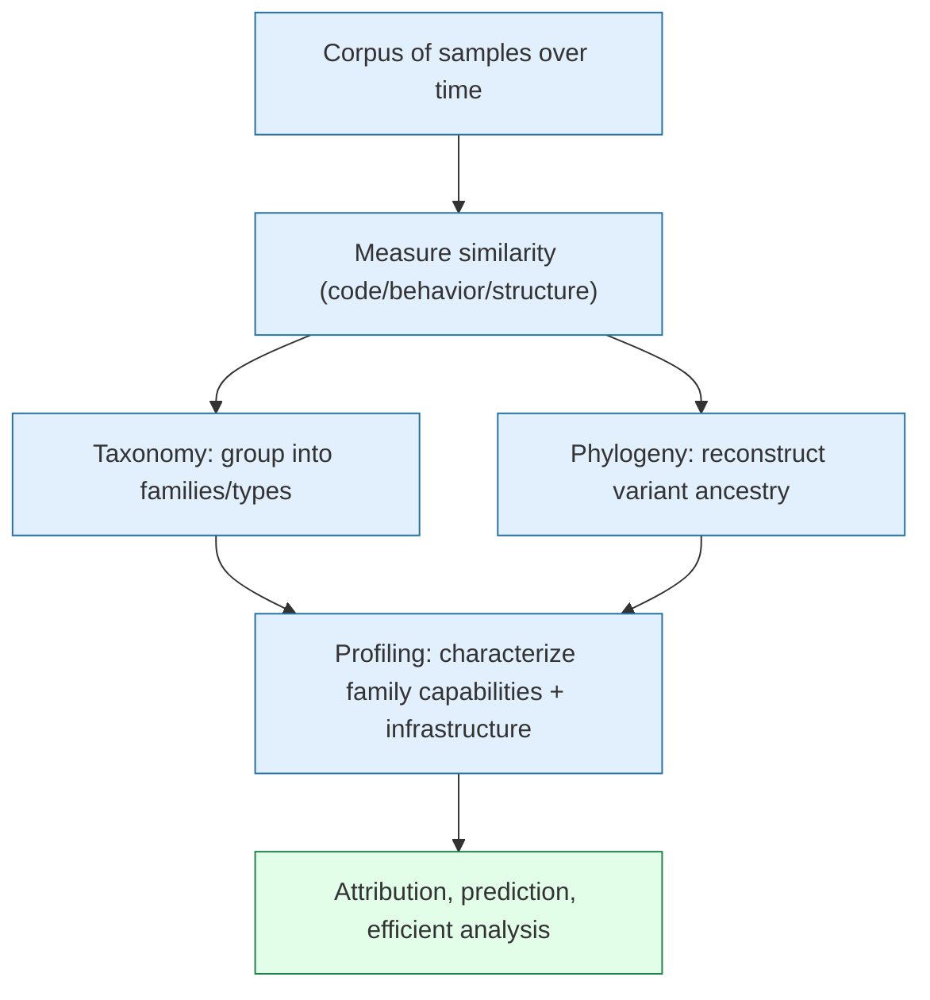

# Malware Profiling and Digital Virology (Taxonomy and Phylogeny)

## Summary

"Digital virology" borrows from biology to study malware as an evolving population rather than a pile of isolated files. **Taxonomy** classifies samples into families and types by shared traits (code, behavior, structure), giving a shared vocabulary for "what kind of thing is this." **Phylogeny** reconstructs the *evolutionary relationships* among samples — which variant descended from which — by measuring similarity and change over time, much as biologists build family trees from genetic differences. **Profiling** builds a characterization of a sample or family: its capabilities, code lineage, infrastructure, and distinctive features. Together these turn a stream of samples into a mapped landscape: families with histories, variants with ancestry, and authors or kits whose fingerprints recur. The practical payoffs are attribution (linking campaigns to a common origin), prediction (anticipating a family's next move from its trajectory), and efficient analysis (new samples slot into known lineages). The methods lean on the same similarity measures used for classification, applied at scale and over time to reveal structure, not just labels.

## Concepts

| Concept | Biology analogy | Yields |
|---|---|---|
| **Taxonomy** | Species/genus classification | Family/type labels, shared vocabulary |
| **Phylogeny** | Evolutionary family tree | Variant ancestry, lineage over time |
| **Profiling** | Organism characterization | Capabilities, code lineage, infrastructure |

The unifying move: treat malware as a living, mutating population so that labels gain histories and samples gain relatives — enabling attribution, prediction, and faster analysis.

## From samples to lineage

## Detection / value

- **Attribution**: shared lineage and infrastructure link samples to common authors/campaigns.
- **Prediction**: a family's evolutionary trajectory hints at its next variants.
- **Efficiency**: new samples placed in known lineages need less fresh analysis.
- Recurring structural/behavioral traits become durable family signatures.

## Defense / practices

- **Build and maintain family trees**: track variants over time, not just point-in-time labels.
- **Use scalable similarity**: apply fuzzy/structural comparison across a large corpus.
- **Profile families**, not just samples: capabilities, code reuse, and infrastructure.
- **Feed intelligence**: lineage and attribution inform threat intel and prioritization.
- **Revisit as families evolve**: keep taxonomies and profiles current.

## ATT&CK mapping

No single ATT&CK technique; profiling/virology is an analytical/intelligence discipline. The capabilities it characterizes map to specific techniques documented in their own files.

## Explanation

It helps to stop thinking of malware as a junk drawer of separate files and start thinking of it as wildlife — populations of organisms that breed, mutate, and evolve. Borrowing the biologist's toolkit, you do three things. You classify: this belongs to such-and-such family, this is that type of creature, giving everyone a common name to use. You build family trees: by measuring how samples differ, you work out which came first and which are descendants, reconstructing the lineage the way geneticists trace ancestry from DNA. And you profile: you write up each creature's characteristics — what it can do, where it nests, whose breeding program it came from. The reward for all this is more than tidy labels. If you know a sample's family and ancestry, you can often guess who's behind it, anticipate what the next generation will look like, and skip re-studying a creature you've effectively met before. It reframes the endless flood of new samples as a mapped ecosystem with histories and relatives, rather than an unending series of strangers.
