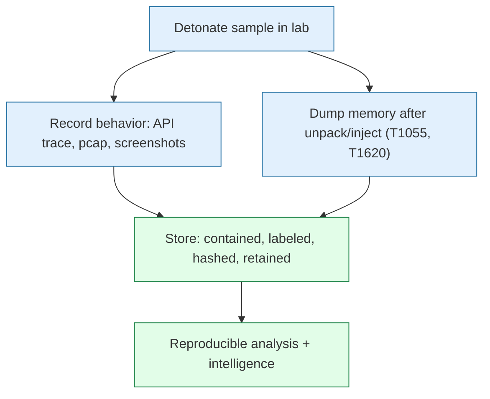

# Malware Recording and Memory Dump Storage for Analysis

## Summary

Thorough malware analysis depends on **capturing and preserving** the evidence a run produces, because much of it is ephemeral and some of it only exists in memory. Two capture types matter most. **Execution recording** preserves the behavioral trace of a run — API calls, process/file/registry events, network capture (pcap), and screenshots — so an analysis is reproducible, reviewable, and shareable without re-detonating. **Memory dumps** capture the contents of a process's (or the whole system's) RAM, which is where malware reveals what it hides on disk: unpacked/decrypted code, injected payloads (process injection, T1055), reflectively loaded modules (T1620), decoded strings and configuration, and keys. Because these artifacts are hostile and volatile, they must be **stored safely** — contained (so stored malware can't execute accidentally), labeled with metadata (sample hash, timestamp, environment), integrity-protected (hashes), and retained for reproducibility and intelligence. The discipline mirrors forensics: capture completely, preserve integrity, and store so the evidence remains usable and safe later. A memory dump taken *after* the sample unpacks and runs is often the single richest artifact an analyst keeps.

## What to capture and why

| Artifact | Captures | Reveals |
|---|---|---|
| **API/behavior trace** | Calls, process/file/registry events | Reproducible behavior story |
| **Network capture (pcap)** | Traffic during run | C2 domains/IPs, protocols |
| **Memory dump** | Process/system RAM | Unpacked/injected code (T1055, T1620), strings, keys |
| **Screenshots** | Visual state | Ransom notes, UI, lures |

The anchor: capture it while it exists, because unpacked code, injected payloads, and decoded config live only in memory and vanish when the run ends.

## Capture and preservation

## Detection / value

- **Memory reveals the hidden**: unpacked code, injected payloads (T1055), reflective loads (T1620), decoded config and keys.
- **Reproducibility**: recorded behavior lets analyses be reviewed and shared without re-running.
- **Network evidence**: stored pcap yields C2 indicators after the fact.
- Preserved artifacts support attribution, detection engineering, and legal/IR needs.

## Defense / practices

- **Dump memory at the right moment** — after the sample unpacks/decrypts/injects — for the richest artifact.
- **Record comprehensively**: API trace, pcap, screenshots, and dropped files per run.
- **Store malware safely**: contained (non-executable storage), clearly labeled, and isolated from production.
- **Preserve integrity**: hash artifacts and record metadata (sample hash, time, environment).
- **Retain for reuse**: keep artifacts for reproducibility, intelligence, and future correlation.

## ATT&CK mapping

| ID | Name | Tactic |
|---|---|---|
| T1055 | Process Injection | Privilege Escalation, Stealth |
| T1620 | Reflective Code Loading | Stealth |

(Recording/memory capture is a defensive/forensic activity; it exposes in-memory techniques such as T1055 and T1620.)

## Explanation

Analyzing malware produces evidence that mostly evaporates, so a big part of doing it well is catching that evidence and keeping it safely. Two kinds are precious. The first is a recording of the run itself — every system call, every network packet, screenshots of what appeared — so you can review the whole episode later, or hand it to a colleague, without ever detonating the dangerous thing again. The second, and often the richest, is a snapshot of the computer's memory. Malware works hard to hide its real self on disk — packing it, encrypting it, scattering it — but to actually run, it has to assemble the genuine code in memory, where it also decodes its secret settings and injects itself into other programs. Grab a photo of memory at that moment and you capture the villain with its mask off. The catch is that all this evidence is both fragile and dangerous, so you store it the way a forensics lab stores hazardous samples: sealed where it can't go off by accident, carefully labeled, fingerprinted so no one can doubt it, and kept for whenever you need it again.
