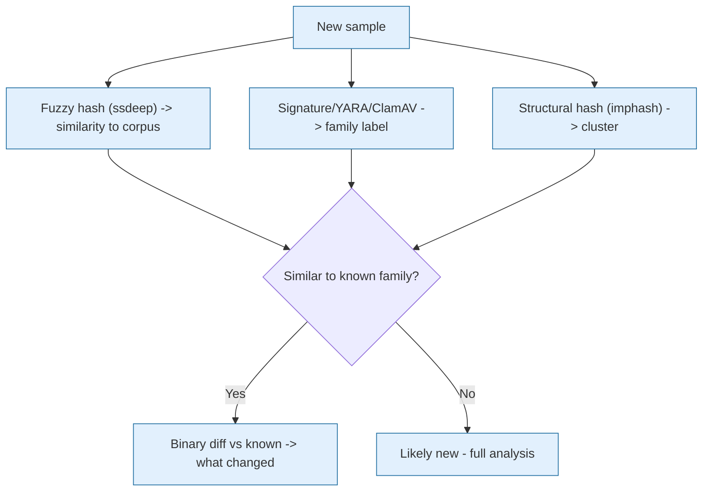

# Malware Similarity and Classification (ssdeep, BinDiff, ClamAV)

## Summary

Because malware mutates and reuses code, comparing samples by **similarity** rather than exact identity is essential for grouping variants, attributing families, and avoiding redundant analysis. Several complementary approaches exist. **Fuzzy hashing** (ssdeep, and context-triggered piecewise hashing in general) produces hashes that stay close when files are only slightly changed, so related variants score as similar despite the byte-level mutation that breaks exact hashes (obfuscation/packing, T1027). **Binary diffing** (BinDiff and similar) compares two binaries at the function/control-flow level to find shared and changed code — powerful for seeing how a new variant differs from a known one, even across recompiles. **Signature-based classification** (ClamAV, YARA) matches samples against patterns to label families. **Import hashing** (imphash) and other structural features cluster by how a binary is built. Used together, these let an analyst take one new sample and immediately place it: "this is a variant of family X, 90% similar to a sample we've seen, with this new function added." Classification turns a flood of samples into tracked families and focuses analysis where it's actually new.

## Similarity techniques

| Technique | Compares | Good for |
|---|---|---|
| **Fuzzy hashing** (ssdeep) | Byte-level similarity | Clustering variants despite mutation (T1027) |
| **Binary diffing** (BinDiff) | Functions / control flow | Seeing what changed between versions |
| **Signatures** (ClamAV/YARA) | Patterns | Family labeling, known-bad matching |
| **Structural hashes** (imphash) | Import table / build features | Grouping by construction |

The point of all four: identity is brittle, but resemblance is durable, so measuring how alike samples are places each new one in a known family and reveals exactly what's novel.

## Classification pipeline

## Detection / value

- **Variant clustering**: fuzzy and structural hashing group mutated samples exact hashes miss (T1027).
- **Change isolation**: binary diffing shows precisely what a new variant added or altered.
- **Family labeling**: signatures/YARA attribute samples to known families.
- **Analysis focus**: classification highlights the genuinely new samples worth deep analysis.

## Defense / practices

- **Cluster incoming samples** with fuzzy and structural hashing to track families, not individuals.
- **Diff against known variants** to focus on what changed rather than re-analyzing everything.
- **Maintain signatures** (YARA/ClamAV) for known families and update as variants appear.
- **Combine signals**: similarity, structure, and signatures together are more robust than any one.
- **Prioritize the novel**: spend deep-analysis effort on samples that don't match known clusters.

## ATT&CK mapping

| ID | Name | Tactic |
|---|---|---|
| T1027 | Obfuscated Files or Information | Stealth |

(Similarity analysis is a defensive technique that defeats the exact-match evasion that mutation, T1027, provides.)

## Explanation

Malware comes in families, like dialects of a language, and the authors constantly tweak their creations to dodge recognition — which means matching on exact identity is almost useless. The fix is to measure resemblance instead. One tool makes a special "smudgeable" fingerprint that stays similar when a file is only lightly changed, so a thousand tweaked cousins all score as near-matches and cluster into one family. Another lays two programs side by side and compares them function by function, so when a new variant shows up you can see at a glance exactly which parts are the familiar old code and which one new routine the author bolted on. Classic signature scanners pin a known family name on a sample, and structural fingerprints group programs by how they were assembled. Put together, these let an analyst greet each new sample with instant context — "this is the Foo family, almost identical to last week's, with one new trick" — instead of starting from scratch every time. The practical win is focus: the tools quietly file away the thousandth rerun of a known threat and flag the rare sample that's genuinely new.
