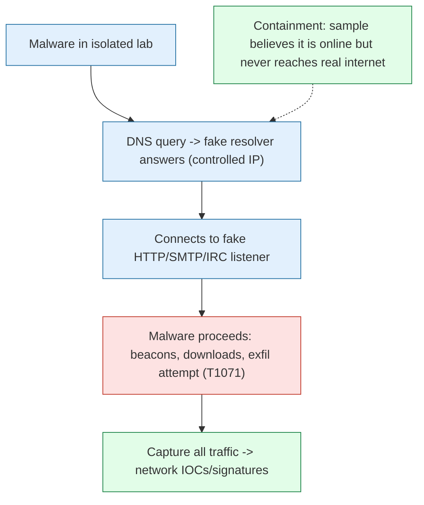

# Network Simulation for Dynamic Analysis

## Summary

Most malware is network-dependent: it resolves a domain, connects to a command-and-control server, downloads a second stage, or exfiltrates data (application-layer C2, T1071). In an isolated lab the real internet is off-limits, so analysts **simulate network services** to make the malware believe it has connectivity and thereby reveal its behavior. The standard approach uses a tool that acts as a universal fake server — answering **all DNS queries** with a controlled IP, and standing up **fake HTTP(S), SMTP, FTP, IRC** and other listeners that reply plausibly — so the sample "reaches its C2," proceeds past its network checks, and shows the next stages of its behavior while every packet is captured. This elicits domains, URLs, user-agents, request patterns, and protocols that become network indicators and signatures, all without ever giving the sample real internet access. The practice balances two goals: let the malware act as if online (to observe it fully), while keeping it truly contained (so it can't actually reach attackers or victims). Captured traffic is the raw material for network detection (IDS rules, domain/IP blocklists).

## What simulation provides

| Service faked | Elicits |
|---|---|
| **DNS (catch-all)** | C2 domains, DGA output, resolution behavior |
| **HTTP/HTTPS** | URLs, user-agents, beacon patterns, downloads (T1071.001) |
| **SMTP/IRC/FTP** | Spam, chat-based C2, transfer behavior |
| **Generic TCP** | Custom protocols and ports |

The balance at the core: convince the sample it is online so it runs its full network logic, while ensuring it never actually touches the real internet.

## Simulated-network analysis

## Detection / value

- **Reveals network behavior** offline: C2 domains, URLs, user-agents, and protocols (T1071).
- **Network IOCs**: captured traffic yields domains/IPs and request patterns for blocklists and IDS rules.
- **Full execution**: passing network checks lets later stages (downloads, payloads) run and be observed.
- DGA output and beaconing cadence become detection signals.

## Defense / practices

- **Fake all services** (catch-all DNS plus HTTP/HTTPS/SMTP/IRC/FTP) so network-dependent samples proceed.
- **Capture everything**: full pcap for later signature and indicator extraction.
- **Keep containment real**: the sample must believe it's online without actually reaching the internet.
- **Vary responses** where needed to coax conditional behavior (e.g. serve a plausible second stage).
- **Operationalize**: turn captured domains, IPs, and patterns into IDS rules and blocklists.

## ATT&CK mapping

| ID | Name | Tactic |
|---|---|---|
| T1071 | Application Layer Protocol | Command and Control |

(Network simulation is a defensive analysis technique that elicits and captures C2 behavior such as T1071.)

## Explanation

Lots of malware is like a spy who won't do anything until they've phoned headquarters for orders — cut the phone line and they just sit there, revealing nothing. In a sealed lab the real phone lines are deliberately cut, so analysts hand the spy a fake phone that connects to a room next door pretending to be headquarters. Whatever number the malware "dials" (whatever domain it looks up), the fake operator answers; whatever service it expects on the other end — a web server, a mail server, a chat channel — there's an impostor ready to reply convincingly. Believing it's talking to its masters, the malware relaxes and carries out its plan: it beacons, it asks for its next payload, it tries to smuggle data out. And the analyst, listening on every line, writes down exactly which numbers it called and what it said — the domains, the web addresses, the telltale patterns — turning them into tripwires that will catch this malware in the wild. The art is making the spy feel fully connected while making sure not a single real call ever leaves the building.
