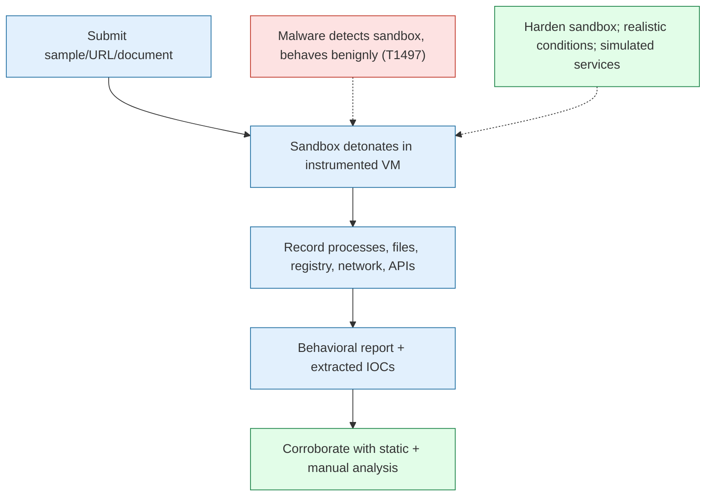

# Sandbox-Based Malware Analysis

## Summary

A malware sandbox is an automated, instrumented environment that **runs a sample and records its behavior** — processes created, files and registry keys touched, network connections, and API calls — producing a behavioral report without a human stepping through the code. Sandboxes make dynamic analysis scalable: feed in thousands of samples, get back structured behavior and extracted indicators. They are central to triage, threat intelligence, and detonation of suspicious attachments/URLs. Their limits define their use: malware that detects the sandbox (virtualization/sandbox evasion, T1497) may behave benignly, samples needing specific conditions (arguments, a C2 that's offline, a particular OS/version) may not fully execute, and time-limited runs miss delayed behavior. The defensive practice is to treat sandbox output as **one strong input, not ground truth**: corroborate with static analysis, harden the sandbox against evasion, provide realistic conditions and simulated network services, and recognize that "no malicious behavior observed" can mean evasion rather than safety. Used well, sandboxes turn slow manual detonation into fast, repeatable, indicator-rich analysis.

## Capabilities and limits

| Aspect | Detail |
|---|---|
| **Captures** | Processes, files, registry, network, API calls → behavioral report |
| **Strength** | Scalable, automated dynamic analysis; indicator extraction |
| **Evasion risk** | Sample detects sandbox and hides (T1497) |
| **Coverage gaps** | Needs right conditions/args; time-limited; offline C2 |
| **Best use** | One input among static + manual analysis, not sole truth |

The governing idea: sandboxes trade depth for scale, so their reports are powerful leads that must be read with their blind spots — above all evasion — in mind.

## Sandbox detonation

## Detection / value

- **Scalable behavior**: automated reports and IOCs for many samples quickly.
- **Detonation**: safely "opens" suspicious attachments/URLs to see what they do.
- **Evasion awareness**: a benign-looking report may reflect sandbox detection (T1497), not safety.
- Behavioral indicators feed signatures, YARA, and network detections.

## Defense / practices

- **Treat reports as leads**, corroborated with static and manual analysis.
- **Harden against evasion**: realistic environment, user-activity simulation, varied configurations.
- **Provide conditions**: arguments, simulated network services, matching OS/versions, adequate run time.
- **Diversify**: multiple sandbox profiles/products reduce blind spots.
- **Operationalize**: extract and deploy IOCs; flag anti-analysis behavior as suspicious.

## ATT&CK mapping

| ID | Name | Tactic |
|---|---|---|
| T1497 | Virtualization/Sandbox Evasion | Discovery, Stealth |

(Sandboxes are defensive analysis tools; T1497 is the adversary behavior that limits them.)

## Explanation

A sandbox is an automatic version of the sealed observation room: instead of a human analyst patiently watching one specimen, a machine drops each sample into an instrumented cage, lets it run, and writes down everything it did — what it spawned, what it rewrote, who it tried to call. Its superpower is volume: you can pour thousands of suspicious files or links through it and get back tidy reports on each, which is why it sits at the heart of modern triage and email-attachment detonation. But it has two honest weaknesses worth remembering. First, clever malware can tell it's in the cage and simply behaves itself, so a clean report sometimes means "it saw the cameras," not "it's harmless." Second, some samples only misbehave under the right conditions — the right command-line, a reachable control server, enough time — and a quick automated run can miss all of that. So the professional reads a sandbox report the way a detective reads a tip: a valuable, fast lead to act on and extract clues from, never the final word, always cross-checked against a closer look.
