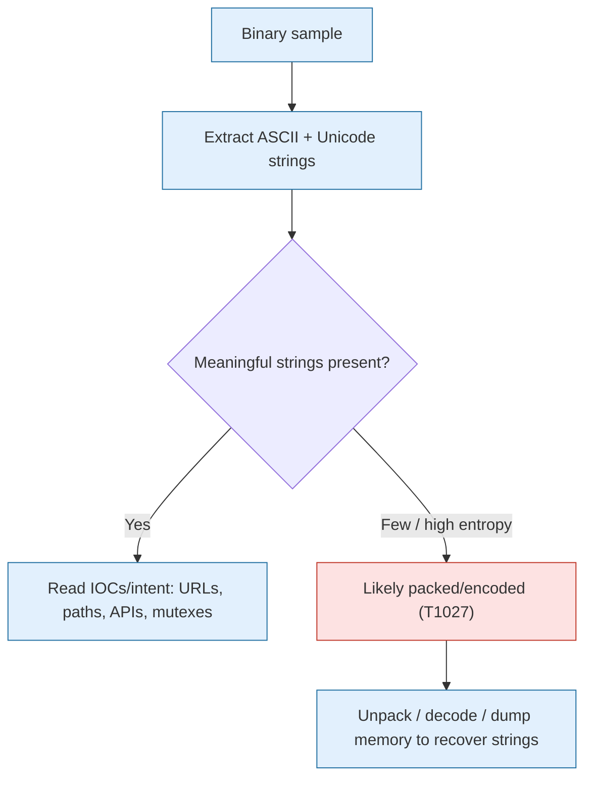

# String Extraction from Binaries

## Summary

Extracting the human-readable text embedded in a binary is one of the fastest, cheapest first steps in static malware analysis. A compiled program carries **strings** — URLs and domains, file paths, registry keys, error and debug messages, command-line arguments, format strings, API names, and sometimes passwords or mutex names — and dumping them (classically with the `strings` utility) can immediately reveal a sample's intent and yield indicators of compromise. Strings come in multiple encodings (ASCII and UTF-16/Unicode, the latter common on Windows), so analysts extract both. The important caveat is that malware often **obfuscates or encrypts its strings** precisely to defeat this (obfuscated files or information, T1027): a sample with suspiciously few meaningful strings, or lots of high-entropy data, is signaling that its real strings are hidden and must be recovered by decoding routines or at runtime in memory. Still, string extraction is high-value triage: it's instant, it frequently surfaces C2 and configuration, and the *absence* of expected strings is itself a clue that the sample is packed or encoded.

## What strings reveal

| String type | Indicates |
|---|---|
| **URLs / domains / IPs** | C2, download, exfil endpoints |
| **File paths / registry keys** | Persistence, drop locations, config |
| **API / DLL names** | Capabilities (network, crypto, injection) |
| **Mutexes / markers** | Infection markers, instance control |
| **Commands / format strings** | Behavior, logging, operator intent |

Two reads matter: the strings that are present (direct indicators and intent) and the strings that are conspicuously missing (a sign of packing or encoding, T1027).

## String triage

## Detection / value

- **Instant IOCs**: URLs, domains, paths, and mutexes often appear directly in strings.
- **Capability hints**: API/DLL names suggest networking, crypto, or injection.
- **Absence is a clue**: too few strings or high entropy indicates packing/encoding (T1027).
- Extracted strings seed YARA rules and detection signatures.

## Defense / practices

- **Extract both ASCII and Unicode** (UTF-16) strings; Windows malware frequently uses the latter.
- **Interpret, don't just dump**: correlate strings with imports and behavior.
- **Recognize obfuscation**: sparse/high-entropy strings mean unpack or decode first, then re-extract.
- **Recover hidden strings** by unpacking, running decode routines, or dumping memory at runtime.
- **Feed detection**: use distinctive recovered strings in YARA and signatures.

## ATT&CK mapping

| ID | Name | Tactic |
|---|---|---|
| T1027 | Obfuscated Files or Information | Stealth |

(String extraction is a defensive analysis step; T1027 is the evasion that hides strings from it.)

## Explanation

The quickest way to get a first impression of a mystery program is to read the bits of plain text baked into it, the way you'd rifle a stranger's pockets for receipts and notes. Programs are full of such text — web addresses they contact, files they create, system functions they borrow, little messages the author left for themselves — and a single command can spill all of it in seconds. Often that's enough to see what the thing is for: a web address no legitimate app would use, a registry key that screams "I install myself to start on boot," the name of a function used only for injecting into other processes. Two subtleties make it an art rather than a chore. First, Windows programs often store text in a wide format, so you have to look for it the right way or you'll miss half of it. Second — and this is the tell experienced analysts love — if you rifle the pockets and find almost nothing readable, that emptiness is loud: the program has deliberately hidden its text, which honest software has no reason to do, and now you know to unwrap it before looking again.
