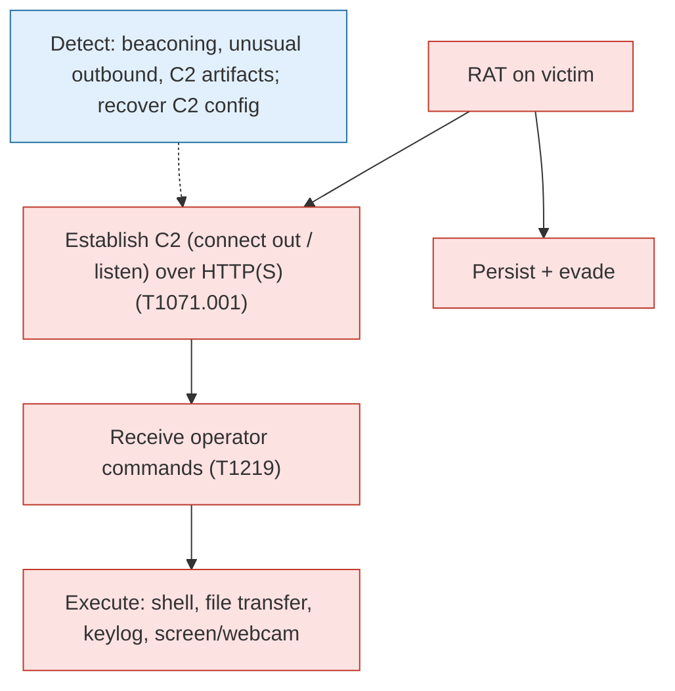

# Backdoors and Remote Access Trojans (RATs)

## Summary

A **backdoor** is malware that gives an attacker covert, persistent access to a system, bypassing normal authentication. A **Remote Access Trojan (RAT)** is a feature-rich backdoor that provides interactive remote control — often file transfer, keylogging, screen/webcam capture, shell access, and plugin modules — effectively a malicious remote-administration tool (remote access tools, T1219). The defining behavior is **command-and-control (C2)**: the RAT connects out to an attacker-controlled server (or listens for connections) and exchanges commands and data, commonly tunneling over ordinary protocols like HTTP/HTTPS to blend in (application layer protocol, T1071; web protocols, T1071.001). RATs typically add **persistence** so they survive reboots and **evasion** so they avoid detection. For detection, the C2 channel is the key surface: beaconing patterns, unusual outbound connections, and distinctive protocol artifacts. Many infamous families (commodity and APT) are RATs, and their analysis centers on recovering the C2 configuration (servers, keys, protocol) and the command set, which reveals both the attacker's reach and the indicators needed to detect and disrupt them.

## RAT characteristics

| Capability | Purpose | Detection surface |
|---|---|---|
| **C2 channel** | Receive commands, send data (T1071) | Beaconing, odd outbound, protocol artifacts |
| **Remote control** | Shell, file transfer, surveillance | Spawned processes, file/registry access |
| **Persistence** | Survive reboot | Autostart, services, tasks |
| **Evasion** | Avoid detection | Obfuscation, injection, anti-analysis |

The crux: a RAT's reason to exist is remote control over a C2 channel, so recovering its C2 configuration and command set is both the analytic goal and the source of detection indicators.

## RAT operation

## Detection / value

- **C2 is the key surface**: beaconing cadence, unusual outbound destinations, and protocol artifacts expose RATs (T1071).
- **Config recovery**: extracting C2 servers, keys, and the command set yields indicators and reveals attacker reach (T1219).
- **Host behavior**: new persistence, injected processes, and surveillance activity (keylog, screen capture) are signals.
- Known-family signatures (YARA) and C2 indicators drive detection and takedown.

## Defense / practices

- **Monitor egress**: baseline normal outbound traffic; flag beaconing and connections to unknown C2.
- **Recover C2 configuration** during analysis for indicators (servers, keys, protocol) and blocking.
- **Hunt persistence and injection**: RATs install autostart and often inject into trusted processes.
- **Block/takedown infrastructure**: use recovered C2 indicators in blocklists and sinkholing.
- **Detect surveillance behavior**: keylogging, screen/webcam capture, and mass file access.

## ATT&CK mapping

| ID | Name | Tactic |
|---|---|---|
| T1219 | Remote Access Tools | Command and Control |
| T1071 | Application Layer Protocol | Command and Control |
| T1071.001 | Application Layer Protocol: Web Protocols | Command and Control |

## Explanation

A backdoor is a secret side entrance an intruder installs so they can come and go without using the front door or showing ID. A Remote Access Trojan is that side entrance upgraded into a full remote-control cockpit: once it's on your machine, the attacker can browse your files, watch your screen, log your keystrokes, switch on your webcam, and run commands, all from anywhere. The whole arrangement hinges on one thing — a private line back to the attacker, the command-and-control channel. The malware dials home and waits for orders, and because an obvious new phone line would be noticed, it usually disguises its calls as ordinary web traffic, hiding in the crowd of normal HTTPS. That disguised phone line is also its weakness and the defender's best target: it has to call out on some rhythm, to some address, in some recognizable way. So analyzing a RAT is largely about prying its address book out of it — which servers it calls, what language it speaks, what commands it understands — because that's exactly what you need to spot it, block it, and cut the line.
