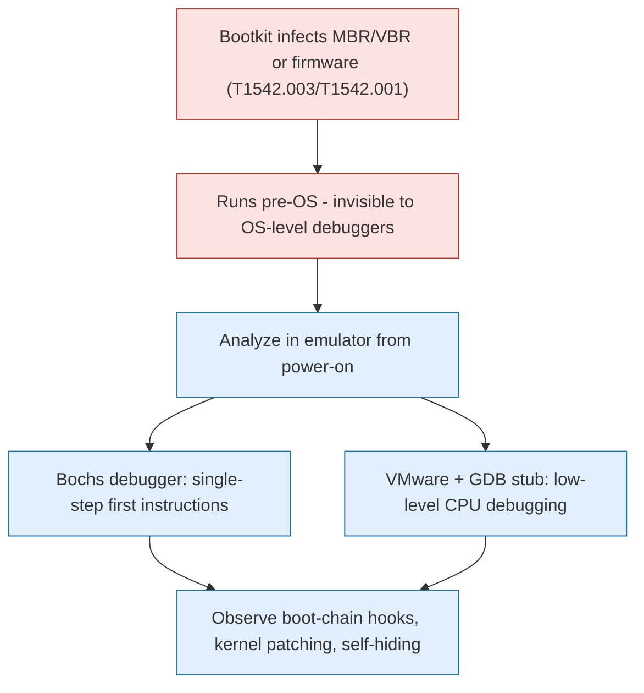

# Bootkit Dynamic Analysis with Emulators (Bochs, VMware GDB)

## Summary

A **bootkit** infects the earliest boot code — the Master Boot Record/Volume Boot Record or, at firmware level, UEFI (bootkit, T1542.003; system firmware, T1542.001) — so it runs *before* the operating system and can subvert it from below. This is exactly what makes bootkits hard to analyze with normal tools: they execute in the pre-OS environment (16-bit real mode for MBR code, or firmware context), where a standard OS-level debugger isn't running yet and can't attach. The solution is to analyze the boot process in an **emulator** that models the machine from power-on. **Bochs** is a full x86 emulator with a built-in debugger that can single-step from the very first instruction the BIOS/firmware hands control to, letting an analyst watch MBR/VBR code execute instruction by instruction. **VMware with a GDB stub** exposes the VM's CPU to a GDB debugger, allowing low-level debugging of early boot inside a virtual machine. The approach lets analysts observe how the bootkit hooks the boot chain, patches the kernel as it loads, and hides itself — behavior invisible to tools that only start once Windows/Linux is already up.

## Why emulators are needed

| Problem | Emulator solution |
|---|---|
| Bootkit runs pre-OS (real mode/firmware) | Emulate from power-on (Bochs) |
| No OS debugger attached yet | Bochs built-in debugger / VMware GDB stub |
| Need to watch boot-chain hooks + kernel patching | Single-step early boot instructions |
| OS-level tools only see post-boot state | Low-level CPU debugging of early stages |

The core reason: a bootkit's whole trick is running before the OS, so you must analyze it with something that also exists before the OS — an emulator that models the machine from the first instruction.

## Early-boot debugging

## Detection / value

- **Pre-OS visibility**: emulators expose boot code that OS-level tools can't see (T1542.003).
- **Hooking revealed**: single-stepping shows how the bootkit intercepts the boot chain and patches the loading kernel.
- **Self-hiding observed**: how the bootkit conceals its on-disk footprint becomes visible during boot.
- Understanding the boot-chain modifications yields detection and remediation guidance.

## Defense / practices

- **Analyze in an emulator from power-on** (Bochs debugger, or VMware with a GDB stub) to reach pre-OS code.
- **Single-step the boot chain** to map hooks, kernel patches, and persistence.
- **Snapshot/compare** clean vs. infected boot sectors/firmware to locate modifications.
- **For firmware bootkits** (T1542.001), combine with firmware-image analysis.
- **Defensive posture**: Secure Boot, boot-integrity measurement, and firmware update controls (see Secure Boot/UEFI security files).

## ATT&CK mapping

| ID | Name | Tactic |
|---|---|---|
| T1542.003 | Pre-OS Boot: Bootkit | Persistence, Stealth |
| T1542.001 | Pre-OS Boot: System Firmware | Persistence, Stealth |

## Explanation

A bootkit's power comes from timing: it seizes control in the first instants after you press the power button, before the operating system — and all its security — has even woken up. That early head start lets it rig the system from beneath, tampering with the OS as it loads and then hiding. But the same timing that makes bootkits dangerous makes them maddening to study, because your usual debugging tools only exist once the OS is running, long after the bootkit has already done its work and covered its tracks. The fix is to analyze the machine with something that, like the bootkit, exists before the OS: an emulator that pretends to be the computer from the very first flicker of power. Tools like Bochs come with a debugger that can freeze the machine on its first instruction and let you step through the boot code one line at a time; VMware can expose its virtual processor to a low-level debugger for the same purpose. Watching the boot unfold in slow motion, you finally see the bootkit do its thing — grab the boot chain, quietly rewrite the kernel as it loads, and tuck itself out of sight.
