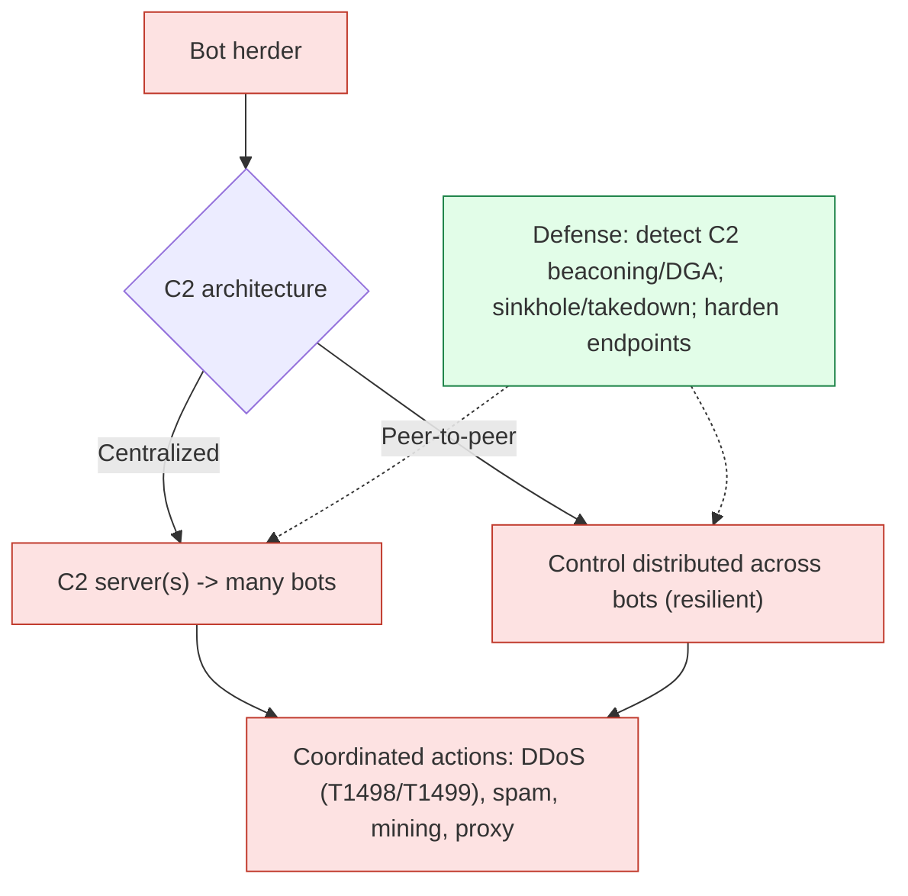

# Botnets

## Summary

A **botnet** is a network of compromised machines ("bots") under the coordinated control of an attacker ("bot herder") via command-and-control infrastructure (adversary-acquired botnet, T1583.005). The power is scale: thousands or millions of bots can be directed at once to launch **distributed denial-of-service** attacks (network and endpoint DoS, T1498, T1499), send spam, mine cryptocurrency, harvest credentials, distribute other malware, or proxy malicious traffic. Botnet **C2 architecture** is the strategic core and the main target for defenders: **centralized** botnets use one or a few C2 servers (simple but a single point of failure), while **peer-to-peer** botnets distribute control across the bots themselves (resilient, no central server to seize). Herders add resilience with domain-generation algorithms (DGAs), fast-flux DNS, and fallback channels. Defensively, botnets are fought at multiple levels: detecting infected hosts (C2 beaconing, DGA-like lookups), disrupting C2 infrastructure (sinkholing, takedowns, seizing domains), and hardening endpoints against the malware that recruits bots. Taking down a resilient P2P botnet is far harder than a centralized one, which is why architecture matters so much.

## Structure and uses

| Aspect | Detail |
|---|---|
| **Control** | Bot herder → C2 → bots (T1583.005) |
| **C2 architecture** | Centralized (single point) vs. P2P (resilient) |
| **Resilience** | DGA, fast-flux DNS, fallback channels |
| **Uses** | DDoS (T1498/T1499), spam, mining, credential theft, malware distribution, proxying |

The decisive variable is C2 architecture: centralized botnets are easier to use *and* to decapitate, while peer-to-peer designs trade simplicity for resilience against takedown.

## Botnet command and control

## Detection / value

- **Host level**: C2 beaconing and DGA-like DNS lookups reveal infected bots.
- **Network level**: coordinated outbound floods (DDoS, T1498/T1499) and spam bursts.
- **Infrastructure**: shared C2 domains/IPs cluster a botnet for takedown.
- Architecture dictates disruption: centralized C2 can be sinkholed/seized; P2P resists it.

## Defense / practices

- **Detect and clean bots**: hunt C2 beaconing, DGA lookups, and known bot malware on endpoints.
- **Disrupt C2**: sinkhole domains, seize/takedown centralized infrastructure, coordinate with providers.
- **Harden endpoints**: patch and control execution to prevent recruitment.
- **Mitigate DDoS**: upstream filtering and capacity for the attacks botnets launch (T1498/T1499).
- **Share intelligence**: botnet C2 indicators and DGA seeds enable coordinated takedowns.

## ATT&CK mapping

| ID | Name | Tactic |
|---|---|---|
| T1583.005 | Acquire Infrastructure: Botnet | Resource Development |
| T1498 | Network Denial of Service | Impact |
| T1499 | Endpoint Denial of Service | Impact |

## Explanation

A botnet is a private army of hijacked computers. Each infected machine — someone's home PC, a hacked router, a neglected server — quietly takes orders from a single commander, the "bot herder," and the herder can tell the whole army to do something at once. That coordinated scale is the weapon: point a million machines at one website and you flood it off the internet; tell them all to send spam, mine cryptocurrency, or relay the attacker's traffic, and you've industrialized crime. The most important question about any botnet is how the commander talks to the troops. The simple design routes everything through a central headquarters — easy to run, but if defenders find and seize that headquarters, the army goes silent. The cleverer design has no headquarters at all; the bots pass orders among themselves like a rumor through a crowd, so there's nothing central to capture, which makes such botnets painfully hard to kill. That's why fighting botnets happens on several fronts at once: cleaning the infected machines, cutting off the command channels, and bracing for the floods the army can unleash.
