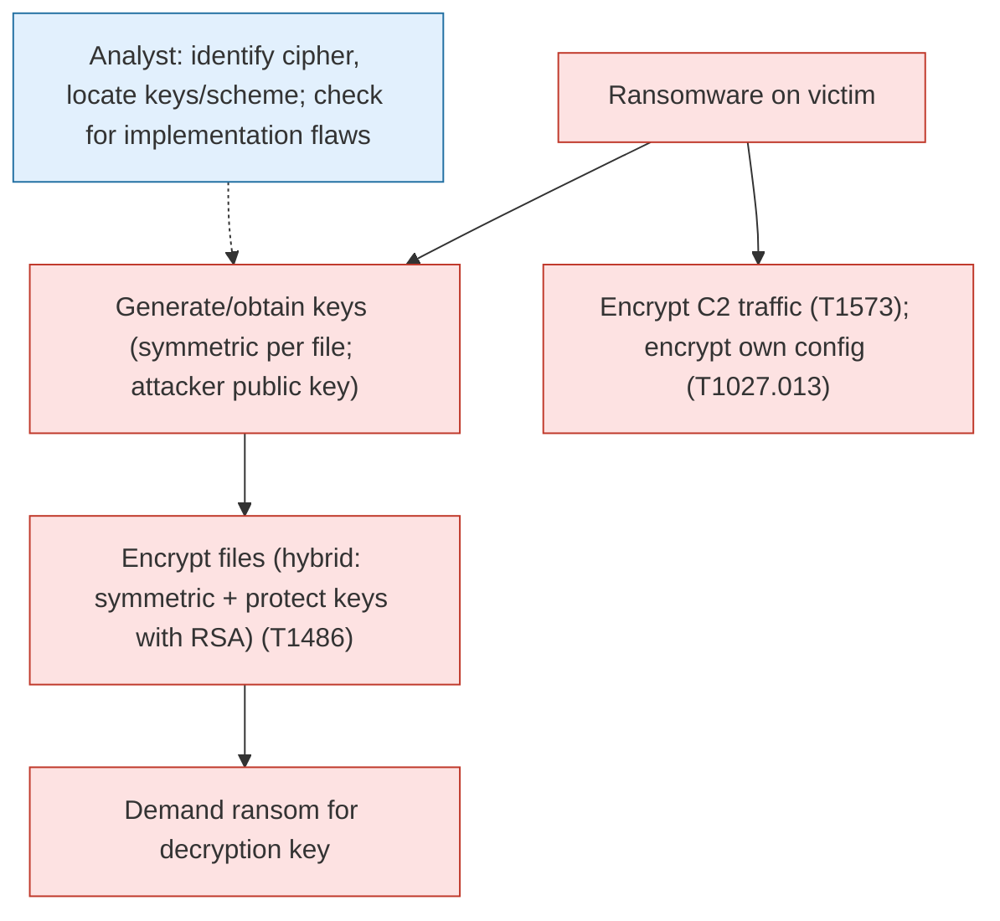

# Cryptography Abuse by Malware

## Summary

Malware uses the same cryptography that protects defenders — turned to offensive ends. Three main abuses recur. **Destructive encryption**: ransomware encrypts victim files (often hybrid: a fast symmetric cipher per file, with the symmetric keys protected by the attacker's public key) so only the attacker can decrypt (data encrypted for impact, T1486); done correctly, recovery without the key is infeasible, which is the whole extortion model. **Encrypted C2**: malware encrypts its command-and-control traffic (encrypted channel, T1573) to evade network inspection and hide commands and stolen data. **Protecting its own secrets**: malware encrypts strings, configuration, and payloads to defeat static analysis (encrypted/encoded file, T1027.013). The analyst's leverage is that malware must carry the means to use its crypto: a ransomware sample contains the public key or key-exchange logic and the encryption routine; a C2 channel's keys and algorithm live in the binary or are derived at runtime. Identifying the cipher (RC4, AES, ChaCha, RSA), locating keys, and understanding the scheme are central to both analysis and — occasionally, when the implementation is flawed — recovery.

## Crypto abuses

| Abuse | Purpose | ATT&CK |
|---|---|---|
| **File encryption** | Extortion; deny access to data | T1486 |
| **Encrypted C2** | Hide commands/stolen data from inspection | T1573 |
| **Config/string/payload encryption** | Defeat static analysis | T1027.013 |

The analyst's foothold: whatever the abuse, the sample must carry keys, algorithms, or key-exchange logic to use crypto — so identifying the cipher and locating the key material is the path into both understanding and, when the scheme is weak, recovery.

## Crypto in a ransomware flow

## Detection / value

- **Crypto routines as capability**: use of CryptoAPI/known cipher constants signals encryption capability (ransomware, C2, or config).
- **Encrypted C2** (T1573) evades payload inspection but still has metadata/beaconing to detect.
- **Config recovery**: finding keys/algorithms decrypts strings and config (T1027.013), exposing indicators.
- **Occasional recovery**: flawed key handling (reused keys, weak RNG, local key retention) can enable decryption without paying (T1486).

## Defense / practices

- **Identify the cipher and scheme** (symmetric/asymmetric/hybrid) and locate key material during analysis.
- **Check for implementation flaws**: weak RNG, hardcoded/reused keys, or keys left in memory can enable recovery.
- **Decrypt config/strings** (T1027.013) to recover indicators.
- **Detect encrypted C2** (T1573) via metadata, JA3/TLS fingerprinting, and beaconing, not payload content.
- **For ransomware** (T1486): prioritize backups and prevention; sound crypto means post-hoc decryption is usually impossible.

## ATT&CK mapping

| ID | Name | Tactic |
|---|---|---|
| T1486 | Data Encrypted for Impact | Impact |
| T1573 | Encrypted Channel | Command and Control |
| T1027.013 | Obfuscated Files or Information: Encrypted/Encoded File | Stealth |

## Explanation

Encryption is a neutral tool — a lock — and malware uses locks for its own ends. The cruelest use is ransomware: it locks up all your files with a key only the attacker holds, so your data is still right there but utterly unreadable, and the ransom buys the key. Well-built ransomware does this the same clever way banks do, using a fast lock for the bulk of the data and then locking *that* key inside the attacker's personal safe, so there's no shortcut back in. Malware also uses encryption to hide its conversations with its masters, scrambling its network chatter so inspectors can't read the commands or the stolen data flowing past, and to hide its own secrets, encrypting its settings and strings so an analyst can't just read them off. The attacker's unavoidable problem — and the analyst's opening — is that to *use* a lock you must carry a key or the means to make one, and those travel with the malware. So the analyst hunts the cipher and the keys, because finding them decrypts the malware's secrets, and now and then, when the criminals botch the locksmithing, even frees the hostages without paying.
