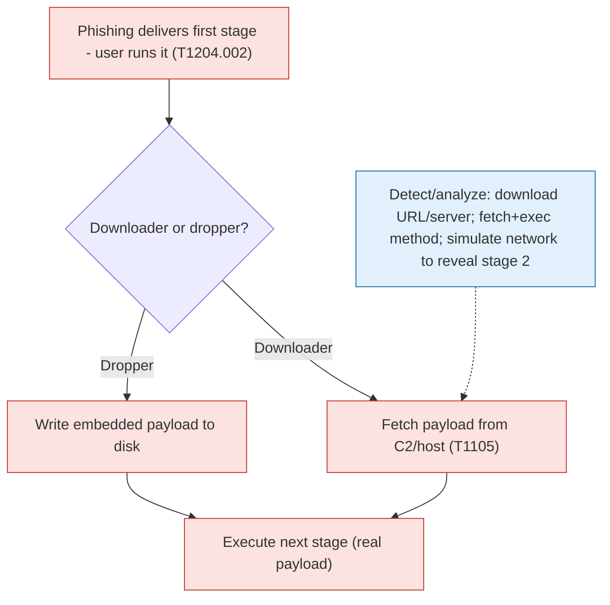

# Downloaders and Launchers

## Summary

**Downloaders** and **launchers** (droppers) are small, first-stage malware whose job is to get the *real* payload onto and running on a system — the opening move in a multi-stage attack. A **downloader** retrieves a further payload from a remote server and executes it (ingress tool transfer, T1105); a **dropper/launcher** carries an embedded payload, writes it out, and launches it. Splitting malware this way benefits the attacker: the first stage is small and disposable, the heavy payload is delivered only after initial access succeeds (often only to validated targets), and the payload can be swapped server-side without changing the delivered lure. First stages commonly arrive via phishing and rely on the user to run them (user execution: malicious file, T1204.002), then pull the next stage over HTTP(S). For analysis and detection, the key facts are the **download URL/server** and how the next stage is fetched and executed — which yield indicators and reveal the staging infrastructure. A benign-looking first stage that "does nothing" in a sandbox often simply failed to reach its download server; providing simulated network services lets it reveal the second stage.

## First-stage roles

| Type | What it does | ATT&CK |
|---|---|---|
| **Downloader** | Fetch payload from remote server, run it | T1105 |
| **Dropper/launcher** | Carry embedded payload, write + execute | T1105 (local), execution |
| **Delivery** | Often phishing + user runs it | T1204.002 |

The staging logic: keep the first move small, cheap, and swappable, and deliver the real weapon only once a foothold is confirmed — so the download URL and fetch-and-run mechanism are the indicators that matter.

## Staged delivery

## Detection / value

- **Staging infrastructure**: download URLs/servers are high-value indicators (T1105).
- **Fetch-and-execute behavior**: a small binary that downloads and runs code is inherently suspicious.
- **Sandbox nuance**: a first stage that "does nothing" may have failed to reach its server — simulate network to reveal stage two.
- Delivery via malicious files relying on user execution (T1204.002) is a detection and awareness surface.

## Defense / practices

- **Recover the download URL/server** and next-stage fetch method during analysis for indicators.
- **Simulate network services** so downloaders retrieve and reveal their second stage offline.
- **Block staging infrastructure** (download domains/IPs) and known first-stage hashes.
- **Control execution**: application control and macro/script restrictions blunt first-stage execution (T1204.002).
- **Monitor for fetch-and-run patterns**: small processes making outbound requests then spawning new code.

## ATT&CK mapping

| ID | Name | Tactic |
|---|---|---|
| T1105 | Ingress Tool Transfer | Command and Control |
| T1204.002 | User Execution: Malicious File | Execution |

## Explanation

Serious malware rarely arrives in one piece. The thing that first lands on your machine is usually a small, unassuming advance scout whose only mission is to bring in the real troops. There are two flavors. One is a courier that, once it's in, phones a server and downloads the actual weapon (a downloader). The other smuggles the weapon inside itself, unpacks it, and sets it loose (a dropper). Attackers love this split for practical reasons: the scout is cheap and throwaway, the real payload only shows up after the break-in has worked — often only for victims worth the trouble — and they can quietly swap the payload on their server without reprinting the lure. For a defender, the scout's most useful secret is the address it fetches from: that download server is both a clue and a chokepoint. There's a common trap in analysis, too — a scout dropped in a sandbox may appear to "do nothing," not because it's harmless but because it couldn't reach its supply depot. Give it a fake depot to call, and it cheerfully hauls in the real payload for you to see.
