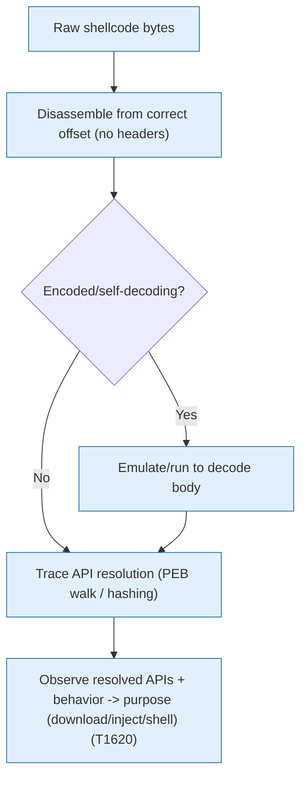

# Shellcode Analysis

## Summary

**Shellcode** is a small chunk of position-independent machine code designed to run as an injected payload — classically the code an exploit executes after hijacking control flow, and more broadly the raw code that loaders, injectors, and in-memory malware run directly (reflective/in-memory execution, T1620; injected into another process, T1055). Because it must run anywhere it lands, shellcode can't rely on a loader to resolve its imports or fix up addresses, so it does these jobs itself: it finds needed libraries and functions at runtime (commonly by walking the PEB and parsing export tables, or by API hashing to avoid readable names), computes its own position (e.g. GetPC tricks), and often decodes an encoded body before running. Analysis is therefore distinct from analyzing a normal executable: there are no headers or import tables to read, just bytes that must be disassembled from the right offset and usually executed or emulated to understand. Analysts use shellcode emulators and debuggers to run it safely and observe the APIs it resolves and calls, which reveals its true purpose (download, inject, spawn a shell). API-hashing and self-decoding are the recurring hallmarks.

## Shellcode traits and analysis

| Trait | Why | Analysis approach |
|---|---|---|
| **Position-independent** | Runs wherever injected (T1055) | Disassemble from correct offset |
| **Self-resolves APIs** | No loader/import table | Trace PEB walk / API hashing |
| **Self-locating (GetPC)** | Find its own address | Recognize GetPC idioms |
| **Often self-decoding** | Evade static detection | Emulate/run to reveal decoded body |

The defining challenge: shellcode is code without the scaffolding (headers, imports) analysts normally lean on, so understanding it means emulating or running it and watching which APIs it resolves and calls.

## Analyzing shellcode

## Detection / value

- **Reveals payload intent**: resolved APIs and behavior show whether shellcode downloads, injects (T1055), or spawns a shell.
- **Hallmarks as signals**: API hashing, PEB walking, GetPC idioms, and self-decoding mark code as shellcode.
- **In-memory focus**: shellcode often runs reflectively (T1620), so memory analysis and emulation are key.
- Distinctive decoders and API-hash constants seed YARA detection.

## Defense / practices

- **Emulate/run safely**: use a shellcode emulator or debugger to resolve its behavior without full infection.
- **Find the right entry offset**: shellcode has no headers; disassemble from where execution actually begins.
- **Trace API resolution**: follow PEB walking/API hashing to learn which functions it uses.
- **Decode first**: self-decoding shellcode must run/emulate to reveal its real body.
- **Detect hallmarks**: API-hash constants, GetPC patterns, and decoder stubs in memory and files.

## ATT&CK mapping

| ID | Name | Tactic |
|---|---|---|
| T1620 | Reflective Code Loading | Stealth |
| T1055 | Process Injection | Privilege Escalation, Stealth |

## Explanation

Shellcode is the bare-knuckle version of a program: a compact blob of machine code built to be dropped anywhere and just run, with none of the usual packaging. A normal program arrives with a manifest — headers that say where everything is and a list of the system functions it needs, which the operating system kindly wires up on launch. Shellcode gets none of that help, because it's meant to land in the middle of someone else's process after an exploit or an injection. So it has to be self-reliant in ways that leave fingerprints: it figures out where it is in memory with little tricks, it hunts down the system functions it needs on its own (often referring to them by scrambled hash values so there are no readable names to spot), and it frequently arrives encrypted and unpacks itself first. For the analyst this flips the usual approach — there's no manifest to read, just a run of bytes — so you typically let it execute in a safe emulator and watch which system functions it goes looking for. That list of functions is the confession: it tells you whether this little blob is here to download more malware, burrow into another process, or hand the attacker a command prompt.
