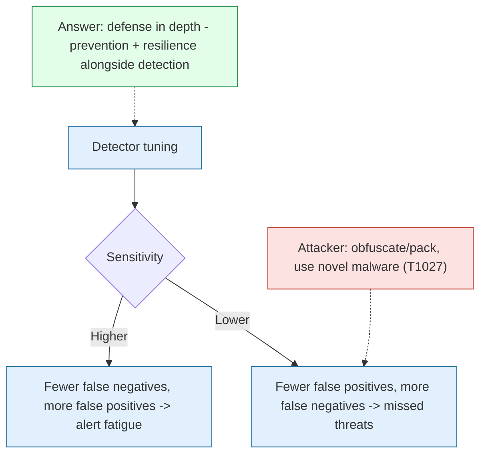

# Limits of Detection-Based Defence (False Positives and Negatives)

## Summary

Detection — spotting malicious files or behavior — is essential but fundamentally **imperfect**, and understanding its limits shapes sound defense. Every detector makes two kinds of error: **false negatives** (missing real malware) and **false positives** (flagging benign activity). These trade off: tuning a detector to catch more threats (fewer false negatives) typically raises false positives, and vice versa. The costs are real on both sides — a missed threat is a breach, but excessive false positives cause **alert fatigue**, wasted analyst time, and desensitization that lets real alerts slip through. Attackers actively widen the gap: obfuscation, packing, and polymorphism (T1027) defeat static signatures, and novel/zero-day malware has no signature at all, guaranteeing false negatives until detection catches up. The **base-rate** problem compounds this: when malicious events are rare relative to benign ones, even an accurate detector produces many false alarms in absolute terms. The sound conclusion is **defense in depth**: detection is one layer, not a guarantee, and must be paired with prevention (reducing attack surface, hardening, least privilege) and resilience (backups, segmentation, incident response), because some malicious activity will always evade detection.

## Why detection is imperfect

| Limit | Consequence |
|---|---|
| **False negatives** | Real malware missed (novel, obfuscated — T1027) |
| **False positives** | Benign flagged → alert fatigue, wasted effort |
| **Trade-off** | More sensitivity ↔ more false positives |
| **Base-rate problem** | Rare threats → many false alarms in absolute terms |
| **Evasion** | Attackers obfuscate/pack to defeat signatures (T1027) |

The takeaway: no detector is perfect, both error types cost, and attackers deliberately push defenders toward missing threats — so detection must be a layer, not the whole plan.

## The detection trade-off

## Detection / value

- **Know the error modes**: both false negatives (breaches) and false positives (fatigue) carry cost.
- **Base rates matter**: rare threats mean even good detectors generate many absolute false alarms — tune and triage accordingly.
- **Evasion is active**: obfuscation and novel malware (T1027) guarantee some misses.
- Measuring real false-positive/negative rates on realistic data is essential to trust a detector.

## Defense / practices

- **Adopt defense in depth**: detection plus prevention (hardening, least privilege, patching) plus resilience (backups, segmentation, IR).
- **Tune to context**: balance sensitivity against alert volume for your environment and base rates.
- **Reduce alert fatigue**: prioritize, correlate, and automate triage so real alerts aren't buried.
- **Assume evasion**: design so that a missed detection isn't a total compromise.
- **Measure honestly**: track false-positive/negative rates and detector drift over time.

## ATT&CK mapping

| ID | Name | Tactic |
|---|---|---|
| T1027 | Obfuscated Files or Information | Stealth |

(This is a defensive concept; obfuscation, T1027, is a primary driver of false negatives.)

## Explanation

It's tempting to think of malware detection as a smoke alarm that simply goes off when there's fire, but every detector is really a nervous guard making judgment calls, and it gets two kinds of things wrong. Sometimes it waves through a genuine threat (a false negative) — a breach. Sometimes it yells about something harmless (a false positive) — and a guard who cries wolf all day trains everyone to ignore him, so the one real warning gets lost in the noise. These two mistakes pull against each other: make the guard twitchier to catch more threats and he'll raise far more false alarms, and vice versa. Attackers lean on this on purpose, disguising their malware so it slips past, and brand-new threats have no description to match at all, so some misses are guaranteed. There's even a statistical trap: when real attacks are rare, a pretty-good detector still buries you in false alarms simply because there's so much normal activity to misjudge. The honest conclusion isn't to abandon detection but to stop treating it as a force field. It's one layer. You pair it with keeping attackers out in the first place and with being able to survive the ones who get through — because something always will.
