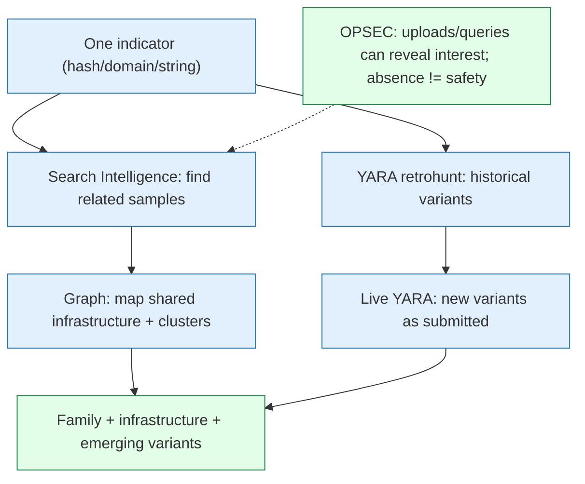

# VirusTotal Intelligence, Graph and YARA Hunting

## Summary

VirusTotal is a large aggregation service that scans submitted files and URLs with many antivirus engines and tools, building a vast corpus of samples and their metadata. Beyond simple multi-engine lookups, its intelligence capabilities turn that corpus into a threat-hunting platform. **Search/Intelligence** lets analysts query the corpus by rich criteria — hashes, detection names, file properties, embedded strings, behaviors, submission metadata — to find related samples and pivot across a campaign. **Graph** visualizes relationships between samples, domains, IPs, and other artifacts, exposing clusters and shared infrastructure. **Retrohunt/live YARA hunting** runs an analyst's YARA rules across the historical corpus and against newly submitted samples, so a well-crafted rule surfaces past and future variants of a family automatically. The practical value is pivoting and early warning: from one indicator you discover the family, its infrastructure, and new variants as they appear. The important caveats are **operational security** (uploading a sample or even querying can reveal interest to adversaries who monitor the platform) and that results reflect only what has been submitted — absence is not proof of safety.

## Capabilities

| Capability | Use |
|---|---|
| **Multi-engine scan** | Quick known/unknown and detection names |
| **Search/Intelligence** | Query corpus; pivot across related samples |
| **Graph** | Visualize sample ↔ domain ↔ IP relationships |
| **Retrohunt / live YARA** | Hunt historical + new samples with YARA rules |

The leverage is pivoting: one indicator expands into a family, its infrastructure, and a stream of new variants — tempered by the reality that results cover only submitted data and that activity on the platform can tip off adversaries.

## Pivoting and hunting

## Detection / value

- **Pivoting**: one indicator expands to a family and its infrastructure across the corpus.
- **Relationship mapping**: Graph exposes shared domains/IPs tying a campaign together.
- **Early warning**: live YARA hunting surfaces new variants automatically as they're submitted.
- **Caveats**: results reflect only submitted data; platform activity can alert adversaries.

## Defense / practices

- **Pivot from indicators** to related samples and infrastructure for fuller campaign understanding.
- **Hunt with YARA** (retrohunt + live) to catch historical and emerging variants.
- **Mind OPSEC**: uploading sensitive samples or querying can reveal your interest; use private handling when needed.
- **Corroborate**: "not seen / not detected" is not proof of safety.
- **Operationalize findings**: feed discovered indicators into detections and blocklists.

## Explanation

VirusTotal started as a simple second opinion — upload a file, see what dozens of antivirus engines think — but its real power is as a giant, searchable memory of malware the whole community has encountered. For a hunter, that memory becomes a map. Start with a single clue, say one suspicious file's fingerprint, and you can search the corpus for anything resembling it, then pull up a visual web connecting that sample to the servers it talks to, the other files that share those servers, and the broader cluster of a campaign — turning one thread into the whole tapestry. Even better, you can hand it a YARA rule describing a family and ask it to sweep both the entire history of submissions and every new file that arrives, so variants you've never seen announce themselves to you automatically. Two cautions keep this honest. First, the platform only knows what people have uploaded, so silence there doesn't mean something is safe. Second, sophisticated adversaries watch it too — uploading their malware, or even searching for it, can quietly tell them you're onto them, which sometimes means looking without touching.

## ATT&CK mapping

No single ATT&CK technique; VirusTotal Intelligence is a defensive threat-hunting platform. The techniques of the samples it surfaces are documented in their own files.
