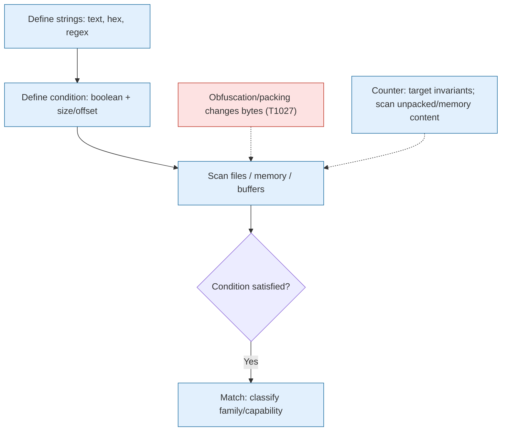

# YARA Rules

## Summary

YARA is a pattern-matching tool and rule language for identifying and classifying malware by content. A **rule** describes a set of **strings** (text, hex byte sequences, or regular expressions) and a **condition** (a boolean expression combining those strings and other criteria like file size or offsets) that, when satisfied, marks a file (or process memory, or network buffer) as a match. Analysts write YARA rules to detect a specific sample, a whole family (by a shared decryptor, mutex, or unique code), or a capability, and to hunt across large repositories and live systems. YARA's strengths are precision and shareability: a good rule expresses exactly what makes a family recognizable, is human-readable, and travels well between teams and tools. Its limits stem from being content-based: obfuscation, packing, and polymorphism (obfuscated files or information, T1027) change the bytes a rule keys on, so rules must often target invariants (unpacked code, decryptor logic, structural features) or run against unpacked/memory content rather than the packed file. Writing effective rules balances **specificity** (avoid false positives) against **generality** (catch variants) — too tight misses variants, too loose floods on benign files.

## Rule anatomy

| Part | Role |
|---|---|
| **Strings** | Text, hex/byte patterns, or regex to look for |
| **Condition** | Boolean logic over strings + file/offset/size criteria |
| **Metadata** | Author, family, reference, date |
| **Targets** | Files, process memory, network buffers |

The craft lives in the condition: it must capture what truly distinguishes a family while tolerating variant drift — specific enough to avoid false positives, general enough to catch relatives.

## Matching with YARA

## Detection / value

- **Family/capability classification**: rules label samples and hunt across corpora and endpoints.
- **Shareable precision**: human-readable rules express and transfer detection knowledge between teams.
- **Memory and unpacked scanning** catches what packed-file scanning misses (counters T1027).
- Distinctive strings, decryptor logic, and structural features make durable rule anchors.

## Defense / practices

- **Target invariants**: write rules on unpacked code, decryptor logic, mutexes, and structure, not mutable packed bytes.
- **Scan the right content**: run rules against memory and unpacked payloads for packed/obfuscated samples (T1027).
- **Balance specificity vs. generality**: specific enough to avoid false positives, general enough to catch variants.
- **Test rules** against benign corpora to measure false positives before deployment.
- **Share and version** rules with metadata for collaboration and maintenance.

## ATT&CK mapping

| ID | Name | Tactic |
|---|---|---|
| T1027 | Obfuscated Files or Information | Stealth |

(YARA is a defensive detection tool; obfuscation/packing, T1027, is the main thing that complicates content-based rules.)

## Explanation

YARA is how analysts turn "I know this malware when I see it" into something a computer can check automatically and a colleague can reuse. A rule is basically a description of telltale signs: these particular bits of text or byte sequences, combined with a logical recipe like "if at least three of these appear and the file is under a megabyte." Point YARA at a pile of files, a running process's memory, or network traffic, and it flags whatever matches. Done well, a rule captures exactly what makes a malware family recognizable — a unique decryption routine, a distinctive marker, an odd structure — in a form that's readable by humans and portable across tools and teams, which is why YARA is the lingua franca of malware hunting. The eternal tension is how tightly to draw the description. Too specific and it only catches the one sample you had, missing every cousin; too loose and it starts screaming at innocent files. And because malware deliberately scrambles its own bytes, the smart move is often to describe the signs that survive the disguise — the behavior-bearing code that shows up once the sample unpacks itself in memory — rather than the shifting wrapper.
