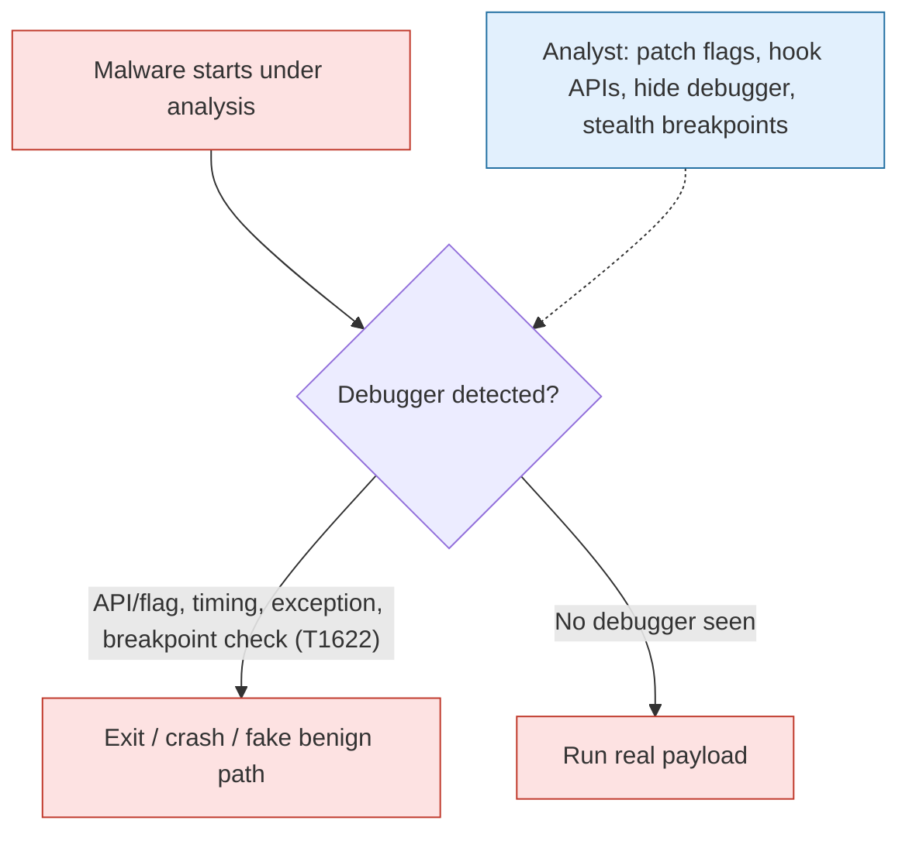

# Anti-Debugging Techniques

## Summary

When static analysis stalls, analysts attach a debugger to step through malware as it runs — so malware authors add **anti-debugging** checks that detect a debugger's presence and respond by exiting, crashing, or diverging into harmless behavior (debugger evasion, T1622). The techniques exploit the observable differences between a normally running process and one under a debugger. Common families: **API/flag checks** (`IsDebuggerPresent`, `CheckRemoteDebuggerPresent`, the PEB `BeingDebugged` flag, `NtGlobalFlag`), **timing checks** (a debugger makes single-stepping slow, so large deltas between two timestamps imply a debugger), **exception-based tricks** (malware raises exceptions it expects to handle itself; a debugger that swallows them reveals itself), and **breakpoint detection** (scanning its own code for the `0xCC` software-breakpoint byte, or checking hardware debug registers). For the analyst, the counter is to recognize the check and neutralize it — patch the flag, hook the API, hide the debugger, or set breakpoints that the check can't see. As with other anti-analysis, the presence of heavy anti-debugging is itself a strong indicator of malicious, deliberately protected code.

## Technique families

| Family | Example | Analyst counter |
|---|---|---|
| **API / flag checks** | `IsDebuggerPresent`, PEB `BeingDebugged`, `NtGlobalFlag` | Patch flag; hook API to return false |
| **Timing checks** | RDTSC / `GetTickCount` deltas across a region | Keep steps fast; patch out the check |
| **Exception-based** | Self-handled exceptions, `INT 3`, `INT 2D` | Pass exceptions to the app; configure debugger |
| **Breakpoint detection** | Scan code for `0xCC`; check debug registers | Use hardware/stealth breakpoints; hide registers |

The common thread: each check keys off a visible side effect of debugging, so each has a specific neutralization — and routine heavy anti-debugging marks a sample as deliberately protected.

## Anti-debugging flow

## Detection / value

- **Anti-debugging as a signal**: calls to `IsDebuggerPresent`/`CheckRemoteDebuggerPresent`, PEB flag reads, and RDTSC timing patterns indicate protected, likely malicious code (T1622).
- **Analysis impact**: naive debugging triggers the check and hides behavior, so analysts must anticipate and neutralize these.
- Self-code scanning for `0xCC` and debug-register reads are observable behaviors.

## Defense / practices

- **For analysts**: identify the technique, then patch flags, hook/false the checks, use a stealth or hardware-assisted debugger, and route exceptions to the sample.
- **Static first**: find anti-debug logic statically so you know what to defeat before running.
- **Combine tools**: emulation and instrumentation can bypass some checks that a plain debugger triggers.
- **Treat as IOC**: for detection engineering, flag binaries that call known anti-debug APIs or embed timing/exception tricks.

## ATT&CK mapping

| ID | Name | Tactic |
|---|---|---|
| T1622 | Debugger Evasion | Discovery, Stealth |

## Explanation

A debugger is the analyst's way of slowing a program to a crawl and watching it think, one instruction at a time — so malware learns to feel the hand that slows it. The simplest tells are almost comical: Windows literally offers a function called `IsDebuggerPresent`, and lazy malware just asks. More cunning samples measure time: stepping through code in a debugger is glacially slow compared to running free, so if the clock shows that a stretch of code "took" far too long, a debugger must be stretching it out. Others lay little traps — they throw an error on purpose, expecting to catch it themselves; if the debugger grabs the error instead, the malware knows someone is watching. And some read their own body looking for the tiny `0xCC` byte a debugger secretly injects to pause execution. Each trick is a tell, and each tell has a countermove — lie to the check, hide the debugger, step faster. But the deepest point is the same as always: a program that fights this hard not to be watched is telling you, by its very resistance, that it has something to hide.
