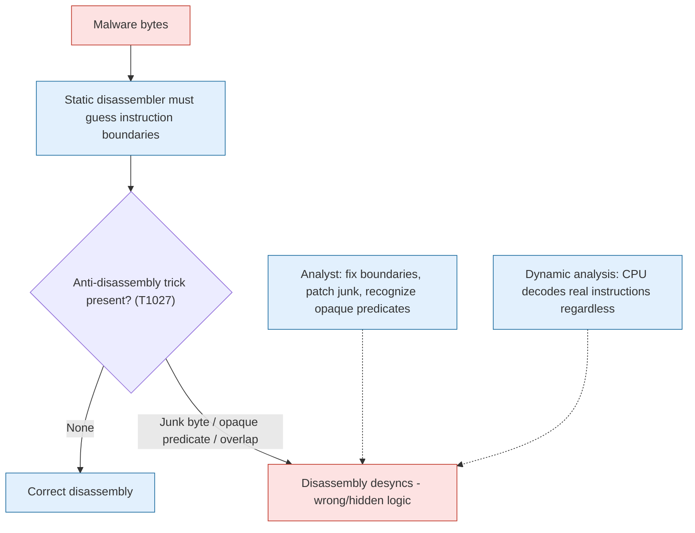

# Anti-Disassembly Techniques

## Summary

Before an analyst can understand malware, a disassembler must turn its bytes back into instructions — so malware authors craft code that **disassembles incorrectly**, hiding the real logic in plain sight (a form of obfuscated files or information, T1027). The techniques exploit the fact that x86 instructions are variable-length and that disassemblers must *guess* where instructions begin. **Linear-sweep** disassemblers decode byte after byte and can be fooled by junk bytes; **recursive-descent** disassemblers follow control flow and can be fooled about where that flow goes. Classic tricks: inserting a bogus byte after a jump that always skips it (so the disassembler decodes the junk and desynchronizes), **opaque predicates** (branches that look conditional but always go one way, hiding dead code or confusing flow), **overlapping instructions** (the same bytes decode differently depending on where you start), and **jumps into the middle of instructions**. The analyst's counters are to force correct instruction boundaries, recognize the pattern, patch out the junk, and lean on dynamic analysis, where the CPU — unlike the disassembler — always decodes correctly.

## Technique families

| Technique | Effect on disassembly | Counter |
|---|---|---|
| **Junk/rogue bytes after jumps** | Desyncs linear sweep; decodes garbage | Mark real flow; patch out junk |
| **Opaque predicates** | Fake conditional hides dead code / confuses flow | Recognize always-taken branch; simplify |
| **Overlapping instructions** | Same bytes decode two ways | Force boundary; trace dynamically |
| **Jump into mid-instruction** | Hides the true instruction stream | Follow actual target; re-disassemble |

The key insight: these tricks attack the disassembler's assumptions, not the CPU. At runtime the processor always decodes the real instructions, so dynamic analysis cuts through what confuses a static view.

## How it confuses analysis

## Detection / value

- **Anti-disassembly as a signal**: unreachable conditional branches, bytes that decode as instructions crossing jump targets, and disassembly that "falls apart" indicate deliberate obfuscation (T1027).
- **Analysis impact**: a clean-looking disassembly can be wrong; analysts must verify boundaries and corroborate with execution.
- Tools that disagree (linear vs. recursive) on the same bytes flag likely anti-disassembly.

## Defense / practices

- **Recognize the patterns**: junk after unconditional jumps, always-true/false predicates, and overlapping/mid-instruction jumps.
- **Force correct boundaries** in the disassembler and patch out rogue bytes to re-synchronize.
- **Corroborate dynamically**: run or emulate; the CPU decodes the true instruction stream.
- **Cross-check tools**: compare linear-sweep and recursive-descent output to spot manipulation.
- **Treat as IOC**: for triage, obfuscation that breaks disassembly marks a sample as deliberately protected.

## ATT&CK mapping

| ID | Name | Tactic |
|---|---|---|
| T1027 | Obfuscated Files or Information | Stealth |

## Explanation

Reading a compiled program means turning raw bytes back into instructions, and on x86 that's trickier than it sounds because instructions come in different lengths and the disassembler has to guess where each one starts. Anti-disassembly is the art of making it guess wrong. The classic trick is to put a jump that always fires, and right after it a single stray byte that no one will ever execute — but the disassembler, reading straight ahead, swallows that byte, miscounts, and from then on decodes everything shifted by one, producing gibberish that hides the real code. Other tricks are sneakier still: the same run of bytes can spell one set of instructions if you start reading here and a completely different set if you start one byte over, so the "true" program is hidden inside the "fake" one depending on where the eye lands. The reassuring part is that none of this fools the actual processor, which always knows exactly where each instruction begins when the code runs for real. So the analyst's escape hatch is to stop staring at the static bytes and watch the thing execute, letting the CPU reveal the instructions the disassembler couldn't.
