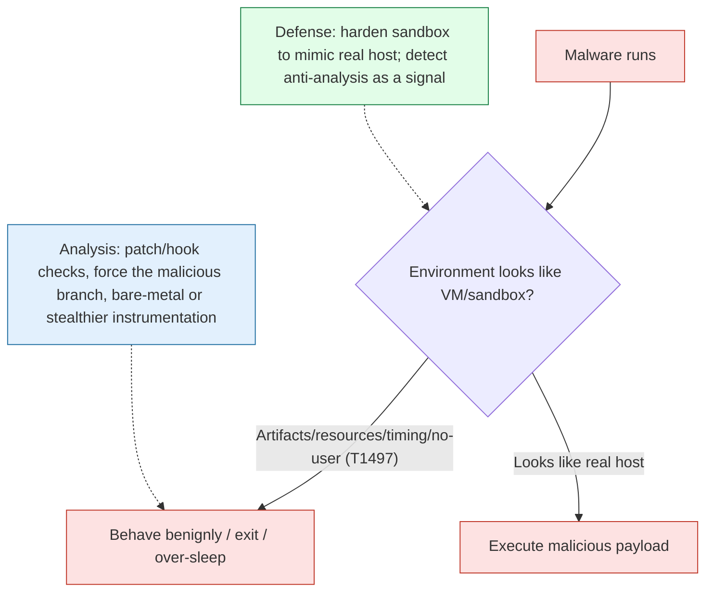

# Anti-VM and Sandbox Evasion

## Summary

Automated malware analysis relies on running a sample in an instrumented virtual machine or sandbox and watching what it does. Malware authors fight back by making their code **detect that it is being analyzed** and behave benignly — or not run at all — when it thinks it is in a VM or sandbox (virtualization/sandbox evasion, T1497). The checks fall into recognizable groups: **environment artifacts** (VM-specific drivers, registry keys, MAC address ranges, process names like analysis tools; system checks, T1497.001), **resource and timing cues** (too few CPU cores, small disk/RAM, no user activity, or time that behaves oddly under instrumentation; time-based checks, T1497.003), and **user-interaction checks** (no mouse movement, no recent documents). When a sample sees these, it may exit, sleep past the sandbox's time budget, or branch to harmless behavior, so the analyst sees nothing malicious. For defenders and analysts the response is twofold: **harden the analysis environment** to look like a real, used machine, and treat evasion itself as a strong signal — code that checks hard for a VM is suspicious by definition.

## Evasion check categories

| Category | Example checks | ATT&CK |
|---|---|---|
| **Environment artifacts** | VM drivers/services, registry keys, MAC OUI, analysis-tool process names | T1497.001 |
| **Resource cues** | CPU core count, RAM/disk size, screen resolution | T1497.001 |
| **Timing** | Sleep-skipping detection, RDTSC deltas, overall time budget | T1497.003 |
| **User interaction** | Mouse movement, recent files, uptime, number of processes | T1497 |

The analyst's counter-move: make the sandbox indistinguishable from a real, lived-in workstation, and remember that aggressive environment-checking is itself an indicator of malicious intent.

## Evasion decision flow

## Detection / value

- **Evasion as a signal**: code that hunts for VM artifacts, checks timing, or looks for user activity is itself suspicious (T1497).
- **Blind spots**: a sample that detects the sandbox hides its real behavior, so "nothing happened" may mean evasion, not safety.
- Timing anomalies (over-long sleeps, RDTSC checks) and queries for VM-specific artifacts are observable during dynamic analysis.

## Defense / practices

- **Harden the sandbox**: remove obvious VM artifacts, use realistic CPU/RAM/disk, simulate user activity, recent files, and uptime.
- **Vary the environment**: bare-metal analysis or diverse configurations defeat checks tuned to one product.
- **Instrument stealthily** and, when needed, **patch or hook the checks** to force the malicious branch.
- **Treat anti-analysis as an IOC**: flag and prioritize samples that aggressively probe their environment.
- **Combine static and dynamic**: static analysis can reveal evasion logic the sample refuses to execute dynamically.

## ATT&CK mapping

| ID | Name | Tactic |
|---|---|---|
| T1497 | Virtualization/Sandbox Evasion | Discovery, Stealth |
| T1497.001 | Virtualization/Sandbox Evasion: System Checks | Discovery, Stealth |
| T1497.003 | Virtualization/Sandbox Evasion: Time Based Checks | Discovery, Stealth |

## Explanation

Sandboxes are the fishbowl analysts drop a suspicious program into to watch it swim, and malware authors have learned to make their creatures notice the glass. A cunning sample looks around first: Is this machine suspiciously clean, with no browsing history, no documents, and the mouse sitting dead still? Does it have only one CPU and a tiny disk, like a throwaway test box? Do the clocks behave strangely, as if someone is fast-forwarding through my sleep timers? Are there telltale fingerprints of VMware or an analysis tool running alongside me? If enough of these say "you're being watched," the malware simply plays dead — it exits or does something harmless — and the analyst walks away thinking it was benign. The two lessons are mirror images. If you run the fishbowl, you dress it up to look like a real, messy, long-used desk so the creature relaxes and shows its true behavior. And if a program is going to all this trouble to check whether it's being watched, that paranoia is itself a confession: honest software doesn't care who's looking.
