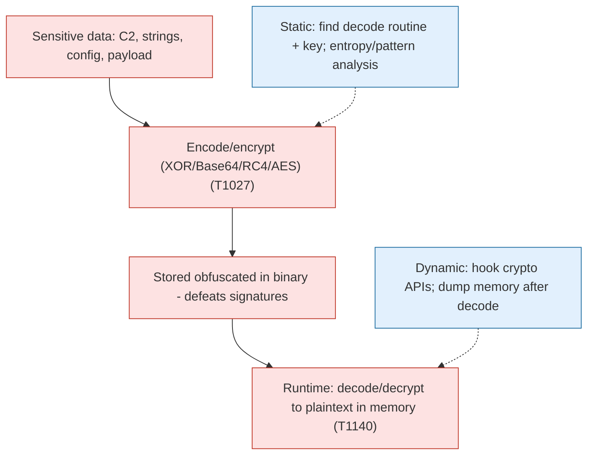

# Data Encoding and Obfuscation in Malware

## Summary

Malware hides its meaningful data — command-and-control addresses, strings, configuration, embedded payloads — behind **encoding and obfuscation** so that static scanners and casual analysts see noise instead of indicators (obfuscated files or information, T1027; encrypted/encoded data, T1027.013). The spectrum runs from trivial to strong: **simple encoding** (XOR with a key, Base64, custom alphabets, byte rotation), **layered/stacked encoding** (Base64 of an XOR of a compressed blob), and **real encryption** (RC4, AES via CryptoAPI). At runtime the malware **decodes/decrypts** the data back to usable form (deobfuscate/decode files or information, T1140), which is the analyst's opportunity: the key and algorithm must be present in the sample, and the plaintext appears in memory when used. Analysts recover secrets by finding the decode routine statically, by recognizing patterns (XOR against a known plaintext, high-entropy regions signaling encryption/packing), or dynamically by dumping memory after the sample decodes. The tension is constant: encoding defeats signatures and string-based detection, but the need to decode at runtime always leaves a seam.

## Encoding spectrum

| Level | Examples | Analyst approach |
|---|---|---|
| **Simple encoding** | XOR (single/multi-byte), Base64, ROT, custom alphabet | Recognize pattern; XOR brute force; decode |
| **Stacked** | Base64(XOR(deflate(x))) | Peel layers; follow the decode chain |
| **Encryption** | RC4, AES via CryptoAPI | Find key/IV in sample; hook crypto APIs; dump plaintext |
| **Runtime decode (T1140)** | Decode-on-use into memory | Dump memory after decode; breakpoint the routine |

The recurring seam: however strong the scheme, the sample must carry the means to reverse it and must produce plaintext when it runs — so the key is in the binary and the secret is in memory.

## Encode/decode lifecycle

## Detection / value

- **Hidden indicators recovered**: decoding reveals C2 domains, keys, and config the sample tried to hide (T1027).
- **Entropy as a signal**: high-entropy regions suggest encryption or packing worth investigating.
- **Runtime seam**: because the sample must decode to use data (T1140), memory after decode yields plaintext.
- Imports of crypto APIs and tight XOR/decode loops are static tells.

## Defense / practices

- **Find the decode routine** statically and reproduce it to recover all encoded data.
- **Exploit the runtime decode**: breakpoint the decode function or hook crypto APIs, then dump plaintext from memory.
- **Use entropy and pattern analysis** to locate encrypted/packed regions.
- **Automate**: script XOR brute-forcing and layered-decode chains for config extraction.
- **For detection**: build signatures on the decode logic and recovered plaintext indicators, not the encoded bytes alone.

## ATT&CK mapping

| ID | Name | Tactic |
|---|---|---|
| T1027 | Obfuscated Files or Information | Stealth |
| T1027.013 | Obfuscated Files or Information: Encrypted/Encoded File | Stealth |
| T1140 | Deobfuscate/Decode Files or Information | Stealth |

## Explanation

Malware is full of incriminating details — the address of its control server, the text it displays, its hidden settings — and leaving those lying in plain text would be like a burglar carrying a signed confession. So it scrambles them. Sometimes the scrambling is laughably simple, like XORing every byte with a single number or wrapping things in Base64; sometimes it's layered, like a parcel inside a parcel inside a parcel; and sometimes it's genuine encryption with a real cipher. To a scanner looking for known bad strings, the scrambled version is invisible. But there's an unavoidable catch that the analyst always exploits: the malware has to *unscramble* its own secrets to use them. That means the recipe and the key are hidden somewhere inside the sample, and the moment the code runs and unlocks its data, the plaintext sits exposed in memory. So the game is either to find the unscrambling recipe in the code and run it yourself, or to let the malware do the work and snatch the result from memory the instant it appears. However clever the lock, the key travels with it.
