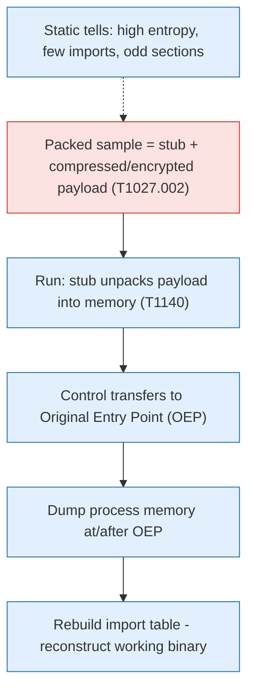

# Packers and Unpacking

## Summary

A **packer** compresses and/or encrypts an executable and wraps it in a small **stub** that, at runtime, unpacks the original code into memory and jumps to it (software packing, T1027.002). Packing serves malware in two ways: it shrinks and scrambles the file so static signatures and string scans see only the stub and a high-entropy blob, and it raises the effort to reverse-engineer the real payload. Packers range from off-the-shelf compressors (UPX) to commercial protectors and bespoke crypters. The analyst's job is **unpacking**: getting the sample to reveal its original code. The universal principle is that the packed code must become the real code in memory to execute (deobfuscate/decode, T1140), so the reliable approach is dynamic — let the stub do its work, find the **Original Entry Point (OEP)** where control transfers to the unpacked code, then dump the process memory and reconstruct a working binary (rebuilding the import table). Simple packers have known unpackers or static approaches; custom ones require manual OEP-finding. High entropy, tiny import tables, and unusual section names are the static tells that a sample is packed.

## Packing and unpacking

| Aspect | Detail |
|---|---|
| **What a packer does** | Compress/encrypt original; prepend unpacking stub (T1027.002) |
| **Why malware uses it** | Defeat static signatures/strings; raise RE effort; shrink file |
| **Static tells** | High entropy, few imports, odd section names (e.g. `UPX0`), small code |
| **Unpacking (T1140)** | Run stub, find OEP, dump memory, rebuild imports |

The anchor: whatever the packer, the genuine code must be unpacked into memory to run, so the moment of transfer to the Original Entry Point is where the analyst captures the real payload.

## Unpacking flow

## Detection / value

- **Packing as a signal**: high entropy, a near-empty import table, and packer-specific section names flag a packed, likely protected sample (T1027.002).
- **Unpacking recovers truth**: the dumped, unpacked binary exposes strings, imports, and logic the packed file hid.
- Memory-based detection and behavior monitoring catch what static scanning of the packed file misses.

## Defense / practices

- **Detect packing**: entropy analysis, import-table inspection, and section-name heuristics.
- **Unpack dynamically**: run to OEP, dump memory, and rebuild imports; use known unpackers for common packers (e.g. UPX).
- **For custom packers**: find the tail jump to OEP manually; breakpoint the unpack-complete transition.
- **Analyze the unpacked image**, not the stub, for real indicators.
- **For detection engineering**: build signatures on unpacked payloads and behavior, since the packed bytes vary.

## ATT&CK mapping

| ID | Name | Tactic |
|---|---|---|
| T1027.002 | Obfuscated Files or Information: Software Packing | Stealth |
| T1140 | Deobfuscate/Decode Files or Information | Stealth |

## Explanation

A packer is shrink-wrap for a program: it takes the real executable, squashes and scrambles it into a dense, meaningless-looking blob, and bolts on a tiny unwrapping routine at the front. When the file runs, that little routine inflates the blob back into the original program in memory and hands over control. For malware this is a double win — a virus scanner peering at the file sees only the wrapper and a block of noise, not the malicious code inside, and a human trying to read it hits a wall. But the wrapper's whole purpose is its weakness: it *must* unwrap the real program to run it, and it does so right in front of you, in memory. So the analyst's move is patient — let the sample unwrap itself, watch for the moment it jumps into the freshly revealed code (the "original entry point"), and then take a snapshot of memory, capturing the genuine program in the clear. The tells that something is wrapped at all are simple: a file that's almost pure randomness, barely imports any system functions, and has oddly named sections is wearing shrink-wrap.
