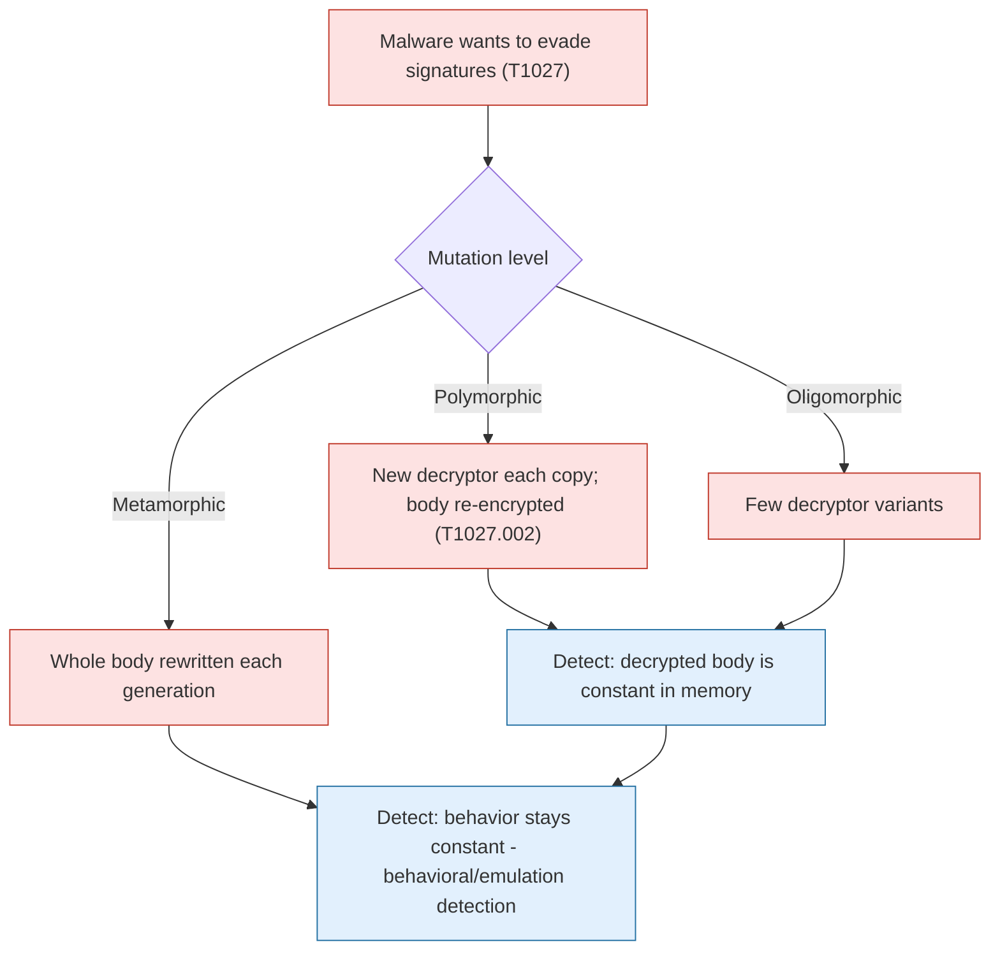

# Polymorphic, Oligomorphic and Metamorphic Code

## Summary

Signature-based detection works by matching a fixed byte pattern, so malware authors evolved techniques to **change the code's appearance on every copy** while keeping its behavior, defeating static signatures (obfuscated files or information, T1027). Three levels, in increasing sophistication: **oligomorphic** malware carries a small set of decryptor variants and swaps between them; **polymorphic** malware encrypts its body and generates a *fresh, mutated decryptor* for each infection (so the encrypted body and the decryptor both look different each time, though the decrypted body is constant — related to software packing/encryption, T1027.002); **metamorphic** malware rewrites its *entire body* each generation using code-mutation techniques (instruction substitution, register reassignment, junk insertion, reordering) so there is no constant encrypted payload to key on at all. The defensive answer is to stop relying on static byte signatures for these and move to **behavioral and dynamic detection**: polymorphic malware still decrypts to a constant body in memory (catchable after decryption), and all of them ultimately *do* the same malicious things, which behavior-based and emulation-based detection can catch regardless of how the bytes are shuffled.

## Levels of mutation

| Level | What changes each copy | Constant part to exploit |
|---|---|---|
| **Oligomorphic** | One of a few fixed decryptors | Limited decryptor set; constant body |
| **Polymorphic** | Freshly mutated decryptor + re-encrypted body (T1027.002) | Decrypted body is constant in memory |
| **Metamorphic** | The entire body is rewritten (T1027) | Behavior stays constant |

The escalation removes more and more constant bytes — but never removes constant *behavior*, which is why detection shifts from "what the bytes look like" to "what the code does."

## Detection shift

## Detection / value

- **Static signatures fail** against polymorphic/metamorphic variants — every sample looks different (T1027).
- **Memory beats mutation for polymorphism**: the body decrypts to a constant form in memory, catchable post-decryption.
- **Behavior is invariant**: emulation and behavioral detection flag the consistent malicious actions regardless of byte-level mutation.
- Emulator-based "generic decryption" lets a sample decrypt itself in a sandbox, then scans the revealed body.

## Defense / practices

- **Don't rely on static byte signatures** for these families; combine with behavioral and heuristic detection.
- **Scan after decryption**: emulate or run to let polymorphic code reveal its constant body in memory.
- **Use behavioral/anomaly detection** and emulation for metamorphic code that has no constant payload.
- **Signature on invariants**: decryptor structure, behavior, or decrypted-body patterns rather than the mutating shell.
- **Layered defense**: no single technique catches all mutation; combine static, dynamic, and behavioral.

## ATT&CK mapping

| ID | Name | Tactic |
|---|---|---|
| T1027 | Obfuscated Files or Information | Stealth |
| T1027.002 | Obfuscated Files or Information: Software Packing | Stealth |

## Explanation

Antivirus long worked like a wanted poster: memorize what the villain looks like, then match faces. Malware's answer was to change its face on every job. The crudest version keeps a handful of disguises and rotates them (oligomorphic). The cleverer version encrypts its real body and, crucially, writes a brand-new unlocking routine for every single copy, so both the locked body and the key-turner look different each time — yet once unlocked, the villain underneath is always the same (polymorphic). The most advanced version doesn't just change its coat; it rebuilds its whole body from scratch each generation, swapping instructions for equivalent ones, shuffling the order, padding with meaningless filler, so no two copies share a single recognizable line (metamorphic). Chasing their faces is hopeless. But a disguise can't change what a person *does*: all these variants still try to hook into the system, phone home, and encrypt your files. So defenders stopped matching faces and started watching behavior — and for the encrypting kind, they simply wait for it to unlock itself and catch the unchanging villain in the act.
