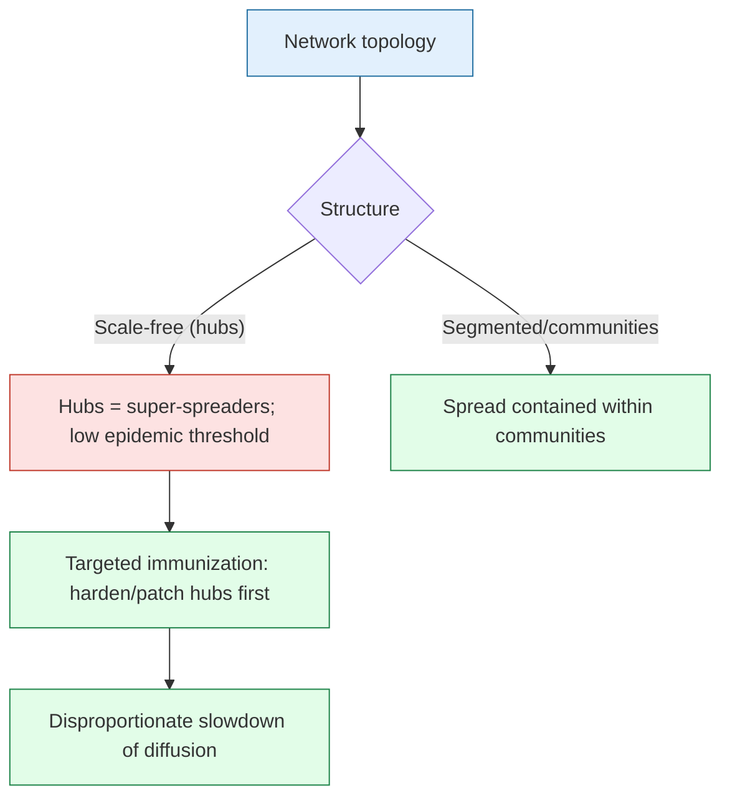

# Complex Network Science for Malware Diffusion

## Summary

Simple epidemic models assume a uniformly mixed population, but real networks — the internet, enterprise LANs, social graphs, email contacts — have **structure** that dramatically changes how malware spreads. Network science studies this structure and its effect on diffusion. A crucial finding concerns **degree distribution**: many real networks are **scale-free**, with a few highly connected **hub** nodes and many sparsely connected ones. In such networks, the epidemic threshold can effectively vanish — malware can persist and spread even at low infection rates — because hubs act as super-spreaders, and once a hub is infected it reaches a huge number of neighbors. This has two sharp implications. For attackers, targeting or reaching hubs accelerates spread enormously. For defenders, **targeted immunization** of hubs (patch and harden the most-connected nodes first) is far more effective than random patching, because protecting a few super-spreaders disproportionately slows diffusion. Other structural features — community structure, path lengths, clustering — further shape how fast and how far malware travels. The lesson is that *topology is a control variable*: understanding and reshaping the network (segmentation, protecting hubs, limiting connectivity) is a defense in its own right.

## Structure matters

| Concept | Effect on spread |
|---|---|
| **Scale-free / hubs** | Super-spreaders; threshold can vanish — persists at low rates |
| **Targeted immunization** | Protecting hubs slows diffusion disproportionately |
| **Community structure** | Spread fast within, slower across communities |
| **Path length / clustering** | Short paths speed global spread |

The core insight: in hub-dominated networks, a handful of nodes govern diffusion — so defending (or attacking) those few changes the whole epidemic.

## Topology and diffusion

## Detection / value

- **Hubs are leverage points**: a few highly connected nodes dominate spread — monitor and protect them first.
- **Low effective threshold**: scale-free structure lets malware persist even at low infection rates, so prevention can't rely on rate alone.
- **Community structure** localizes outbreaks, aiding containment if boundaries are enforced.
- Mapping the real topology reveals where diffusion will concentrate.

## Defense / practices

- **Immunize hubs first**: prioritize patching/hardening of the most-connected nodes for outsized impact.
- **Reshape topology**: segmentation and connectivity limits create community boundaries that contain spread.
- **Map your network**: identify hubs, communities, and short paths to target defenses.
- **Don't rely on rate alone**: in hub networks, even low infection rates can sustain spread, so structural defense matters.
- **Combine with epidemic models**: topology refines the predictions simple models give.

## Explanation

The simplest spread models pretend every computer is equally likely to bump into every other, like gas molecules in a box. Real networks are nothing like that — they have shape, and the shape changes everything. The most important discovery is that many real networks are wildly lopsided: a handful of nodes are connected to enormous numbers of others (the hubs — think a mail server everyone talks to, or a celebrity in a social graph), while most nodes have only a few links. In such a network, malware behaves alarmingly: even a weak, slow-spreading worm can take hold and persist, because sooner or later it reaches a hub, and a hub is a super-spreader that infects a vast crowd at once. The flip side is a gift to defenders. If a few hubs dominate the spread, then protecting just those hubs — patching and hardening the most-connected machines first — slows the whole epidemic far more than patching random machines would. In other words, the layout of your network is a lever you can pull: carve it into compartments, guard the super-spreaders, and limit needless connections, and you've defended it by geometry alone.
