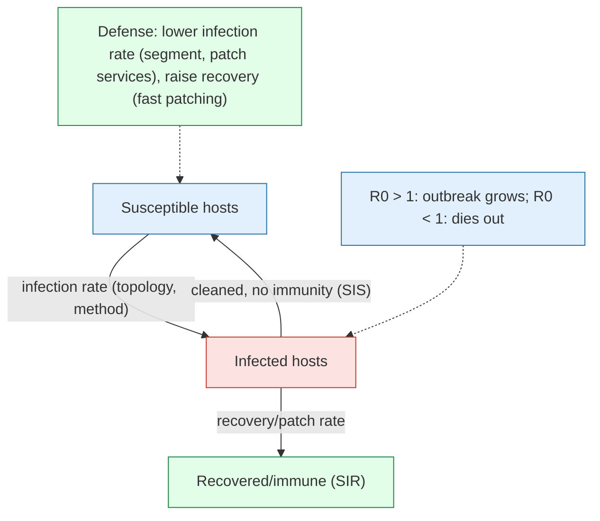

# Epidemic Models of Malware Spread

## Summary

Self-propagating malware (worms) spreads through a population of computers much like a biological disease spreads through people, so epidemiologists' **compartmental models** are used to understand and predict it. The classic models divide the population into states and describe the rates of movement between them. **SI** (Susceptible → Infected) captures spread with no recovery. **SIS** (Susceptible → Infected → Susceptible) models hosts that can be cleaned but reinfected (no lasting immunity). **SIR** (Susceptible → Infected → Recovered) adds a recovered/immune state — e.g. patched or permanently cleaned hosts that can't be reinfected. Key parameters are the **infection rate** (how readily an infected host infects a susceptible one — a function of the malware's method and network topology) and the **recovery/patch rate**. A central quantity is the **basic reproduction number (R0)**: if each infection causes more than one further infection on average, an outbreak grows explosively; if fewer, it dies out. These models explain why fast-patching and reducing the infection rate (segmentation, closing vulnerable services) are so effective, and why worms like fast-spreading network worms reach saturation so quickly. They are abstractions — real networks aren't uniformly mixed — but they give powerful intuition and inform response.

## Compartmental models

| Model | States | Captures |
|---|---|---|
| **SI** | Susceptible → Infected | Spread with no recovery |
| **SIS** | S → I → S | Cleanable but reinfectable (no immunity) |
| **SIR** | S → I → Recovered | Patched/immune hosts removed from spread |
| **Key params** | Infection rate, recovery rate, R0 | Growth vs. die-out |

The pivotal idea is R0: above one, an outbreak explodes; below one, it fades — so defenses that cut the infection rate or raise recovery (patching) push R0 down.

## Spread dynamics

## Detection / value

- **Prediction**: models forecast whether an outbreak grows or dies and how fast it saturates.
- **Lever identification**: infection and recovery rates show where defense has the most impact.
- **R0 intuition**: keeping each infection from causing more than one more halts an epidemic.
- Deviations from predicted curves can signal changes in malware behavior or defense effectiveness.

## Defense / practices

- **Lower the infection rate**: segmentation, closing vulnerable services, and reducing exposed attack surface.
- **Raise the recovery rate**: fast, broad patching moves hosts to immune (SIR) before they're infected.
- **Drive R0 below 1**: combine prevention and rapid response so each infection spreads to less than one more host.
- **Model-informed response**: use spread dynamics to prioritize containment during an outbreak.
- **Remember the abstraction**: real topology matters (see network-science models), so treat predictions as guidance.

## Explanation

A computer worm spreads the way a cold runs through an office: one infected machine reaches out and infects others, which infect still more. Because the dynamics are so similar, the math epidemiologists built for real diseases works beautifully on malware. You sort all the computers into buckets — those that can still be infected, those currently infected, and (in some models) those that have been patched or cleaned and can't catch it again — and then describe how fast machines move between buckets. Two speeds dominate the story: how quickly an infected machine spreads the worm, and how quickly defenders clean or patch machines. Out of this falls one magic number, the reproduction rate: if each infected machine infects, on average, more than one other, the outbreak snowballs out of control; if fewer than one, it fizzles out on its own. That single insight is why defenders obsess over patching speed and over cutting the network into compartments — both push that number below one, which is the difference between a worm that saturates the internet in hours and one that sputters and dies. The models simplify reality, but they give you the right knobs to turn.
