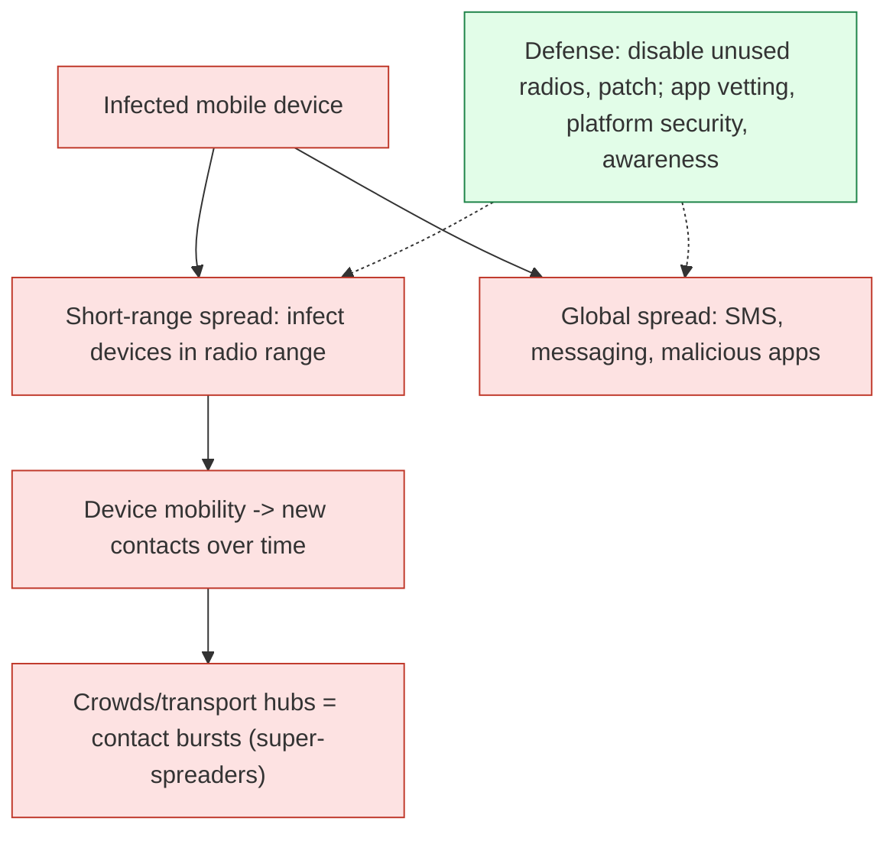

# Malware Diffusion in Wireless and Mobile Networks

## Summary

Wireless and mobile networks spread malware through mechanisms that wired-network and classic epidemic models don't fully capture, because connectivity depends on **proximity and movement**. In short-range wireless settings (Bluetooth, Wi-Fi Direct, device-to-device), a device can only infect others **within radio range**, so spread is governed by physical closeness and the **mobility** of devices: as people move, the contact network constantly rewrites itself, and human mobility patterns (commutes, gatherings, crowds) create bursts of contact that accelerate diffusion. This resembles how diseases spread through a moving population more than through a fixed wired graph. Mobile malware also exploits **mixed propagation**: it can spread both proximally (short-range) and over the wider network (SMS, messaging, app stores, cellular/Internet), combining local and global reach. Modeling this requires marrying epidemic dynamics with **mobility models** and the network's spatial structure. The defensive implications: proximity-based spread is blunted by disabling unnecessary wireless interfaces and by patching, while global vectors (malicious apps, messaging links) are addressed by app-store vetting, platform security, and user awareness. Crowds and high-mobility hubs (transport, events) are the mobile equivalent of network super-spreaders.

## Mobile/wireless spread factors

| Factor | Effect |
|---|---|
| **Proximity (short-range)** | Infection limited to radio range (Bluetooth/Wi-Fi) |
| **Mobility** | Moving devices rewrite the contact graph; crowds = bursts |
| **Mixed propagation** | Local (proximity) + global (SMS, apps, cellular) reach |
| **Spatial hubs** | Transport/events act as super-spreader locations |

The distinguishing feature is that the contact network is physical and in motion, so where and how people move shapes diffusion as much as the malware's method.

## Proximity + mobility diffusion

## Detection / value

- **Mobility shapes spread**: contact patterns from human movement determine diffusion speed and reach.
- **Spatial super-spreaders**: crowded, high-mobility locations (transport hubs, events) accelerate proximity-based spread.
- **Mixed vectors**: combining short-range and global propagation gives mobile malware both local persistence and wide reach.
- Unusual short-range connection attempts and mass messaging are detection signals.

## Defense / practices

- **Reduce proximity surface**: disable unnecessary wireless interfaces (Bluetooth/Wi-Fi Direct) and patch devices.
- **Guard global vectors**: app-store vetting, platform security controls, and messaging/link awareness.
- **Protect spatial hubs**: recognize crowded/high-mobility environments as higher-risk for proximity spread.
- **Model with mobility**: combine epidemic and mobility models for realistic mobile-malware prediction.
- **User awareness**: caution with unsolicited connections, links, and untrusted app sources.

## Explanation

On phones and other wireless gadgets, malware spreads in a way that feels more like a cold passing through a moving crowd than a worm crawling across fixed cables. Some mobile malware can only jump to a device that's physically nearby — within Bluetooth or Wi-Fi range — so whether it spreads at all depends on who's standing next to whom. And since people are always moving, that map of "who's near whom" is constantly being redrawn: a packed train, a concert, a busy café becomes a flurry of new contacts, briefly turning those places into super-spreader hotspots. On top of this local, proximity-based spread, mobile malware usually has a second, longer-range gear — it can text itself to everyone in your contacts, ride a malicious app, or travel over the cellular and internet connections — giving it both neighborhood persistence and global reach. Predicting all this means blending the disease math with models of how people actually move around. The defenses follow naturally: switch off the short-range radios you aren't using and keep devices patched to choke the proximity spread, and lean on app-store vetting, platform protections, and plain user caution to block the long-range vectors. The crowded transit hub, it turns out, is the mobile world's version of the hyper-connected server.
