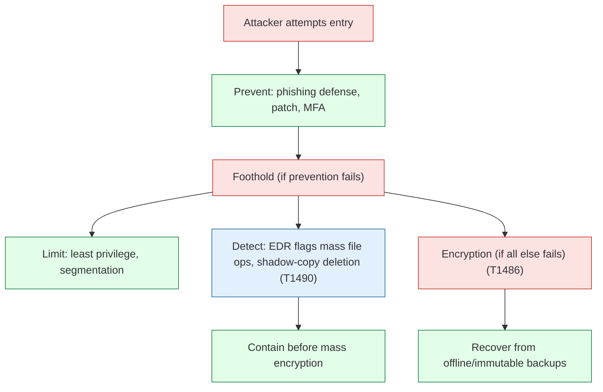

# Ransomware Defence: Endpoint, Enterprise and Awareness

## Summary

Because sound encryption is irreversible (data encrypted for impact, T1486), ransomware defence is overwhelmingly about **prevention, resilience, and early detection** rather than recovery of encrypted data. The controls layer across the attack chain. **Prevent initial access**: phishing-resistant email defense and user awareness, patching internet-facing services, and MFA on remote access (RDP/VPN) close the common entry points. **Limit spread and impact**: least privilege, network segmentation, and disabling unnecessary services stop a single foothold from becoming enterprise-wide encryption. **Detect early**: EDR and monitoring for pre-encryption behavior — mass file access, shadow-copy and backup deletion (inhibit system recovery, T1490), and credential abuse — give a chance to contain before mass encryption. **Ensure recovery**: tested, **offline or immutable backups** are the single most important control, since they restore availability regardless of the attacker's key. **Awareness** ties it together: users who recognize phishing and report early, and an organization that has rehearsed its response, dramatically reduce both likelihood and impact. No single control suffices; ransomware defence is defense-in-depth with backups as the backstop.

## Layered defence

| Layer | Controls | Addresses |
|---|---|---|
| **Prevent access** | Phishing defense, patching, MFA on RDP/VPN | Initial access |
| **Limit impact** | Least privilege, segmentation, disable unused services | Spread, escalation |
| **Detect early** | EDR, alerts on mass file ops / backup deletion (T1490) | Pre-encryption window |
| **Recover** | Tested offline/immutable backups | Availability (counters T1486) |
| **Awareness** | User training, reporting, rehearsed IR | Likelihood + response |

The backstop is backups: everything else lowers the odds and buys time, but offline/immutable backups are what make encryption survivable.

## Defence across the chain

## Detection / value

- **Pre-encryption detection**: mass file changes, shadow-copy/backup deletion (T1490), and credential abuse precede encryption and are catchable.
- **Backups decide outcomes**: tested offline/immutable backups make encryption survivable (counters T1486).
- **Segmentation limits blast radius**: contained segments stop enterprise-wide encryption.
- Early user reporting of phishing shortens attacker dwell time.

## Defense / practices

- **Close entry points**: phishing-resistant defenses, patch internet-facing services, enforce MFA on all remote access.
- **Keep tested offline/immutable backups** and verify restores regularly — the essential backstop.
- **Segment and least-privilege** to limit spread and escalation.
- **Deploy EDR and alert** on pre-encryption behavior (mass file ops, backup/shadow-copy deletion, T1490).
- **Train and rehearse**: user awareness plus a practiced incident-response plan.

## ATT&CK mapping

| ID | Name | Tactic |
|---|---|---|
| T1486 | Data Encrypted for Impact | Impact |
| T1490 | Inhibit System Recovery | Impact |

## Explanation

Since you can't unlock files that strong ransomware has encrypted, defending against it means winning before the lock clicks — and having a spare set of keys if it does. Think of it as a series of gates. The outer gate is keeping attackers out at all: teaching people to spot the poisoned email, patching the exposed servers, and putting a second lock (MFA) on every remote door, because that's how ransomware almost always gets in. If someone slips through, the inner gates slow them down: don't give every account the master key, and wall your network into compartments so one breached machine can't reach everything. Meanwhile, watchful alarms (EDR) look for the unmistakable rampage that comes just before encryption — a program suddenly tearing through thousands of files and, tellingly, deleting your restore points — which is your chance to slam the doors before real damage. And behind all of it sits the one control that actually guarantees recovery: good backups kept somewhere the ransomware can't reach and can't delete, tested often enough that you know they'll work. No single gate holds forever; the point is that each one lowers the odds, buys time, and leaves you that offline backup as the safety net under everything.
