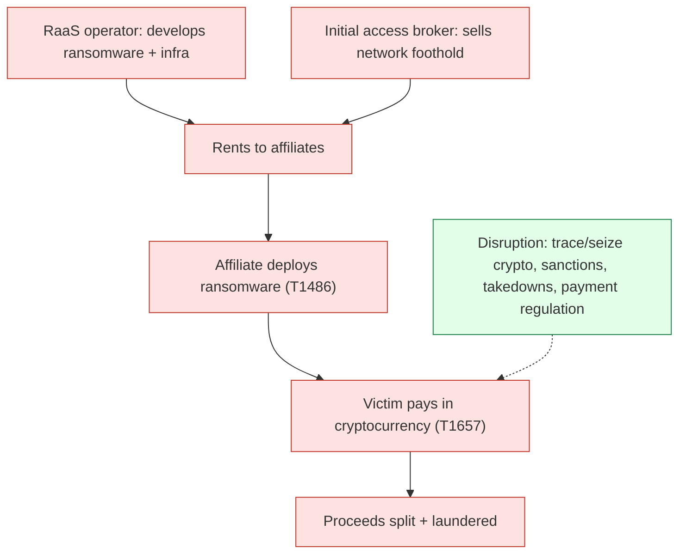

# Ransomware Economics, Cryptocurrency and Crime-as-a-Service

## Summary

Ransomware is best understood as a **criminal business**, and its economics explain its scale and persistence. **Cryptocurrency** is the enabling rail: it lets attackers receive extortion payments (financial theft, T1657) pseudonymously and move them across borders, which is why modern ransomware (data encrypted for impact, T1486) became viable where mailed payments failed. **Ransomware-as-a-Service (RaaS)** industrializes the model: a core group develops and maintains the ransomware and infrastructure, then rents it to **affiliates** who carry out intrusions, splitting the proceeds (commonly the affiliate keeps the majority, the operator takes a cut). This division of labor lowers the skill needed to attack (affiliates don't write malware) and multiplies the number of actors. A supporting economy surrounds it: **initial access brokers** sell footholds into victim networks, negotiators handle ransom talks, and launderers convert and obscure crypto proceeds. The defensive implication is that disruption is most effective when it raises the cost or lowers the payoff of this business — through payment tracing and seizure, sanctions, takedowns of RaaS infrastructure, and refusing/regulating payments — because the technology alone will keep being rented out as long as it's profitable.

## The ransomware economy

| Role | Function |
|---|---|
| **RaaS operator** | Builds/maintains ransomware + infrastructure; rents it |
| **Affiliate** | Breaks in, deploys ransomware; splits payment |
| **Initial access broker** | Sells footholds into victim networks |
| **Negotiator** | Handles ransom negotiation |
| **Launderer** | Converts/obscures cryptocurrency proceeds (T1657) |

The structure is a supply chain: specialization lowers the skill to attack, multiplies actors, and makes the whole thing resilient — so defense that targets profitability hits the system, not one sample.

## Value chain

## Detection / value

- **Follow the money**: cryptocurrency, while pseudonymous, is traceable on public blockchains and has enabled seizures (T1657).
- **RaaS reuse**: shared tooling and infrastructure across affiliates mean indicators transfer between incidents.
- **Access brokers** upstream: anomalous access sales and footholds precede ransomware deployment.
- Understanding incentives guides where disruption yields the most leverage.

## Defense / practices

- **Raise cost / lower payoff**: payment tracing and seizure, sanctions on operators, and infrastructure takedowns.
- **Reduce affiliate success**: strong prevention (phishing defense, patching, MFA) denies the footholds affiliates rely on.
- **Regulate/limit payments**: payment decisions are legal/organizational; paying funds the economy and may breach sanctions.
- **Share intelligence**: RaaS reuse makes shared TTPs and indicators broadly useful.
- **Target access brokers**: detecting and closing initial-access vectors disrupts the supply chain early.

## ATT&CK mapping

| ID | Name | Tactic |
|---|---|---|
| T1657 | Financial Theft | Impact |
| T1486 | Data Encrypted for Impact | Impact |

## Explanation

To understand why ransomware won't simply go away, follow the money and the org chart. The money runs on cryptocurrency, which is what makes the whole thing work — a hostage-taker in one country can collect a ransom from a victim in another without ever touching a bank that would stop or trace the transfer the old-fashioned way. The org chart is the real eye-opener: this isn't a lone genius but a franchise. One crew builds and maintains the ransomware like a software product, then rents it out to "affiliates" who do the actual break-ins and hand back a cut of what they extort. Around them orbit specialists — brokers who sell ready-made access into companies, negotiators who haggle over ransoms, launderers who scrub the coins clean. Spreading the work this way means you no longer need to be a skilled hacker to launch a devastating attack; you just rent the kit and buy a way in. The sobering conclusion is that fighting this is economics, not just engineering. As long as it reliably pays, the kit will keep being rented, so the real pressure points are making the money harder to keep — tracing and seizing it, sanctioning the operators, and tearing down the infrastructure that makes the business hum.
