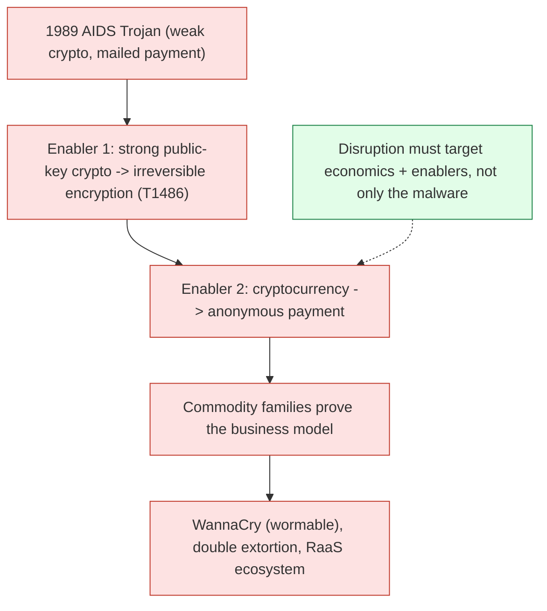

# Ransomware History, Case Studies and Sociology

## Summary

Ransomware is not new — the first documented case was the **AIDS Trojan (1989)**, distributed on floppy disks, which hid filenames and demanded payment by mail — but it was limited by weak cryptography and the difficulty of collecting money. Two enabling shifts turned it into today's dominant criminal threat: **strong, usable public-key cryptography** (making encryption truly irreversible, T1486) and **cryptocurrency** (making anonymous, hard-to-trace payment practical). The modern era saw commodity families (CryptoLocker and successors) prove the business model, then **WannaCry (2017)**, which combined ransomware with a wormable exploit to spread automatically and cause global disruption, and NotPetya, which masqueraded as ransomware but was destructive. The **sociology** matters as much as the code: ransomware is an organized-crime industry with specialized roles (developers, access brokers, negotiators, launderers), affiliate programs, "customer support" for victims, and a reputation economy where groups that reliably decrypt after payment build "trust" to encourage future payment. Understanding this history and ecosystem explains why ransomware is resilient — it's a profitable, adaptable business, not a lone hacker's trick — and why disruption must target the economics, not just the malware.

## Milestones

| Era | Development |
|---|---|
| **1989** | AIDS Trojan — first ransomware (weak crypto, postal payment) |
| **2000s–2010s** | Strong public-key crypto makes encryption irreversible (T1486) |
| **~2013+** | CryptoLocker-era proves the model; cryptocurrency enables payment |
| **2017** | WannaCry (wormable) causes global disruption; NotPetya (destructive) |
| **Now** | Ransomware-as-a-service, double extortion, organized ecosystem |

The two unlocks — unbreakable encryption and untraceable payment — plus an organized criminal economy explain the shift from a 1989 curiosity to a global industry.

## Evolution drivers

## Detection / value

- **History explains resilience**: ransomware thrives because crypto and cryptocurrency removed its old limits.
- **Case studies inform defense**: WannaCry showed the danger of wormable spread; NotPetya, that "ransomware" can be cover for destruction.
- **Ecosystem awareness**: specialized roles and affiliate models mean many actors and reused tooling/infrastructure.
- Reputation dynamics ("pay and we decrypt") shape, but never guarantee, outcomes.

## Defense / practices

- **Target the economics**: law-enforcement action, payment disruption, and infrastructure takedowns address the business, not just samples.
- **Learn from case studies**: patch wormable vulnerabilities fast; assume "ransomware" may be destructive.
- **Don't rely on criminal honor**: paying may not restore data and funds future attacks; decisions are organizational/legal, not technical.
- **Share intelligence**: RaaS reuse means indicators and TTPs transfer across incidents.
- **Prepare for the ecosystem**: access brokers and affiliates mean prevention must cover many entry paths.

## ATT&CK mapping

| ID | Name | Tactic |
|---|---|---|
| T1486 | Data Encrypted for Impact | Impact |

## Explanation

Ransomware's story is really the story of two missing pieces finally snapping into place. The idea is ancient by computing standards — back in 1989 someone mailed out infected floppy disks that scrambled filenames and asked victims to post a check to a box in Panama. It flopped, for two reasons: the encryption was weak enough to undo, and collecting money by mail was a great way to get arrested. Decades later both problems were solved from the outside. Strong, easy-to-use encryption made the hostage-taking genuinely unbreakable, and cryptocurrency made it possible to collect ransoms anonymously from anywhere. Those two keys unlocked an industry. And it truly is an industry, not a basement hobbyist — it has software developers, "salespeople" who sell access to break-ins, negotiators, money launderers, affiliate schemes, even help desks for victims trying to pay. Some gangs cultivate a grim reputation for actually handing over the key, because reliable extortion is more profitable than random cruelty. Seeing ransomware as a business, not a bug, is the whole point: you don't defeat a business by swatting one product, you go after what makes it pay.
