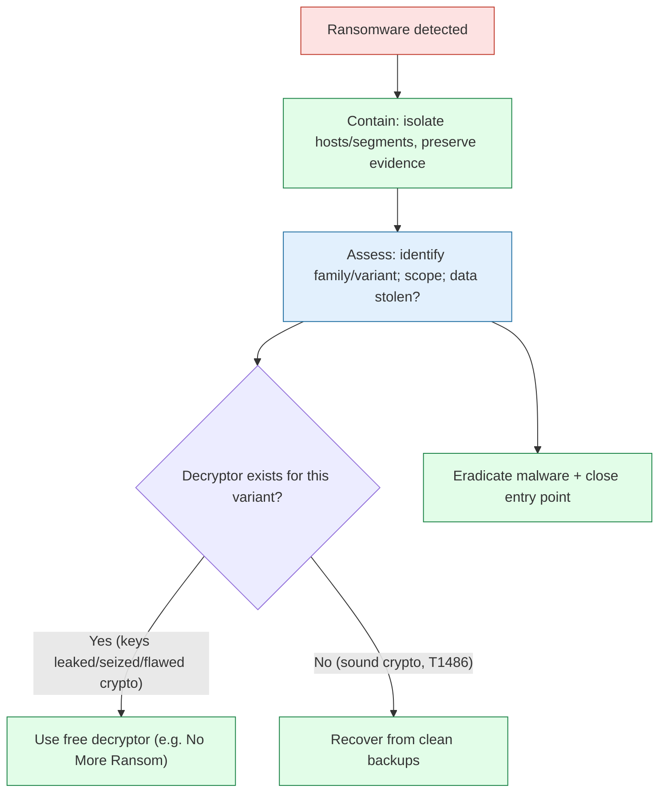

# Ransomware Incident Response and Decryption Tools

## Summary

When ransomware hits, a disciplined **incident response** limits damage and speeds recovery, while **free decryption tools** occasionally help — but only in specific circumstances. The IR priorities in order: **contain** (isolate affected hosts and segments to stop ongoing encryption and spread, but preserve evidence), **assess** (identify the family, scope the impact, determine whether data was stolen for double extortion), **eradicate** (remove the malware and persistence, close the entry point), and **recover** (restore from clean offline/immutable backups, rebuilding where needed). Throughout, **preserve forensic evidence** (memory, logs, samples) for investigation, attribution, and any decryption attempt. On decryption: initiatives like **No More Ransom** host free decryptors for families whose encryption was broken or whose keys were seized/leaked — so **identifying the exact family/variant first** is essential, because a decryptor only works for the specific scheme it targets. For soundly implemented ransomware (T1486), no decryptor exists and recovery depends on backups. **Paying the ransom** is a legal and business decision, not a technical one: it may not restore data, funds the criminal economy, and can violate sanctions. Having inhibited recovery (T1490), attackers count on victims lacking backups — which is exactly why preparation beats response.

## IR priorities

| Phase | Action |
|---|---|
| **Contain** | Isolate hosts/segments; stop spread; preserve evidence |
| **Assess** | Identify family/variant; scope; check for data theft |
| **Eradicate** | Remove malware/persistence; close entry point |
| **Recover** | Restore from clean offline/immutable backups |
| **Decrypt (maybe)** | Only if a decryptor exists for that exact variant |

The ordering is deliberate: stop the bleeding and preserve evidence first, identify precisely what you're facing, then recover — with free decryption a bonus that applies only to specific, already-broken schemes.

## Response flow

## Detection / value

- **Family identification** determines options: it tells you whether a free decryptor exists and reveals known TTPs.
- **Scope and data-theft assessment**: double extortion means a backup restore may not resolve a leak.
- **Evidence preservation** enables attribution, law-enforcement engagement, and decryption attempts.
- Decryptors exist only for specific broken/leaked-key variants — never assume one is available.

## Defense / practices

- **Contain first, preserving evidence**: isolate without wiping memory/logs/samples needed for analysis.
- **Identify the exact variant** before attempting any decryptor; match the tool to the scheme.
- **Recover from clean offline/immutable backups**; rebuild compromised systems rather than trusting them.
- **Engage law enforcement** and check reputable decryptor repositories (e.g. No More Ransom).
- **Treat payment as legal/business, not technical**: it may fail, funds crime, and can breach sanctions — and attackers rely on your lacking backups (T1490).

## ATT&CK mapping

| ID | Name | Tactic |
|---|---|---|
| T1486 | Data Encrypted for Impact | Impact |
| T1490 | Inhibit System Recovery | Impact |

## Explanation

The moment ransomware goes off, the instinct is to fix the files, but the right first move is to stop the fire while keeping the evidence. You isolate the burning machines so the encryption can't keep spreading, without carelessly wiping the memory and logs you'll need to understand what happened. Then you identify your attacker precisely — which family, which variant — because that single fact decides your options. Occasionally there's good news: for certain strains, researchers or police have cracked the encryption or recovered the keys, and projects like No More Ransom hand out free unlockers — but an unlocker only fits the exact lock it was made for, which is why naming the variant comes first. For well-built ransomware, though, there is no magic tool, and the honest answer is that your clean, offline backups are your recovery; the files themselves are gone until restored. As for paying — that's a decision for lawyers and leadership, not technicians, because the money might buy nothing, it bankrolls the next attack, and in some cases it's outright illegal. The whole ordeal underlines the earlier lesson: the attackers deliberately destroyed your safety net on the way in, betting you had no other, which is precisely why the real win was preparing before they ever arrived.
