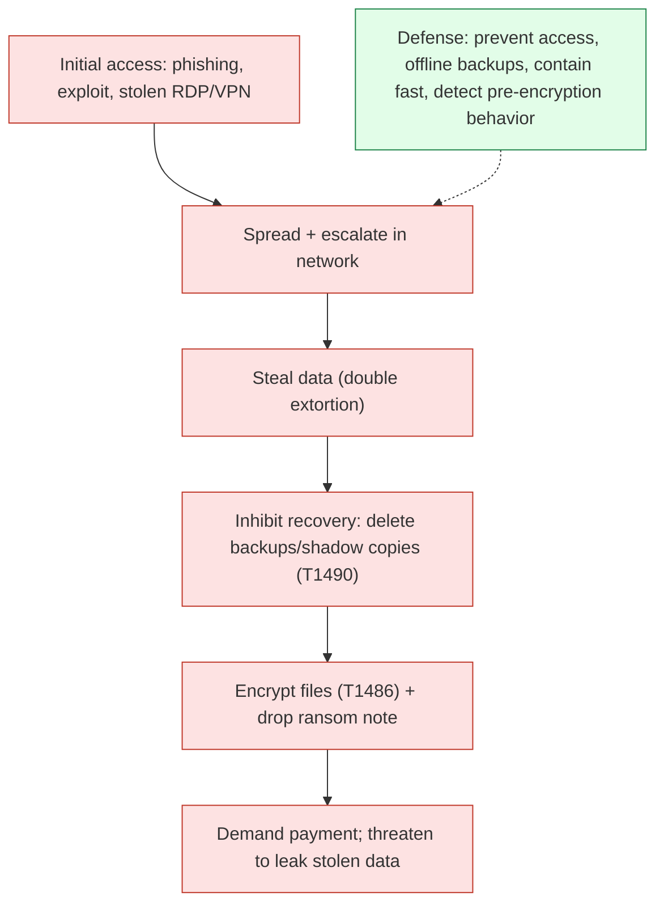

# Ransomware Overview, Distribution and Families

## Summary

Ransomware is malware that denies a victim access to their data or systems and demands payment to restore it. The dominant form is **crypto-ransomware**, which encrypts files with strong cryptography so recovery without the attacker's key is infeasible (data encrypted for impact, T1486), typically after first **inhibiting recovery** by deleting backups and volume shadow copies (T1490). Earlier/lesser forms include **locker** ransomware (locks the screen/UI without encrypting) and **scareware**. Modern ransomware operations add **double extortion**: before encrypting, they steal data and threaten to publish it, so backups alone no longer guarantee safety. **Distribution** follows the same vectors as other malware: phishing with malicious attachments/links, exploitation of internet-facing services, compromised RDP/VPN credentials, and delivery by prior infections (droppers, botnets). Notable families have shaped the landscape (e.g. the WannaCry worm-ransomware outbreak and numerous ransomware-as-a-service operations). The decisive defensive facts: well-implemented encryption cannot be reversed after the fact, so prevention, tested offline backups, and rapid containment matter far more than any hope of decryption; and because of double extortion, preventing initial access and data theft is as important as protecting availability.

## Ransomware at a glance

| Aspect | Detail |
|---|---|
| **Crypto-ransomware** | Encrypts files; key held by attacker (T1486) |
| **Recovery sabotage** | Deletes backups/shadow copies first (T1490) |
| **Double extortion** | Steals data, threatens to leak it |
| **Locker / scareware** | Blocks access / bluffs without strong encryption |
| **Distribution** | Phishing, exploited services, stolen RDP/VPN, droppers/botnets |

The hard truth: sound encryption is irreversible without the key, and attackers delete your safety net first — so the battle is won before encryption, through prevention, offline backups, and containment.

## Ransomware attack flow

## Detection / value

- **Pre-encryption behavior is the window**: mass file access, shadow-copy deletion (T1490), and backup tampering precede encryption.
- **Double extortion**: large outbound data transfers before encryption indicate theft.
- **Distribution signals**: phishing, exploited services, and anomalous RDP/VPN logins are upstream indicators.
- Ransom notes, mass file-extension changes, and encryption bursts confirm an active event.

## Defense / practices

- **Prevent initial access**: phishing defense, patching internet-facing services, MFA on RDP/VPN.
- **Keep tested, offline/immutable backups** — the single most important recovery control (counters T1486/T1490).
- **Detect early**: alert on shadow-copy deletion, mass file changes, and backup tampering.
- **Contain fast**: isolate affected hosts to stop spread before mass encryption.
- **Plan for double extortion**: prevent and detect data theft; backups don't address leaks.

## ATT&CK mapping

| ID | Name | Tactic |
|---|---|---|
| T1486 | Data Encrypted for Impact | Impact |
| T1490 | Inhibit System Recovery | Impact |

## Explanation

Ransomware is a digital hostage-taking: it makes your own data unreadable and sells you back the key. The modern version is brutally effective because it uses real, unbreakable encryption — once your files are scrambled, there's genuinely no way back without the attacker's key, so the fantasy of "just decrypt it later" almost never comes true. Worse, attackers learned to pull the fire alarm's wires first: before they scramble anything, they hunt down and destroy your backups and the system's own restore points, so your safety net is gone when you reach for it. And because companies got better at restoring from backups, the criminals added a second threat — they copy your sensitive data on the way out and promise to publish it unless you pay, which means even a perfect restore doesn't save you from the leak. It arrives the way all malware does: a booby-trapped email, an unpatched server, a stolen remote-login password. The uncomfortable lesson is that this fight is won early — by keeping attackers out, keeping backups somewhere they can't reach, and spotting the tell-tale rampage before the encryption hits — not by clever recovery afterward.
