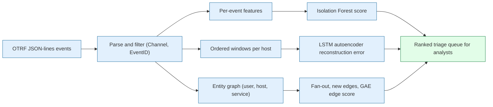

# ML Anomaly Detection for the SOC

Three unsupervised machine-learning approaches to finding attacker activity in security logs, each explained from first principles, walked through with a plain-language SOC scenario, and then applied end to end to real, public attack data from the **OTRF Security Datasets** project (formerly known as Mordor).

Every code snippet in this folder was run against the named OTRF files before it was committed, and the result tables shown are the actual output (exact scores will move slightly between library versions and random seeds).

## Read this first: what these models can and cannot do

- **They rank, they do not convict.** Each method produces an anomaly score. A high score means "unlike the rest of the data", not "malicious". In every worked example below, benign but rare activity (an Azure guest agent, a log-manifest update) lands in the top results next to real attacker activity. Plan for an analyst to triage the top of the list.
- **OTRF datasets are short, attack-heavy captures, not production baselines.** The APT29 Day 1 capture used here is about 33 minutes from 4 hosts; the PurpleSharp playbook is about one minute. That is enough to *demonstrate* each method and to *test* a pipeline, but it is not enough to *train* a model you would deploy. In production you fit on weeks of your own telemetry and use OTRF data to check that known attack behaviour still scores high.
- **Feature engineering matters more than the algorithm.** Most of each doc is about turning Windows events into numbers, sequences or graphs that expose attacker behaviour. A good feature set with a simple model beats a clever model on raw fields.

## The three approaches

| Doc | Question it answers | Unit scored | Best at | Needs |
|---|---|---|---|---|
| [Isolation Forest](isolation-forest.md) | "Is this single event or entity-window unusual?" | One row (e.g. a process creation, a user-hour) | Rare process lineage, odd command lines, unusual logon attributes | Tabular features; scikit-learn |
| [LSTM Autoencoder](lstm-autoencoder-sequence-anomaly-detection.md) | "Is this *order* of events unusual?" | A window of consecutive events | Multi-step chains and slow-burn activity that looks normal event by event | Ordered event streams per host or user; PyTorch |
| [Graph-based detection](graph-based-anomaly-detection.md) | "Is this *connection pattern* unusual?" | A node or an edge | Lateral movement fan-out, password spraying, Kerberoasting, new host-to-host paths | Entity pairs (user→host, host→host); networkx, optionally PyTorch Geometric |

They are complementary: Isolation Forest looks at one row, the LSTM autoencoder at a row's neighbours in time, and the graph at who talks to whom. In the APT29 Day 1 data, all three surface the attacker's hosts and the move from SCRANTON to NASHUA, each from a different angle.



## Getting the OTRF data

The datasets live in [OTRF/Security-Datasets](https://github.com/OTRF/Security-Datasets) (docs at [securitydatasets.com](https://securitydatasets.com)). Each dataset is a zip containing one JSON-lines file: one Windows event per line, already flattened, with the event fields as top-level keys (`Channel`, `EventID`, `Hostname`, `@timestamp`, `TargetUserName`, `Image`, `CommandLine`, and so on).

The examples in this folder use these files, all verified in the repository's `master` branch:

| Dataset | Download (zip) | File inside | Events | Hosts | Used for |
|---|---|---|---|---|---|
| APT29 ATT&CK Evals, Day 1 (compound) | [`apt29_evals_day1_manual.zip`](https://raw.githubusercontent.com/OTRF/Security-Datasets/master/datasets/compound/apt29/day1/apt29_evals_day1_manual.zip) (14 MB, 367 MB unzipped) | `apt29_evals_day1_manual_2020-05-01225525.json` | 196,081 | SCRANTON, NASHUA, NEWYORK (DC), UTICA | All three docs |
| PurpleSharp AD Playbook I (atomic, `SDWIN-201022042947`) | [`purplesharp_ad_playbook_I.zip`](https://raw.githubusercontent.com/OTRF/Security-Datasets/master/datasets/atomic/windows/lateral_movement/host/purplesharp_ad_playbook_I.zip) (1.4 MB) | `purplesharp_ad_playbook_I_2020-10-22042947.json` | 25,993 | WORKSTATION5, WORKSTATION6, WORKSTATION7, MORDORDC (DC) | Graph doc |
| Empire Invoke PsExec (atomic, `SDWIN-190518210652`) | [`empire_psexec_dcerpc_tcp_svcctl.zip`](https://raw.githubusercontent.com/OTRF/Security-Datasets/master/datasets/atomic/windows/lateral_movement/host/empire_psexec_dcerpc_tcp_svcctl.zip) (0.7 MB) | `empire_psexec_dcerpc_tcp_svcctl_2020-09-20121608.json` | 4,348 | WORKSTATION5, WORKSTATION6, MORDORDC | Suggested extra test set |

Dataset metadata (description, ATT&CK mapping, simulation steps) is in `datasets/atomic/_metadata/<id>.yaml` and `datasets/compound/apt29/README.md`. The repository's `LICENSE` file is MIT.

```bash
mkdir -p otrf && cd otrf
curl -sSLO https://raw.githubusercontent.com/OTRF/Security-Datasets/master/datasets/compound/apt29/day1/apt29_evals_day1_manual.zip
curl -sSLO https://raw.githubusercontent.com/OTRF/Security-Datasets/master/datasets/atomic/windows/lateral_movement/host/purplesharp_ad_playbook_I.zip
unzip -o apt29_evals_day1_manual.zip && unzip -o purplesharp_ad_playbook_I.zip

python -m venv .venv && . .venv/bin/activate
pip install pandas scikit-learn networkx torch torch_geometric
```

Tested with Python 3.13, pandas 3.0, scikit-learn 1.9, networkx 3.7, PyTorch 2.15 (CPU) and PyTorch Geometric 2.8. Everything runs on a laptop CPU in under a minute.

Field notes that trip people up in these files:

- `EventID` is an integer, but `LogonType` is a string (`"3"`, not `3`).
- Sysmon and Security events share one file; always filter on `Channel` as well as `EventID` (Sysmon Event ID 3 and Security Event ID 3 are unrelated).
- `Hostname` is the logging host's FQDN (`SCRANTON.dmevals.local`); `IpAddress` on 4624 is `-` for many Kerberos network logons.
- In 4769 events `TargetUserName` carries a realm suffix (`pgustavo@THESHIRE.LOCAL`).

## The worked examples at a glance

| Doc | Data | What scored highest | Benign noise in the top results |
|---|---|---|---|
| Isolation Forest | APT29 Day 1, Sysmon 1 (446 process creations) | 10 of the top 15 are `pbeesly` attacker activity: `control.exe → powershell.exe`, `powershell.exe → rar.exe`, `cmd.exe → sdelete64.exe` | Azure guest agent `collectguestlogs.exe → cmd.exe` |
| LSTM autoencoder | APT29 Day 1, Sysmon 1/3/5/11/22 as token windows | Most alerting windows fall on SCRANTON, the first compromised host, during the attack | Azure `WaAppAgent.exe` running `wevtutil.exe` |
| Graph | PurpleSharp AD Playbook I; APT29 Day 1 Sysmon 3 | `pgustavo` fans out to 3 hosts and 5 RC4 service tickets; WORKSTATION5 tries 7 accounts; SCRANTON→NASHUA WinRM/SMB/RPC edges are new and workstation-to-workstation | New workstation→DC edges (normal, down-weighted) |

## ATT&CK techniques present in the example data

These are behaviours the examples surface, not techniques the models "detect" by name.

| Technique | ID | Where it shows up |
|---|---|---|
| Remote Services: Windows Remote Management | T1021.006 | SCRANTON→NASHUA port 5985 (APT29); PurpleSharp WinRM to 4 hosts |
| Remote Services: SMB/Windows Admin Shares | T1021.002 | SCRANTON→NASHUA port 445 (APT29) |
| System Services: Service Execution | T1569.002 | `PsExec64.exe` SCRANTON→NASHUA port 135 (APT29); Empire Invoke-PsExec dataset |
| Brute Force: Password Spraying | T1110.003 | PurpleSharp: one workstation, 7 accounts, all bad-password |
| Steal or Forge Kerberos Tickets: Kerberoasting | T1558.003 | PurpleSharp: 5 RC4 (`0x17`) service tickets in under 20 ms |
| Network Share Discovery | T1135 | PurpleSharp share enumeration |
| Indicator Removal: File Deletion | T1070.004 | `sdelete64.exe` on SCRANTON and NASHUA (APT29) |
| Archive Collected Data: Archive via Utility | T1560.001 | `rar.exe` on NASHUA (APT29) |
| Command and Scripting Interpreter: PowerShell | T1059.001 | PowerShell parent/child chains throughout APT29 Day 1 |

IDs checked against the MITRE ATT&CK Enterprise STIX dataset (collection version 20.1).

## Related notes in this knowledge base

- [Threat Hunting Methodology](../general/threat-hunting/threat-hunting-methodology.md): where an anomaly score fits in a hypothesis-driven hunt.
- [Data Quality and Hunting Program Metrics](../general/threat-hunting/data-quality-and-hunting-program-metrics.md): telemetry coverage, which every model here depends on.
- [Neural Network Architectures for Security](../general/malware-analysis/neural-network-architectures-for-security.md): background on LSTMs, autoencoders and GNNs.
- [Lateral Movement with PsExec, WMI and Stolen Credentials](../windows/credential-access/lateral-movement-with-psexec-wmi-and-stolen-credentials.md) and [Kerberoasting](../windows/active-directory/kerberoasting.md): the behaviours the graph doc finds.
