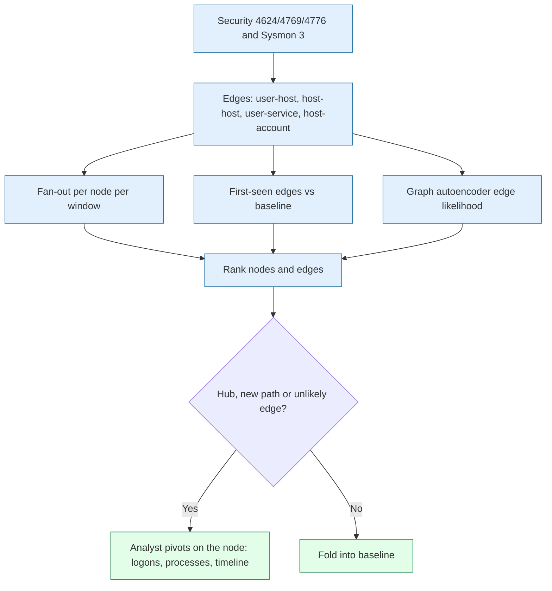

# Graph-Based Anomaly Detection for Lateral Movement

## Summary

Graph-based anomaly detection models **entities as nodes** (users, hosts, IP addresses, services, accounts) and **interactions as edges** (user logged on to host, host connected to host on port 445, user requested a ticket for a service). Instead of asking "is this log line odd?", it asks "is this *connection pattern* odd?". Anomalies show up as structure: a node that suddenly becomes a hub (fan-out), an edge that has never existed before, or two groups of nodes that were never connected becoming linked.

There are two levels of sophistication, and in practice you start with the first:

1. **Simple graph metrics.** Out-degree, distinct neighbours per time window, first-seen edges, centrality. Cheap, explainable, and very effective for lateral movement.
2. **Graph neural networks (GNNs).** A model such as a graph autoencoder (GAE, Kipf and Welling 2016) learns an embedding for every node from its neighbourhood and scores how "expected" each edge is. Useful when the graph is large and "normal" is too complex to describe with a few hand-written metrics.

This doc explains both, gives a plain-language SOC example, and applies them to two OTRF datasets: the **PurpleSharp Active Directory Playbook I** (password spraying, Kerberoasting, share enumeration and WinRM lateral movement) and **APT29 ATT&CK Evals Day 1** (lateral movement from SCRANTON to NASHUA).

## Why it fits SOC work

- **Lateral movement is invisible row by row and obvious in a graph.** One 4624 network logon is routine. The same account logging on to 20 hosts it has never touched in 10 minutes is a sudden **fan-out** that only appears when you look at the account's edges together.
- **Credential attacks have shape.** Password spraying is one source touching many accounts. Kerberoasting is one user requesting tickets for many services. Both are star shapes in the right graph.
- **New paths matter more than volume.** Workstations mostly talk to domain controllers and servers. A first-ever workstation-to-workstation SMB or WinRM edge is rare in most networks and is exactly what PsExec- and WinRM-style movement creates.
- **Fraud rings in payments show as dense subgraphs.** Accounts that should be unrelated but share devices, cards, addresses or beneficiaries form tight clusters. Community detection or k-core decomposition on an account–attribute graph surfaces them. The same idea finds shared attacker infrastructure in threat-intel graphs.

## How it works

**Build the graph.** Pick an edge definition that matches the behaviour you care about:

| Behaviour | Nodes | Edge | Windows source |
|---|---|---|---|
| Lateral movement | user, host | user → host it logged on to over the network | Security 4624 with `LogonType` 3 (network) or 10 (RemoteInteractive) |
| Host-to-host movement | host | source host → destination host:port | Sysmon Event ID 3 (NetworkConnect), or firewall/Zeek `conn.log` |
| Kerberoasting | user, service | user → service account it requested a ticket for | Security 4769, with `TicketEncryptionType` (0x17 = RC4-HMAC) |
| Password spraying | host, account | source workstation → account it tried to validate | Security 4776 (NTLM credential validation) with `Status`, or 4625 |

**Score it.** Three families of signal, from simplest to most complex:

- **Fan-out / degree.** Count distinct neighbours of each kind per node per time window. Compare with that node's own history and with its peers.
- **New edges.** Keep the set of edges seen in a baseline period. Any edge not in it is new. Weight new edges by how surprising the endpoint types are (workstation → workstation is more surprising than workstation → domain controller).
- **Learned edge likelihood (GNN).** Train a graph autoencoder to reconstruct the adjacency matrix from node embeddings. Edges the model finds unlikely given the rest of the graph get high anomaly scores.



## Plain-language SOC example

A helpdesk account, `svc_helpdesk`, normally logs on to about five machines a day, always the ones with open tickets. On Tuesday at 14:05 it logs on to 23 different workstations in eight minutes, each over SMB, each followed by a new service being installed.

In a SIEM table that is 23 rows of Event ID 4624, logon type 3, from an account that logs on to workstations every day. Nothing about any single row is wrong. In the logon graph, `svc_helpdesk` jumps from out-degree 5 to out-degree 28 in one window, and 23 of those edges have never existed before. That node lights up as a hub, and the analyst sees the fan-out before reading a single log line. The investigation finds the account's password was phished that morning and an attacker is using PsExec to spread ransomware staging scripts.

## Applying it to OTRF data

### Example 1: credential attacks and WinRM fan-out (PurpleSharp AD Playbook I)

**Dataset:** PurpleSharp Active Directory Playbook I, OTRF ID `SDWIN-201022042947`.

- Download: `https://raw.githubusercontent.com/OTRF/Security-Datasets/master/datasets/atomic/windows/lateral_movement/host/purplesharp_ad_playbook_I.zip`
- File: `purplesharp_ad_playbook_I_2020-10-22042947.json` (25,993 events, 2020-10-22 08:29:48 to 08:30:42 UTC)
- Hosts logged: `WORKSTATION5`, `WORKSTATION6`, `WORKSTATION7`, `MORDORDC` (domain controller), domain `theshire.local`
- Per the dataset metadata, user `pgustavo` on WORKSTATION5 runs PurpleSharp to simulate password spraying (T1110.003), Kerberoasting (T1558.003), network share discovery (T1135) and WinRM lateral movement (T1021.006).

**Feature engineering.** Three edge types from Security events, collapsed into per-node fan-out counts:

| Edge | Event and filter | Metric |
|---|---|---|
| user → host | 4624, `LogonType` 3 or 10, drop machine accounts (`$`) and `ANONYMOUS LOGON` | `logon_hosts`: distinct hosts |
| user → service | 4769, drop `krbtgt` and computer accounts (`$`) | `tgs_services`; `rc4_tgs` where `TicketEncryptionType == "0x17"` |
| workstation → account | 4776, `Status` not `0x0` | `failed_ntlm_accounts`: distinct accounts with failed validation |

```python
import json, sys
import pandas as pd
import networkx as nx

PATH = sys.argv[1]   # purplesharp_ad_playbook_I_2020-10-22042947.json
rows = [json.loads(l) for l in open(PATH, encoding="utf-8")]
sec = pd.DataFrame(rows)
sec = sec[sec["Channel"] == "Security"]

def short(h):
    return str(h).split(".")[0].upper()

G = nx.MultiDiGraph()

# Edge type 1: user -> host they logged on to over the network (4624, type 3 or 10)
lg = sec[(sec["EventID"] == 4624) & sec["LogonType"].isin(["3", "10"])]
lg = lg[~lg["TargetUserName"].str.endswith("$") & (lg["TargetUserName"] != "ANONYMOUS LOGON")]
for _, r in lg.iterrows():
    G.add_edge("user:" + r["TargetUserName"].lower(), "host:" + short(r["Hostname"]), kind="logon", ts=r["@timestamp"])

# Edge type 2: user -> service they requested a Kerberos service ticket for (4769)
tgs = sec[(sec["EventID"] == 4769)]
tgs = tgs[~tgs["ServiceName"].str.endswith("$") & (tgs["ServiceName"] != "krbtgt")]
for _, r in tgs.iterrows():
    user = r["TargetUserName"].split("@")[0].lower()
    G.add_edge("user:" + user, "svc:" + r["ServiceName"].lower(), kind="tgs", ts=r["@timestamp"],
               enc=r["TicketEncryptionType"])

# Edge type 3: source workstation -> account it tried to validate with NTLM (4776)
ntlm = sec[sec["EventID"] == 4776]
for _, r in ntlm.iterrows():
    G.add_edge("host:" + short(r["Workstation"]), "user:" + r["TargetUserName"].lower(), kind="ntlm_validate",
               status=r["Status"])

# Per-node fan-out metrics (distinct neighbours of each kind)
def fan(n, kind, cond=lambda d: True):
    return len({v for _, v, d in G.out_edges(n, data=True) if d["kind"] == kind and cond(d)})

m = pd.DataFrame({
    "logon_hosts": {n: fan(n, "logon") for n in G},
    "tgs_services": {n: fan(n, "tgs") for n in G},
    "rc4_tgs": {n: fan(n, "tgs", lambda d: d["enc"] == "0x17") for n in G},
    "failed_ntlm_accounts": {n: fan(n, "ntlm_validate", lambda d: d["status"] != "0x0") for n in G},
})
m["total_fanout"] = m.sum(axis=1)
print(m[m["total_fanout"] > 0].sort_values("total_fanout", ascending=False).to_string())
```

**Output (actual run):**

```
                   logon_hosts  tgs_services  rc4_tgs  failed_ntlm_accounts  total_fanout
user:pgustavo                3             5        5                     0            13
host:WORKSTATION5            0             0        0                     7             7
```

**How to read it:**

- **`user:pgustavo` is a hub with three kinds of fan-out at once.** It logged on over the network to 3 hosts (WORKSTATION6, WORKSTATION7, MORDORDC) within seconds, and requested RC4 (`0x17`) service tickets for 5 different service accounts (`sysmonsvc`, `nxlogsvc`, `defensesvc`, `otrsvc`, `mordorsvc`) in about 16 ms. A human user requesting RC4 tickets for every SPN in the domain in one burst is the Kerberoasting signature.
- **`host:WORKSTATION5` fans out to 7 accounts, all failing.** Every 4776 from it has `Status 0xc000006a` (bad password). One source, many accounts, one or two attempts each, is password spraying rather than brute force against one account.
- **What the graph does not show.** The PurpleSharp output says WinRM was used against 4 hosts, including `WEC`. Only 3 appear because WEC's own Security log is not in this dataset. A graph is only as complete as the hosts that log to it. Coverage gaps hide edges.
- **In production, compare against history.** On its own, 3 logon hosts is not alarming. The alert is "3 *new* hosts in 10 seconds for an account whose 30-day median is 1", or "5 RC4 TGS requests in one second for an account that normally requests none".

### Example 2: new host-to-host paths (APT29 Day 1)

**Dataset:** APT29 ATT&CK Evals Day 1, `apt29_evals_day1_manual_2020-05-01225525.json` (see the [folder README](README.md) for download).

**Feature engineering.** Sysmon Event ID 3 records the process that made each connection, which turns a flat network graph into a much more useful one:

- Map each IP address to its host name from the data itself (each host's most common IPv4 source address), so no IPs are hard-coded.
- Keep host-to-host connections to admin and authentication service ports: 88 (Kerberos), 135 (RPC endpoint mapper), 139/445 (SMB), 389 (LDAP), 3389 (RDP), 5985/5986 (WinRM).
- Treat the first ~10 minutes (before 03:05 UTC) as the baseline graph and look for edges that appear afterwards.
- Weight new edges: an edge to the domain controller (NEWYORK) gets weight 1, workstation → workstation gets 3.

```python
import json, sys
import pandas as pd
import networkx as nx

PATH = sys.argv[1]   # apt29_evals_day1_manual_2020-05-01225525.json
df = pd.DataFrame(json.loads(l) for l in open(PATH, encoding="utf-8"))
net = df[(df["Channel"] == "Microsoft-Windows-Sysmon/Operational") & (df["EventID"] == 3)].copy()
net["t"] = pd.to_datetime(net["@timestamp"])

# 1. Map IP -> host name from the data itself: each host's most common IPv4 source address
v4 = net[net["SourceIp"].str.match(r"^10\.")]
ip2host = {v4[v4["Hostname"] == h]["SourceIp"].mode()[0]: h.split(".")[0] for h in v4["Hostname"].unique()}
print("ip2host:", ip2host)

# 2. Keep host->host connections to admin/auth service ports
SERVICE_PORTS = {88, 135, 139, 389, 445, 3389, 5985, 5986}
net = net[net["SourceIp"].isin(ip2host) & net["DestinationIp"].isin(ip2host)
          & (net["SourceIp"] != net["DestinationIp"])
          & net["DestinationPort"].astype(int).isin(SERVICE_PORTS)].copy()
net["src_h"] = net["SourceIp"].map(ip2host)
net["dst_h"] = net["DestinationIp"].map(ip2host)
net["proc"] = net["Image"].str.split("\\").str[-1].str.lower()
net["edge"] = list(zip(net["src_h"], net["dst_h"], net["DestinationPort"].astype(str)))

# 3. Baseline graph = first ~10 minutes; everything after is scored against it
cut = pd.Timestamp("2020-05-02T03:05:00Z")
base, live = net[net["t"] < cut], net[net["t"] >= cut]
new = (live[~live["edge"].isin(set(base["edge"]))]
       .groupby(["src_h", "dst_h", "DestinationPort", "proc"])
       .agg(first_seen=("t", "min"), n=("t", "size")).reset_index())

# 4. Weight new edges: workstation->workstation is far rarer than anything->DC
DC = "NEWYORK"
new["risk"] = 1 + 2 * (new["dst_h"] != DC)
print(new.sort_values(["risk", "first_seen"], ascending=[False, True]).head(8).to_string(index=False))

def fanout(frame):
    g = nx.DiGraph(); g.add_edges_from(zip(frame["src_h"], frame["dst_h"])); return dict(g.out_degree())
print("baseline fan-out:", fanout(base)); print("live fan-out:    ", fanout(live))
```

**Output (actual run):**

```
ip2host: {'10.0.0.4': 'NEWYORK', '10.0.1.4': 'SCRANTON', '10.0.1.6': 'NASHUA', '10.0.1.5': 'UTICA'}
   src_h   dst_h DestinationPort           proc                       first_seen  n  risk
SCRANTON  NASHUA            5985 powershell.exe 2020-05-02 03:09:27.836000+00:00  4     3
SCRANTON  NASHUA            5985         system 2020-05-02 03:09:27.837000+00:00  4     3
SCRANTON  NASHUA             445         system 2020-05-02 03:10:25.531000+00:00 16     3
SCRANTON  NASHUA             135   psexec64.exe 2020-05-02 03:11:21.079000+00:00  5     3
SCRANTON  NASHUA             135    svchost.exe 2020-05-02 03:11:21.080000+00:00  5     3
  NASHUA NEWYORK             445         system 2020-05-02 03:05:34.244000+00:00  8     1
   UTICA NEWYORK             445         system 2020-05-02 03:06:10.965000+00:00  6     1
  NASHUA NEWYORK             135    svchost.exe 2020-05-02 03:10:41.734000+00:00  4     1
baseline fan-out: {'SCRANTON': 1, 'NEWYORK': 0}
live fan-out:     {'NASHUA': 1, 'NEWYORK': 0, 'SCRANTON': 2, 'UTICA': 1}
```

**How to read it:**

- **The top five rows are the lateral movement.** From 03:09 UTC, SCRANTON (the first compromised workstation) opens WinRM (5985) from `powershell.exe`, SMB (445), and RPC (135) from `PsExec64.exe` to NASHUA. None of these edges existed in the baseline, and all are workstation-to-workstation, so they rank highest. These match T1021.006 (WinRM), T1021.002 (SMB/Admin Shares) and T1569.002 (Service Execution, which is what PsExec uses).
- **The process name on the edge is the key context.** `psexec64.exe → NASHUA:135` tells the analyst what happened before they open a single log.
- **New edges to the DC are mostly noise.** NASHUA and UTICA start talking to NEWYORK on 445 and 135 after the baseline cut. That is normal domain traffic that happened not to occur in the first 10 minutes. The weighting pushes it down. In production a 2 to 4 week baseline removes most of it.
- **Fan-out moved from 1 to 2 for SCRANTON.** At this scale fan-out is a weak signal. It becomes strong in a real network with hundreds of hosts, where an attacker's machine jumping from "talks to the DC and file server" to "talks to 20 workstations" stands out.

### Example 3: graph autoencoder (GNN) edge scoring (APT29 Day 1)

**Honest scope note.** The APT29 Day 1 graph below has 21 nodes and 27 edges. That is far too small for a GNN to learn anything you could not see by eye, and the simple metrics above already find the lateral movement. This example shows the **mechanics** with PyTorch Geometric so you can apply the same code to a graph with thousands of hosts. Treat its ranking as illustrative.

**Graph design.** Nodes are `proc:<source host>/<image>` and `svc:<destination host>:<port>`; an edge means that process on that host connected to that service. Node features are node type and log-degree. A two-layer GCN encoder produces an 8-dimensional embedding per node; the GAE decoder scores an edge as `sigmoid(z_u · z_v)`. Training uses PyTorch Geometric's `recon_loss`, which contrasts real edges against randomly sampled non-edges. After training, `anomaly = 1 - p_edge`: real edges the model finds unlikely given the graph's structure.

```python
import json, sys
import pandas as pd
import torch
from torch_geometric.nn import GAE, GCNConv
from torch_geometric.utils import to_undirected

torch.manual_seed(0)
PATH = sys.argv[1]
df = pd.DataFrame(json.loads(l) for l in open(PATH, encoding="utf-8"))
net = df[(df["Channel"] == "Microsoft-Windows-Sysmon/Operational") & (df["EventID"] == 3)].copy()
v4 = net[net["SourceIp"].str.match(r"^10\.")]
ip2host = {v4[v4["Hostname"] == h]["SourceIp"].mode()[0]: h.split(".")[0] for h in v4["Hostname"].unique()}

# Edges: (process on source host) -> (destination host:service) from Sysmon 3
net = net[net["SourceIp"].isin(ip2host) & net["DestinationIp"].isin(ip2host) & (net["SourceIp"] != net["DestinationIp"])]
net = net[net["DestinationPort"].astype(int).isin({88, 135, 389, 445, 3389, 5985})]
proc = net["Image"].str.split("\\").str[-1].str.lower()
src = "proc:" + net["SourceIp"].map(ip2host) + "/" + proc
dst = "svc:" + net["DestinationIp"].map(ip2host) + ":" + net["DestinationPort"].astype(str)
edges = pd.DataFrame({"src": src, "dst": dst}).value_counts().reset_index(name="count")

nodes = sorted(set(edges["src"]) | set(edges["dst"]))
idx = {n: i for i, n in enumerate(nodes)}
ei = torch.tensor([[idx[s] for s in edges["src"]], [idx[d] for d in edges["dst"]]])
ei = to_undirected(ei)
deg = torch.bincount(ei[0], minlength=len(nodes)).float()
is_proc = torch.tensor([n.startswith("proc:") for n in nodes]).float()
x = torch.stack([is_proc, 1 - is_proc, torch.log1p(deg)], dim=1)  # simple node features

class Encoder(torch.nn.Module):
    def __init__(self, d_in, d_hid=16, d_out=8):
        super().__init__()
        self.c1, self.c2 = GCNConv(d_in, d_hid), GCNConv(d_hid, d_out)
    def forward(self, x, ei):
        return self.c2(self.c1(x, ei).relu(), ei)

model = GAE(Encoder(x.size(1)))
opt = torch.optim.Adam(model.parameters(), lr=0.01)
for epoch in range(300):
    opt.zero_grad()
    z = model.encode(x, ei)
    loss = model.recon_loss(z, ei)     # positive edges vs. random negative edges
    loss.backward(); opt.step()

model.eval()
with torch.no_grad():
    z = model.encode(x, ei)
    pos = torch.tensor([[idx[s] for s in edges["src"]], [idx[d] for d in edges["dst"]]])
    edges["p_edge"] = model.decode(z, pos, sigmoid=True).numpy()   # how "expected" the edge is
edges["anomaly"] = 1 - edges["p_edge"]
print(f"nodes={len(nodes)} edges={len(edges)} final loss={loss.item():.3f}")
print(edges.sort_values("anomaly", ascending=False).head(10).round(3).to_string(index=False))
```

**Output (actual run, seed 0; scores change slightly between runs):**

```
nodes=21 edges=27 final loss=0.923
                         src             dst  count  p_edge  anomaly
   proc:SCRANTON/svchost.exe  svc:NASHUA:135      5   0.389    0.611
proc:SCRANTON/powershell.exe svc:NASHUA:5985      4   0.460    0.540
      proc:UTICA/svchost.exe svc:NEWYORK:135      1   0.567    0.433
 proc:SCRANTON/taskhostw.exe svc:NEWYORK:389      2   0.592    0.408
proc:SCRANTON/powershell.exe svc:NEWYORK:389      2   0.650    0.350
       proc:NASHUA/lsass.exe  svc:NEWYORK:88     24   0.662    0.338
     proc:SCRANTON/lsass.exe  svc:NEWYORK:88     71   0.662    0.338
        proc:SCRANTON/system svc:NASHUA:5985      4   0.687    0.313
  proc:SCRANTON/psexec64.exe  svc:NASHUA:135      5   0.732    0.268
   proc:SCRANTON/svchost.exe svc:NEWYORK:135     10   0.822    0.178
```

**How to read it:**

- **The two highest anomaly scores are SCRANTON → NASHUA** (RPC 135 from `svchost.exe` and WinRM 5985 from `powershell.exe`). They were the top two in each of seeds 0, 1 and 2. Workstation processes connecting to another workstation's services do not fit the graph's dominant pattern of everything connecting to the DC.
- **`psexec64.exe → NASHUA:135` scores low (0.27).** That node has only one edge and the GAE can embed it however it likes, so it is easy to "reconstruct". GAE scores are about structure, not rarity. That is why you still want the first-seen-edge check from Example 2 alongside it.
- **`UTICA/svchost.exe → NEWYORK:135` with one connection ranks third.** Low-degree nodes are often scored as unusual in small graphs. On real data, include degree and history features and evaluate on a held-out period.

## Defence and operational practices

- **Start with fan-out and first-seen edges.** They are cheap, explainable and catch most lateral movement. Move to a GNN only when the graph is too large or varied for hand-written rules.
- **Window the graph.** Build hourly or daily graphs and compare each node with its own history (for example, distinct new hosts per hour against a 30-day median) and with its peer group (helpdesk accounts, servers, workstations).
- **Know your endpoint roles.** Label domain controllers, file servers, jump hosts and admin workstations. Most of the value of "new edge" detection comes from knowing which edge types should never exist.
- **Fix logging coverage first.** Missing hosts mean missing edges. In Example 1 the WEC logon is simply absent from the data.
- **Keep the edge context.** Store the process image, logon type, authentication package and encryption type on each edge. An analyst needs "`psexec64.exe` to NASHUA:135", not "edge 14".
- **Fraud and payments.** Build an account–attribute graph (device ID, card fingerprint, IP, beneficiary) and run community detection or `networkx.k_core` to surface dense clusters of accounts that should not be connected. Review clusters, not individual accounts.

## ATT&CK mapping (behaviour in the example data)

| Technique | ID | Seen as |
|---|---|---|
| Remote Services: Windows Remote Management | T1021.006 | `pgustavo` network logons to 3 hosts (PurpleSharp); SCRANTON → NASHUA:5985 (APT29) |
| Remote Services: SMB/Windows Admin Shares | T1021.002 | SCRANTON → NASHUA:445 (APT29) |
| System Services: Service Execution | T1569.002 | `psexec64.exe` SCRANTON → NASHUA:135 (APT29) |
| Brute Force: Password Spraying | T1110.003 | WORKSTATION5 → 7 accounts, all `0xc000006a` (PurpleSharp) |
| Steal or Forge Kerberos Tickets: Kerberoasting | T1558.003 | `pgustavo` → 5 services with RC4 tickets (PurpleSharp) |
| Network Share Discovery | T1135 | Share enumeration in the PurpleSharp playbook (5140 on 3 hosts) |

## Explanation

Picture an office building at night where you can only see a list of door-badge swipes. Each swipe on its own looks fine: an employee, a door they are allowed through. Now draw it as a map, with a line from each person to each door they opened. Most people have a few lines to the same few doors every day. One person suddenly has lines to every door on three floors within ten minutes. You did not need to read a single swipe to spot them; the shape gave it away. That is graph-based anomaly detection. Users and computers are the dots, logons and connections are the lines, and attacks like lateral movement, password spraying and Kerberoasting all draw distinctive shapes: a star, a sudden hub, a line between two places that were never connected. Simple counts of those lines catch most of it. Graph neural networks go further by learning what the whole map normally looks like and pointing at the lines that do not fit, which matters once the map has thousands of dots.
