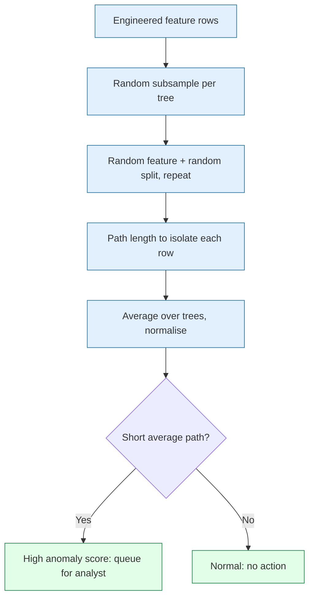

# Isolation Forest for SOC Anomaly Detection

## Summary

**Isolation Forest** (Liu, Ting and Zhou, ICDM 2008) finds outliers by trying to *isolate* each record with random cuts. It builds many random binary trees: at each node it picks a random feature and a random split value between that feature's min and max, and keeps splitting until every record sits alone in a leaf. A record that is rare and different gets separated after only a few cuts, so it ends up on a **short path** from the root. A normal record, surrounded by many similar ones, needs many cuts. The average path length across all trees becomes an **anomaly score per record**. No labels are used at any point.

This doc explains the algorithm, walks through a plain-language SOC scenario, and then applies it to **Sysmon process-creation events from the OTRF APT29 ATT&CK Evals Day 1 dataset**, with concrete feature engineering, runnable scikit-learn code, and how to read the output.

## Why it fits SOC work

- **No labels needed.** Production SOCs almost never have a clean, labelled "attack" set. Isolation Forest learns only from the shape of the data you already have.
- **Handles wide, mixed security features.** A logon or process event easily yields 20+ engineered features (rarity, time, privilege, command-line traits). Random feature selection per split means irrelevant features dilute the signal but do not break the model.
- **Fast on large volumes.** Each tree is built on a small subsample (scikit-learn's default `max_samples` is `min(256, n_samples)`), so training cost barely grows with data size, and scoring is a handful of comparisons per tree. It is practical for daily or hourly re-scoring of log data.
- **Explainable enough for an analyst.** The score itself is opaque, but because the inputs are features you designed ("this parent/child pair is seen once on this host", "command line is 900 characters with high entropy"), you can show an analyst *which* features are extreme for a flagged row.

## How it works

1. **Subsample.** Each tree gets a random sample of `max_samples` rows.
2. **Grow an isolation tree.** At each node pick a random feature, then a random split between its min and max in that node. Recurse until each row is alone or a depth limit (about `log2(max_samples)`) is reached.
3. **Path length.** For a row `x`, `h(x)` is the number of edges from root to the leaf it lands in, with a correction for leaves that still hold several rows.
4. **Normalise and average.** The paper's score is `s(x) = 2^(-E[h(x)] / c(n))`, where `c(n)` is the average path length of an unsuccessful search in a binary search tree of `n` items. Scores near **1** mean "isolated quickly" (anomalous); well below **0.5** means normal.
5. **scikit-learn conventions.** `score_samples(X)` returns the **negative** of that score (lower = more abnormal). `decision_function(X)` shifts it by `offset_` so that negative values are outliers, and `predict(X)` returns `-1` for outliers and `1` for inliers. With `contamination="auto"` the offset is fixed at `-0.5`, the threshold from the original paper; with a number such as `0.01` the threshold is set so that fraction of training rows is flagged.



## Plain-language SOC example

A mid-sized company collects Sysmon from 3,000 laptops. Every night a job takes the day's process-creation events and, for each one, computes a few numbers: how often this parent→child combination has been seen on that laptop, how long and how random-looking the command line is, whether the binary ran from a user-writable folder, and whether it ran elevated.

Isolation Forest scores all ~2 million rows. Almost all of them are boring: `explorer.exe → chrome.exe`, `services.exe → svchost.exe`, seen thousands of times. They take many random cuts to isolate. One row stands out after two or three cuts: on a finance laptop, `winword.exe → powershell.exe` with a 1,200-character command line containing `-enc`. That parent/child pair has never appeared on that laptop before. It lands at the top of the morning queue, and the analyst opens it first.

The same queue also contains a new IT software-deployment agent spawning `cmd.exe` on 40 laptops. It is rare too, so it scores high. The analyst marks it benign, and the team either adds it to an allow-list or lets it age into the baseline. That is the normal rhythm: **the model decides what to look at first; the analyst decides what it is.**

## Applying it to OTRF data

### Dataset

**APT29 ATT&CK Evals, Day 1** from OTRF Security Datasets: a replay of the MITRE ATT&CK Evaluations Round 2 APT29 scenario.

- Download: `https://raw.githubusercontent.com/OTRF/Security-Datasets/master/datasets/compound/apt29/day1/apt29_evals_day1_manual.zip`
- File: `apt29_evals_day1_manual_2020-05-01225525.json` (JSON lines, 196,081 events)
- Hosts: `SCRANTON`, `NASHUA`, `NEWYORK` (domain controller), `UTICA`, domain `dmevals.local`
- Time range: 2020-05-02 02:55 to 03:28 UTC

We use **Sysmon Event ID 1 (Process Create)**: 447 events, 446 with an `Image` field. Useful fields: `Hostname`, `User`, `Image`, `ParentImage`, `CommandLine`, `IntegrityLevel`, `@timestamp`.

### Feature engineering

Each row is one process creation. The features turn attacker tradecraft into numbers without hard-coding any attack:

| Feature | How it is computed | Why it helps |
|---|---|---|
| `pair_rarity` | `-log(count(host, parent→child) / N)` | Attackers create unusual lineages (`control.exe → powershell.exe`) |
| `image_rarity` | `-log(count(host, image) / N)` | Dropped tools (`rar.exe`, `sdelete64.exe`) are rare on a host |
| `cmd_len` | Length of `CommandLine` | Encoded or inline payloads are long |
| `cmd_entropy` | Shannon entropy of `CommandLine` | Base64 and obfuscation raise entropy |
| `cmd_has_encoded` | Regex `-enc` or `frombase64` | Common PowerShell payload delivery |
| `user_dir_image` | Image path under `\Users\`, `\AppData\` or `\Temp\` | Staged tools often run from writable paths |
| `high_integrity` | `IntegrityLevel` is High or System | Privileged execution |
| `is_script_host` | Image is powershell, cmd, wscript, cscript, mshta or rundll32 | LOLBins used for execution |

Rarity is computed **per host**, because "normal" differs between a workstation and a domain controller.

### Code

```python
import json, math, sys
from collections import Counter
import numpy as np
import pandas as pd
from sklearn.ensemble import IsolationForest

PATH = sys.argv[1]  # apt29_evals_day1_manual_2020-05-01225525.json

# 1. Load the JSON-lines file and keep Sysmon process creation (Event ID 1)
rows = [json.loads(line) for line in open(PATH, encoding="utf-8")]
df = pd.DataFrame(rows)
proc = df[(df["Channel"] == "Microsoft-Windows-Sysmon/Operational") & (df["EventID"] == 1)].dropna(subset=["Image"]).copy()

# 2. Feature engineering
def basename(p):
    return str(p).split("\\")[-1].lower()

def entropy(s):
    s = str(s)
    if not s:
        return 0.0
    counts = Counter(s)
    return -sum(c / len(s) * math.log2(c / len(s)) for c in counts.values())

proc["image"] = proc["Image"].map(basename)
proc["parent"] = proc["ParentImage"].map(basename)
proc["pair"] = proc["parent"] + "->" + proc["image"]

# Rarity: how often has this host seen this parent->child pair / image?
pair_freq = proc.groupby(["Hostname", "pair"])["pair"].transform("count")
img_freq = proc.groupby(["Hostname", "image"])["image"].transform("count")

cmd = proc["CommandLine"].fillna("")
X = pd.DataFrame({
    "pair_rarity": -np.log(pair_freq / len(proc)),
    "image_rarity": -np.log(img_freq / len(proc)),
    "cmd_len": cmd.str.len(),
    "cmd_entropy": cmd.map(entropy),
    "cmd_has_encoded": cmd.str.contains(r"-enc|frombase64", case=False).astype(int),
    "user_dir_image": proc["Image"].str.contains(r"\\Users\\|\\AppData\\|\\Temp\\", case=False, regex=True).astype(int),
    "high_integrity": proc["IntegrityLevel"].isin(["High", "System"]).astype(int),
    "is_script_host": proc["image"].isin(["powershell.exe", "cmd.exe", "wscript.exe", "cscript.exe", "mshta.exe", "rundll32.exe"]).astype(int),
})

# 3. Fit and score (no labels used anywhere)
model = IsolationForest(n_estimators=200, contamination="auto", random_state=42)
model.fit(X)
proc["score"] = -model.score_samples(X)     # higher = more anomalous
proc["flag"] = model.predict(X) == -1       # True = outlier

# 4. Triage queue: top 15
cols = ["@timestamp", "Hostname", "User", "pair", "score"]
pd.set_option("display.width", 200); pd.set_option("display.max_colwidth", 60)
print(proc.sort_values("score", ascending=False)[cols].head(15).to_string(index=False))
print("flagged:", proc["flag"].sum(), "of", len(proc))
```

Run it with `python iforest.py apt29_evals_day1_manual_2020-05-01225525.json`.

### Output (actual run)

```
              @timestamp               Hostname                       User                           pair    score
2020-05-02T03:22:09.772Z SCRANTON.dmevals.local            DMEVALS\pbeesly powershell.exe->powershell.exe 0.730083
2020-05-02T02:58:46.047Z SCRANTON.dmevals.local            DMEVALS\pbeesly    control.exe->powershell.exe 0.689665
2020-05-02T03:16:19.677Z   NASHUA.dmevals.local            DMEVALS\pbeesly        powershell.exe->rar.exe 0.675029
2020-05-02T03:23:15.752Z    UTICA.dmevals.local        NT AUTHORITY\SYSTEM  collectguestlogs.exe->cmd.exe 0.663847
2020-05-02T03:03:43.459Z  NEWYORK.dmevals.local        NT AUTHORITY\SYSTEM  collectguestlogs.exe->cmd.exe 0.663847
2020-05-02T03:21:50.099Z SCRANTON.dmevals.local        NT AUTHORITY\SYSTEM  collectguestlogs.exe->cmd.exe 0.662131
2020-05-02T03:22:42.872Z   NASHUA.dmevals.local        NT AUTHORITY\SYSTEM  collectguestlogs.exe->cmd.exe 0.657044
2020-05-02T03:21:33.260Z SCRANTON.dmevals.local NT AUTHORITY\LOCAL SERVICE     services.exe->wudfhost.exe 0.653480
2020-05-02T03:15:49.921Z   NASHUA.dmevals.local            DMEVALS\pbeesly     python.exe->powershell.exe 0.644866
2020-05-02T03:14:27.740Z   NASHUA.dmevals.local            DMEVALS\pbeesly      svchost.exe->rundll32.exe 0.642986
2020-05-02T03:15:05.613Z   NASHUA.dmevals.local            DMEVALS\pbeesly         python.exe->python.exe 0.642238
2020-05-02T03:17:19.147Z   NASHUA.dmevals.local            DMEVALS\pbeesly         cmd.exe->sdelete64.exe 0.641664
2020-05-02T03:17:41.521Z   NASHUA.dmevals.local            DMEVALS\pbeesly         cmd.exe->sdelete64.exe 0.634588
2020-05-02T03:16:53.506Z   NASHUA.dmevals.local            DMEVALS\pbeesly         cmd.exe->sdelete64.exe 0.629440
2020-05-02T02:56:15.884Z SCRANTON.dmevals.local            DMEVALS\pbeesly        cmd.exe->powershell.exe 0.622604
flagged: 86 of 446
```

### How to read the results

- **Top of the list is mostly the attacker.** 10 of the 15 highest scores belong to the compromised user `pbeesly`, starting with the first `cmd.exe → powershell.exe` on SCRANTON at 02:56. They include `control.exe → powershell.exe` on SCRANTON, `powershell.exe → rar.exe` on NASHUA (archiving data, T1560.001) and `cmd.exe → sdelete64.exe` on NASHUA (secure deletion of staged files, T1070.004).
- **Rare but benign shows up too.** `collectguestlogs.exe → cmd.exe` running as SYSTEM on every host is the Azure VM guest agent collecting logs, and `services.exe → wudfhost.exe` is a user-mode driver host. They are rare in a 33-minute capture, so they score high. In a weeks-long baseline they would be common and drop down the list. This is the most important lesson: **a score is "unusual here", not "bad".**
- **`flagged: 86 of 446` is too many to page someone for.** With `contamination="auto"` the paper's fixed threshold flags about 19% of this small, attack-heavy dataset. In production, ignore `predict()` and work from a **ranked list with a daily budget** (for example "top 25 per day"), or set `contamination` to the fraction of rows your team can actually review.
- **Explain a flag by looking at its features.** For any flagged row, print `X.loc[row_index]` next to the per-feature medians. For `powershell.exe → rar.exe`, `pair_rarity` and `image_rarity` are at their maximum (seen once on NASHUA) and `user_dir_image` is 1 (`C:\Windows\Temp\Rar.exe`). That one-line explanation is what makes the alert actionable.

### Variant: logon events (Security 4624/4625)

The same recipe works on authentication. Aggregate to one row per `(TargetUserName, Hostname, 1-hour window)` and compute features such as: logon count, distinct source `IpAddress`, share of `LogonType` 3 (network) and 10 (RemoteInteractive), failed-logon count from 4625, distinct `AuthenticationPackageName`, hour-of-day, and whether the account ends in `$` (machine account). In the APT29 Day 1 file the interesting rows are `pbeesly` network logons to NASHUA and NEWYORK from `10.0.1.4` (SCRANTON); machine-account rows dominate the volume, so drop or separate `$` accounts before fitting.

## Defence and operational practices

- **Fit on a clean-as-possible baseline, score new data.** Train on the previous 2 to 4 weeks, then score each new day with `model.score_samples`. Refit on a schedule so new software ages into normal.
- **Per-entity context in features, not separate models.** Rarity per host or per user is cheaper and more robust than thousands of per-host models.
- **Keep features stable and documented.** Analysts need to know what `pair_rarity = 6.1` means. Log the feature vector with every alert.
- **Pair with rules, do not replace them.** A known-bad rule (encoded PowerShell from Office) should fire regardless of score. Isolation Forest is for the long tail that no one wrote a rule for.
- **Test with OTRF.** Before shipping a feature change, append an OTRF dataset to a day of your own data and check that the attacker rows still rank near the top.

## ATT&CK mapping (behaviour in the example data)

| Technique | ID | Seen as |
|---|---|---|
| Command and Scripting Interpreter: PowerShell | T1059.001 | Rare PowerShell parent/child chains for `pbeesly` |
| Archive Collected Data: Archive via Utility | T1560.001 | `powershell.exe → rar.exe` on NASHUA |
| Indicator Removal: File Deletion | T1070.004 | `cmd.exe → sdelete64.exe` on NASHUA |

## Explanation

Imagine trying to single out one person in a crowd by asking random yes/no questions: "Taller than 1.8 m?", "Wearing red?". Someone who looks like everyone else takes many questions to pin down. Someone wearing a bright orange astronaut suit is isolated in one or two. Isolation Forest plays that game thousands of times with random questions about your log events and keeps track of how quickly each event gets singled out. Events that are consistently easy to isolate are the odd ones out, and they go to the top of the analyst's list. It never needs to be told what an attack looks like, which is why it works in a SOC that has no labelled attack data. The catch is that "odd" is not the same as "malicious": a newly installed IT agent is odd too. The model chooses what a human looks at first, and the human decides what it is.
