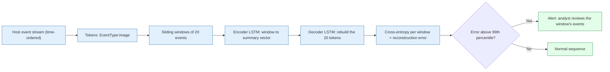

# LSTM Autoencoder for Sequence Anomaly Detection

## Summary

An **LSTM autoencoder** is a neural network trained to take a sequence of events, squeeze it into a small summary vector, and then rebuild the original sequence from that summary. It is trained only on data assumed to be mostly normal, so it becomes good at rebuilding *normal* sequences. At inference time, a sequence it has rarely or never seen rebuilds badly, and that **reconstruction error is the anomaly score**.

The "LSTM" part (Long Short-Term Memory, Hochreiter and Schmidhuber, 1997) is a recurrent layer that reads a sequence one step at a time and keeps an internal memory, so it captures *order*: A then B then C is a different input from C then B then A. That is what makes it useful in a SOC, where the order of actions often matters more than any single action.

This doc explains the model, walks through a plain-language SOC scenario, and then applies it to **Sysmon event streams from the OTRF APT29 ATT&CK Evals Day 1 dataset**, with tokenisation, windowing, runnable PyTorch code and how to read the alerts.

## Why it fits SOC work

- **Security events are inherently sequential.** Logon, then a process, then a network connection, then file writes is a chain. An attacker's chain (spawn PowerShell, archive files, delete the archive tool) differs from a user's even when each step is individually common.
- **It learns "normal over time", not "normal at this moment".** A per-event model like Isolation Forest asks whether one row is odd. The LSTM asks whether this row is odd *given what came just before it*.
- **It catches slow-burn and living-off-the-land activity.** `powershell.exe`, `cmd.exe` and `sc.exe` are everywhere, so each event looks fine. The sequence `powershell → rar → cmd → sdelete → sdelete → sdelete` is not.
- **No labels needed.** Like Isolation Forest, it trains on unlabelled history.

The cost: it is heavier to train, sensitive to hyperparameters and random seeds, and much harder to explain than a tree-based model. Use it where order genuinely carries the signal.

## How it works

1. **Turn events into tokens.** Each event becomes a categorical symbol, for example `proc:powershell.exe` or `net:lsass.exe`. Rare symbols collapse into one `<rare>` token so the vocabulary stays small.
2. **Slice each entity's stream into windows.** For each host (or user), order events by time and cut overlapping windows of `T` events (here `T = 20`, stride 5).
3. **Encode.** An embedding layer maps tokens to vectors; an encoder LSTM reads the window and its final hidden state `h` becomes the summary of the whole window.
4. **Decode.** The summary is fed to a decoder LSTM at every time step, and a linear layer predicts which token should be at each position.
5. **Score.** The loss is cross-entropy between predicted and actual tokens at each position. Averaged over the window, it is the **reconstruction error**. Windows whose error exceeds a threshold (here the 99th percentile of training error) become alerts.



For tokenised logs there are two common designs. This doc uses the **autoencoder** (rebuild the whole window). The other is **next-event prediction** (DeepLog, Du et al., CCS 2017): an LSTM predicts the next log key and flags an event when the actual key is not among its top-k guesses. Both learn order; the autoencoder scores whole windows, and the next-event model pinpoints the single step that broke the pattern.

## Plain-language SOC example

A SaaS company logs every action its customer-support staff take in an internal admin tool: log in, search for a customer, open a ticket, view an invoice, add a note, log out. Each support agent does a few hundred of these a day, and the order is very regular.

The team trains an LSTM autoencoder on three months of these sessions, cut into windows of 20 actions. It learns that "search, open ticket, view invoice, add note" is a common rhythm.

One evening an agent account logs in from the usual laptop and performs only common actions: search, view customer, export, search, view customer, export, repeated 300 times. No single action is unusual and the volume is within that user's daily range, so a threshold rule does not fire. But the autoencoder has never seen 20 back-to-back search-view-export loops, so it cannot rebuild the window well and the error spikes. The SOC opens the session and finds a stolen session cookie being used to scrape customer records.

That is the "slow burn" case: every event is legitimate, the **sequence** is not.

## Applying it to OTRF data

### Dataset

**APT29 ATT&CK Evals, Day 1** from OTRF Security Datasets.

- Download: `https://raw.githubusercontent.com/OTRF/Security-Datasets/master/datasets/compound/apt29/day1/apt29_evals_day1_manual.zip`
- File: `apt29_evals_day1_manual_2020-05-01225525.json` (JSON lines, 196,081 events, about 33 minutes)
- Hosts: `SCRANTON` (first compromised workstation), `NASHUA`, `NEWYORK` (domain controller), `UTICA`

### Feature engineering: from events to tokens

Sysmon Event IDs 12 and 13 (registry) and 10 (process access) make up most of this file and are dominated by background noise, so the example keeps five event types that describe *what a process did*:

| Sysmon Event ID | Meaning | Token prefix |
|---|---|---|
| 1 | Process creation | `proc:` |
| 3 | Network connection | `net:` |
| 5 | Process terminated | `exit:` |
| 11 | File created | `file:` |
| 22 | DNS query | `dns:` |

Each event becomes `prefix:image_basename`, for example `proc:sdelete64.exe` or `net:lsass.exe`. The 59 most frequent tokens get their own IDs; everything else becomes `<rare>` (ID 0). That gives 748 windows of 20 events across the four hosts.

Design choices worth knowing:

- **Group by host** for endpoint telemetry, by **user** or **session** for authentication or SaaS logs. Mixing entities in one stream destroys the order you are trying to learn.
- **The `<rare>` token is a signal.** A window full of `<rare>` tokens is hard to rebuild and scores high, which is what you want for never-seen tools.
- **Window length is a trade-off.** Short windows catch quick bursts; long windows catch slow chains but dilute a single odd event. Try 10, 20 and 50 and compare against a known OTRF attack.
- **Add time if gaps matter.** A token like `gap:>10min` between events lets the model learn pacing, which is useful for beaconing or human-versus-script timing.

### Code

```python
import json, sys
import numpy as np
import pandas as pd
import torch
import torch.nn as nn

PATH = sys.argv[1]
TRAIN_HOSTS = sys.argv[2].split(",") if len(sys.argv) > 2 else None   # optional: hosts to train on
WIN, STRIDE, VOCAB_MAX = 20, 5, 60
torch.manual_seed(0); np.random.seed(0)

# 1. Load Sysmon events and turn each into a token "EventID:image"
rows = [json.loads(l) for l in open(PATH, encoding="utf-8")]
df = pd.DataFrame(rows)
keep = {1: "proc", 3: "net", 5: "exit", 11: "file", 22: "dns"}
ev = df[(df["Channel"] == "Microsoft-Windows-Sysmon/Operational") & df["EventID"].isin(keep.keys())].copy()
ev = ev.dropna(subset=["Image"])
ev["image"] = ev["Image"].str.split("\\").str[-1].str.lower()
ev["token"] = ev["EventID"].map(keep) + ":" + ev["image"]
ev = ev.sort_values(["Hostname", "@timestamp"])

# 2. Vocabulary: most common tokens, everything else -> <rare>
top = ev["token"].value_counts().index[:VOCAB_MAX - 1]
vocab = {t: i + 1 for i, t in enumerate(top)}          # 0 = <rare>
ev["tid"] = ev["token"].map(vocab).fillna(0).astype(int)

# 3. Sliding windows per host
wins, meta = [], []
for host, g in ev.groupby("Hostname"):
    ids, ts, toks = g["tid"].to_numpy(), g["@timestamp"].to_numpy(), g["token"].to_numpy()
    for s in range(0, len(ids) - WIN + 1, STRIDE):
        wins.append(ids[s:s + WIN]); meta.append((host, ts[s], ts[s + WIN - 1], list(toks[s:s + WIN])))
X = torch.tensor(np.array(wins), dtype=torch.long)
hosts = np.array([m[0] for m in meta])
print("windows:", len(X), "vocab:", len(vocab) + 1)

# 4. LSTM autoencoder over token sequences
class LSTMAE(nn.Module):
    def __init__(self, n_tokens, emb=32, hid=64):
        super().__init__()
        self.emb = nn.Embedding(n_tokens, emb)
        self.enc = nn.LSTM(emb, hid, batch_first=True)
        self.dec = nn.LSTM(hid, hid, batch_first=True)
        self.out = nn.Linear(hid, n_tokens)
    def forward(self, x):
        _, (h, _) = self.enc(self.emb(x))                  # h: (1, B, hid) = the "summary" of the window
        z = h[-1].unsqueeze(1).repeat(1, x.size(1), 1)      # feed the summary to every decoder step
        y, _ = self.dec(z)
        return self.out(y)                                  # logits (B, T, n_tokens)

model = LSTMAE(len(vocab) + 1)
opt = torch.optim.Adam(model.parameters(), lr=3e-3)
loss_fn = nn.CrossEntropyLoss(reduction="none")

train_mask = np.isin(hosts, TRAIN_HOSTS) if TRAIN_HOSTS else np.ones(len(X), bool)
Xtr = X[torch.tensor(train_mask)]
print("training windows:", len(Xtr))
for epoch in range(40):
    perm = torch.randperm(len(Xtr))
    for i in range(0, len(Xtr), 64):
        xb = Xtr[perm[i:i + 64]]
        loss = loss_fn(model(xb).transpose(1, 2), xb).mean()
        opt.zero_grad(); loss.backward(); opt.step()
    if epoch % 10 == 9: print(f"epoch {epoch+1} loss {loss.item():.3f}")

# 5. Reconstruction error per window = anomaly score
model.eval()
with torch.no_grad():
    err = loss_fn(model(X).transpose(1, 2), X).mean(dim=1).numpy()
thr = np.percentile(err[train_mask], 99)
res = pd.DataFrame({"host": hosts, "start": [m[1] for m in meta], "end": [m[2] for m in meta], "error": err})
res["alert"] = res["error"] > thr
print(f"threshold (99th pct of training error): {thr:.3f}; alerts: {res['alert'].sum()}")
pd.set_option("display.width", 200)
print(res.sort_values("error", ascending=False).head(10).to_string(index=False))
print(res.groupby("host")["alert"].agg(["sum", "count"]))

# 6. What is inside each alert? List the processes started in the window
for i in res[res["alert"]].sort_values("error", ascending=False).index:
    procs = sorted({t[5:] for t in meta[i][3] if t.startswith("proc:")})
    print(meta[i][0].split(".")[0], meta[i][1], procs)
```

Run it with `python lstm_ae.py apt29_evals_day1_manual_2020-05-01225525.json`. It takes about 30 seconds on a laptop CPU.

**Important caveat about training data.** This capture has no clean "before the attack" period: the scenario starts within a minute of the first event. So the example trains on **all** windows and relies on attacker windows being a small minority, which is a common real-world compromise ("train on everything, assume contamination is low"). In production, train on a historical period, score new data, and refresh the model on a schedule. The optional second argument lets you train on chosen hosts only, but in this dataset UTICA, the least-touched host, yields only 13 windows, which is far too few to learn from.

### Output (actual run, seed 0)

```
threshold (99th pct of training error): 2.773; alerts: 8
                  host                    start                      end    error  alert
SCRANTON.dmevals.local 2020-05-02T03:20:02.443Z 2020-05-02T03:20:15.693Z 2.964641   True
SCRANTON.dmevals.local 2020-05-02T03:02:50.735Z 2020-05-02T03:04:06.748Z 2.936382   True
SCRANTON.dmevals.local 2020-05-02T03:20:02.100Z 2020-05-02T03:20:07.532Z 2.893013   True
 NEWYORK.dmevals.local 2020-05-02T03:03:19.186Z 2020-05-02T03:04:05.751Z 2.892478   True
SCRANTON.dmevals.local 2020-05-02T03:02:55.910Z 2020-05-02T03:04:27.972Z 2.834833   True
SCRANTON.dmevals.local 2020-05-02T03:06:22.309Z 2020-05-02T03:07:55.861Z 2.805518   True
SCRANTON.dmevals.local 2020-05-02T03:04:57.392Z 2020-05-02T03:05:31.834Z 2.780397   True
SCRANTON.dmevals.local 2020-05-02T03:22:14.396Z 2020-05-02T03:23:02.319Z 2.777931   True
  NASHUA.dmevals.local 2020-05-02T03:14:26.719Z 2020-05-02T03:15:05.600Z 2.766416  False
SCRANTON.dmevals.local 2020-05-02T03:03:16.093Z 2020-05-02T03:04:29.163Z 2.747072  False
                        sum  count
host
NASHUA.dmevals.local      0    160
NEWYORK.dmevals.local     1    150
SCRANTON.dmevals.local    7    425
UTICA.dmevals.local       0     13
SCRANTON 2020-05-02T03:20:02.443Z ['conhost.exe', 'dispdiag.exe', 'svchost.exe', 'taskhostw.exe', 'wevtutil.exe', 'wmiprvse.exe']
SCRANTON 2020-05-02T03:02:50.735Z ['sdelete64.exe', 'wmiprvse.exe']
SCRANTON 2020-05-02T03:20:02.100Z ['conhost.exe', 'svchost.exe', 'wevtutil.exe', 'wmiprvse.exe']
NEWYORK 2020-05-02T03:03:19.186Z ['cmd.exe', 'collectguestlogs.exe', 'conhost.exe', 'svchost.exe', 'wmiprvse.exe']
SCRANTON 2020-05-02T03:02:55.910Z ['sdelete64.exe', 'wmiprvse.exe']
SCRANTON 2020-05-02T03:06:22.309Z ['conhost.exe', 'powershell.exe']
SCRANTON 2020-05-02T03:04:57.392Z ['backgroundtaskhost.exe', 'conhost.exe', 'powershell.exe', 'runtimebroker.exe', 'svchost.exe', 'taskhostw.exe', 'werfault.exe']
SCRANTON 2020-05-02T03:22:14.396Z ['backgroundtaskhost.exe', 'conhost.exe', 'sc.exe', 'svchost.exe', 'wermgr.exe']
```

### How to read the results

Triage of the 8 alerts, done by looking up each window's Sysmon Event ID 1 records (`User`, `ParentImage`, `CommandLine`):

| Alert window (UTC) | Host | What is in it | Verdict |
|---|---|---|---|
| 03:02:50 and 03:02:55 | SCRANTON | `powershell.exe` (user `pbeesly`) launching `sdelete64.exe` to securely delete dropped files | **Attacker** (T1070.004) |
| 03:04:57 and 03:06:22 | SCRANTON | `pbeesly` `powershell.exe` spawning child `powershell.exe -Version 5.1 -s -NoLogo -NoProfile` processes during the attack | **Attacker session activity**, needs the command lines to confirm what ran |
| 03:20:02 (two overlapping windows) | SCRANTON | `wevtutil.exe um` / `im` on `AzureEvents.man`, parent `WaAppAgent.exe` | **Benign**: Azure VM guest agent re-registering its event manifest |
| 03:03:19 | NEWYORK | `collectguestlogs.exe → cmd.exe` | **Benign**: Azure guest agent log collection |
| 03:22:14 | SCRANTON | `sc.exe`, `wermgr.exe`, background task hosts | **Needs triage** |

What this tells you:

- **The model concentrates on the right host.** 7 of 8 alerts are on SCRANTON, the first compromised workstation, and SCRANTON also has the most windows. Normalise by window count when you compare hosts (7 of 425 here versus 1 of 150 for NEWYORK).
- **`wevtutil.exe` is a good example of why you must look inside the window.** `wevtutil` is also an attacker's log-clearing tool, so a rule would care about it too. Here the command line (`um`/`im` on an Azure manifest) and parent (`WaAppAgent.exe`) show it is the cloud agent. Neither the score nor the token can tell you that; the raw event can.
- **NASHUA's attack activity is just under the threshold.** The NASHUA window at 03:14:26 (rank 9) is the attacker after moving laterally. A 99th-percentile threshold on a 748-window dataset is only about 8 alerts; a 98th-percentile threshold would include it. Tune the threshold to your review capacity, and expect to trade false positives for coverage.
- **Results move with the seed, a lot.** Across seeds 0, 1 and 2, SCRANTON held most alerts every time, but the best-ranked `sdelete64` window was rank 2, 11 and 7, and NASHUA's 03:14:26 window was rank 9, 12 and 3 (above the threshold only with seed 2). With this little data a single training run is not a stable ranking. Average the error over several seeds, or use an ensemble, before trusting it.

## Defence and operational practices

- **Train on history, score forward.** Fit on 2 to 4 weeks, score each new day, and retrain on a schedule. Keep the threshold from the training period, not from the day being scored.
- **One model per entity *type*, not per entity.** One model for workstations, one for servers, one for domain controllers. Their sequences differ too much to share a model, but per-host models overfit.
- **Always ship the window with the alert.** Attach the token list and the raw events. Analysts cannot triage a number.
- **Allow-list known agents before training.** Cloud guest agents, EDR updaters and software deployment tools generate rare but benign sequences. Filtering their process trees (by parent image and signer) removes a lot of noise.
- **Combine with per-event scoring.** Isolation Forest flags the odd event; the LSTM flags the odd sequence around it. An alert from both on the same host and time is a much stronger lead.
- **Regression-test with OTRF.** Keep a few OTRF datasets (APT29 Day 1, an atomic lateral-movement dataset) as a test set and check after each retrain that their windows still score above threshold.

## ATT&CK mapping (behaviour in the example data)

| Technique | ID | Seen as |
|---|---|---|
| Indicator Removal: File Deletion | T1070.004 | `sdelete64.exe` windows on SCRANTON |
| Command and Scripting Interpreter: PowerShell | T1059.001 | `pbeesly` PowerShell process chains |

## Explanation

Think of a security guard who has watched the same office for months. They do not memorise every person; they learn the rhythm: people badge in, get coffee, sit down, and leave at six. If someone badges in, walks straight to the server room, then to the CEO's office, then out the side door, every single step is something people do, but the guard knows the *order* is wrong. An LSTM autoencoder is that guard for log data. It is trained to retell, from memory, short stretches of normal activity. When it is shown a stretch it has never seen anything like, it retells it badly, and how badly is the alarm level. That is why it catches attacks made entirely of ordinary tools, which is how most modern intrusions work. The trade-off is that it cannot say *why* the stretch is odd. It points at a 20-event window, and a human still has to read those 20 events and decide.
