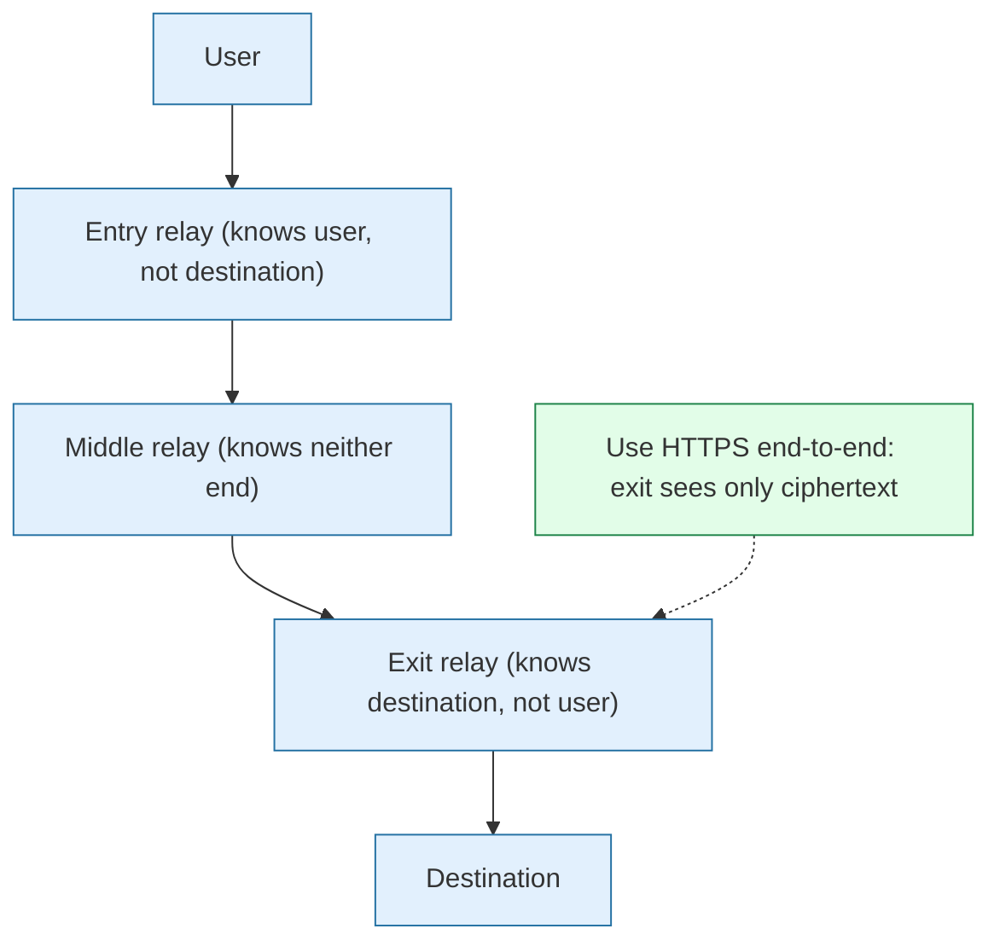

# Anonymity Layers: Tor, VPNs and Combined Networks

## Summary

Anonymity tools hide who is talking to whom by routing traffic through intermediaries so the destination (and observers) cannot easily trace it back to the origin. **VPNs** tunnel traffic through one provider, hiding the user's IP from the destination but trusting the provider. **Tor** routes through several volunteer relays with layered encryption so no single relay knows both ends. These are privacy tools for legitimate users, and the same mechanisms appear in attacker tradecraft as multi-hop proxies and encrypted channels (T1090.003, T1090, T1573). Understanding them matters for both privacy and defence.

## How the layers differ

| Tool | What it hides | Trust model |
|---|---|---|
| **VPN** | Your IP from the destination; your traffic from the local network | You trust the single VPN provider, who sees both ends |
| **Tor** | The link between source and destination; no relay sees both | Distributed trust across three relays; exit relay sees plaintext if unencrypted |
| **Proxychains / bouncing** | Origin behind one or more proxies | Each hop is a trust point; more hops, more latency |
| **Combined (VPN + Tor)** | Layers the two, with different trade-offs by order | Depends on ordering; adds complexity, not automatic safety |

Tor's strength is that its three-hop circuit (entry, middle, exit) splits knowledge: the entry sees you but not your destination, the exit sees the destination but not you (multi-hop proxy, T1090.003). End-to-end encryption still matters, because a Tor exit relay can read unencrypted traffic leaving it.

## How traffic is layered

## Detection

From a defender's or network operator's view (the same tools attackers use for proxying):

- Connections to known Tor entry/relay nodes or VPN provider ranges (published lists).
- TLS fingerprints and traffic patterns characteristic of Tor or specific VPN clients.
- Multi-hop proxying in C2 (T1090.003) or encrypted channels to anonymity infrastructure (T1573) in incident traffic.

## Defense and safe use

- **For privacy**: keep end-to-end encryption (HTTPS) on even over Tor/VPN, since the last hop can see plaintext; understand that a VPN moves trust to the provider rather than removing it.
- **Avoid deanonymisation leaks**: DNS leaks, WebRTC, browser fingerprinting and logging in to identifying accounts can unmask a user regardless of the tunnel.
- **For defenders**: recognise that anonymity networks appear in attacker C2; monitor for connections to Tor/VPN infrastructure where policy warrants, and apply this as risk signal, not proof.
- **Match the tool to the threat model**: no single layer is universally "most anonymous"; the right choice depends on who you are hiding from.

## ATT&CK mapping

| ID | Name | Tactic |
|---|---|---|
| T1090.003 | Proxy: Multi-hop Proxy | Command and Control |
| T1090 | Proxy | Command and Control |
| T1573 | Encrypted Channel | Command and Control |

## Explanation

Sending a letter normally shows your return address. A VPN is posting it through one trusted forwarding office that restamps it — the recipient sees the office, not you, but the office knows both. Tor is passing the letter through three strangers in sequence, each told only the previous and next hand, so no one holds the whole route. Neither hides what you write unless you also seal the envelope (end-to-end encryption), because the last person to touch it before delivery can read anything left open.
